[English](README.md) | [한국어](README.ko.md) | [日本語](README.ja.md) | [简体中文](README.zh.md)

<h1 align="center">
  <picture>
    <source media="(prefers-color-scheme: dark)" srcset="public/brand/lockup-dark@2x.png" />
    
  </picture>
</h1>

<p align="center"><strong>AI エージェントがコードを変えても、システムを理解し続けられます。</strong></p>

<p align="center">
  コードが何をしていて、なぜそうなっているのかを示すマップを、リポジトリ内の Markdown として残します。<br />
  あなたもコーディングエージェントも、同じファイルを読みます。
</p>

<p align="center">
  <a href="https://ontologyatlas.com/ja/download/"><strong>macOS 版をダウンロード</strong></a> ·
  <a href="https://ontologyatlas.com/ja/topology/">ブラウザで試す</a> ·
  <a href="https://ontologyatlas.com/ja/guide/">ガイド</a>
</p>

<p align="center"><a href="LICENSE"></a> <a href="https://github.com/wlsdks/ontology-atlas/releases"></a> <a href="https://mcpservers.org/servers/wlsdks/ontology-atlas"></a> <a href="https://stackmap.shipwithai.xyz/repos/wlsdks/ontology-atlas"></a></p>

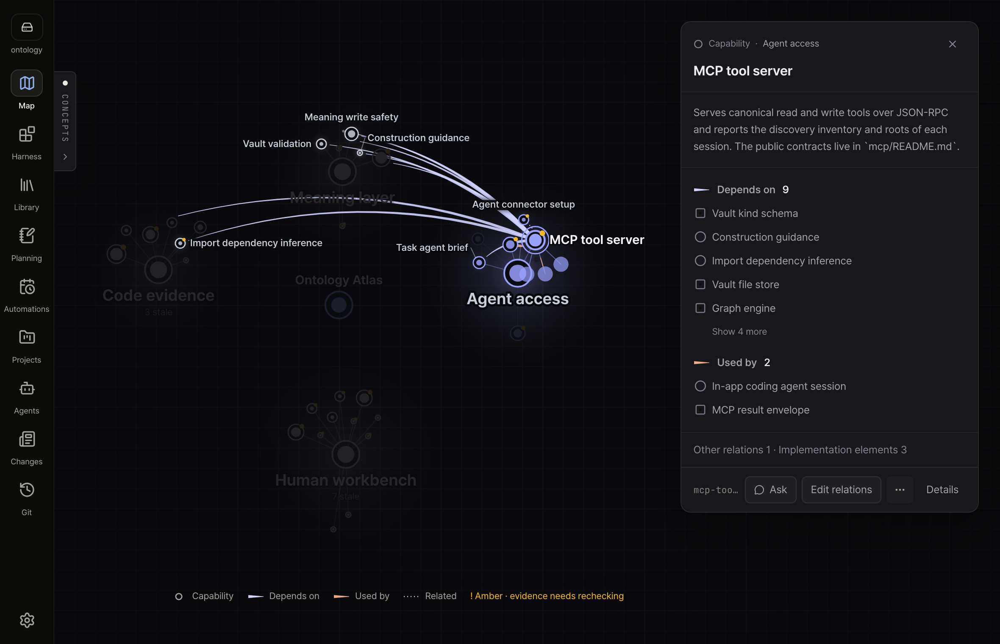

## なぜ Atlas か

コーディングエージェントがコードを変える速さは、チームが頭の中に全体像を保てる速さを超えています。Atlas はその全体像をコードのそばに置きます。各部分が何のためにあるのか、どのファイルが実装しているのか、何が何に依存しているのか、そしてまだ誰も知らないことは何か。エージェントはタスクの前にそれを読み、タスクの後に更新を提案します。あなたは変更ごとに Markdown の diff を見て、そのまま残すか、直すか、却下します。

- **エージェントは文脈を持って作業を始められます。** Claude Code、Codex、Cursor、Antigravity が MCP 経由で、タスクに関わる概念、コードパス、依存関係、未解決の問いを読み取ります。
- **記録はあなたのものです。** `atlas/` フォルダに概念ごとに 1 つの Markdown ファイルがあり、コードと同じように Git でバージョン管理とレビューを行います。
- **何が正しいかはあなたが決めます。** エージェントの提案は、あなたが受け入れるまで提案のままです。
- **分からないことは分からないと示します。** マップ上の線は宣言された関係であり、実行時の影響の証拠ではありません。根拠がなければ「安全」ではなく「不明」と表示されます。

## 画面を見る

<table>
<tr>
<td width="50%">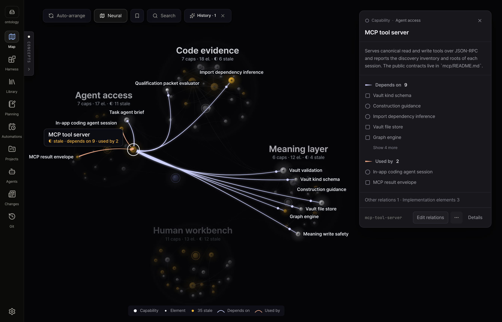<br /><b>マップ · 神経網</b> — 同じ概念を、回して見られる立体として描きます。一つ選ぶと、何に依存し、何から使われているかがわかります。</td>
<td width="50%">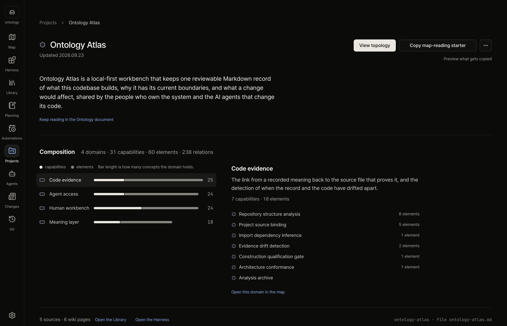<br /><b>プロジェクト</b> — プロジェクトが何のためにあり、どのドメインに分かれ、各ドメインに何が入っているか。</td>
</tr>
<tr>
<td width="50%">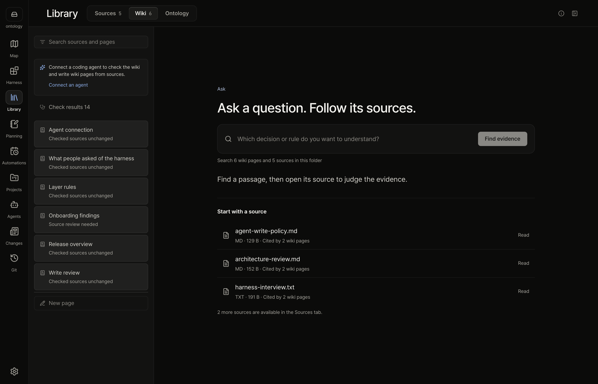<br /><b>資料室</b> — 文書を入れると、出典つきの Wiki ページが出てきます。一節を探し、ソースで確かめます。</td>
<td width="50%">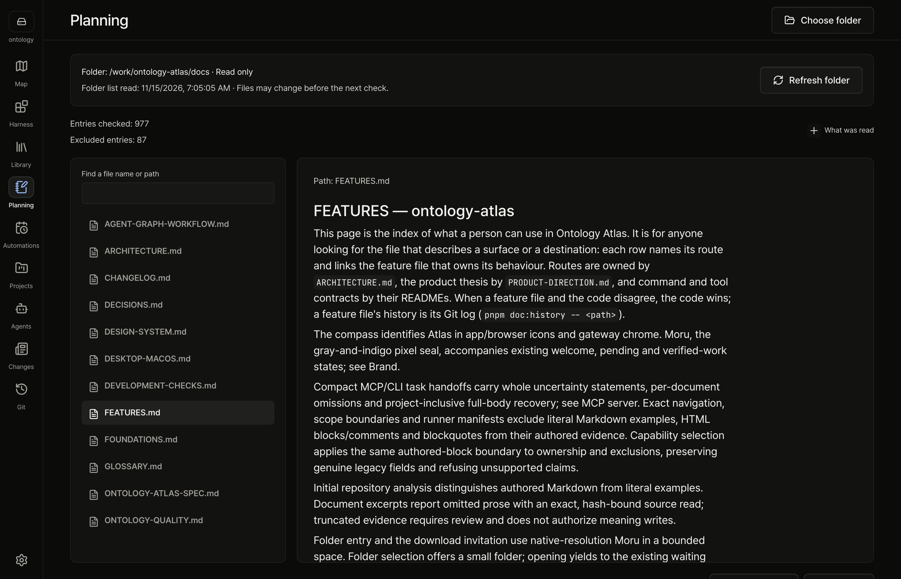<br /><b>企画</b> — プロジェクトフォルダの Markdown を、コピーせずその場で読みます。</td>
</tr>
<tr>
<td width="50%">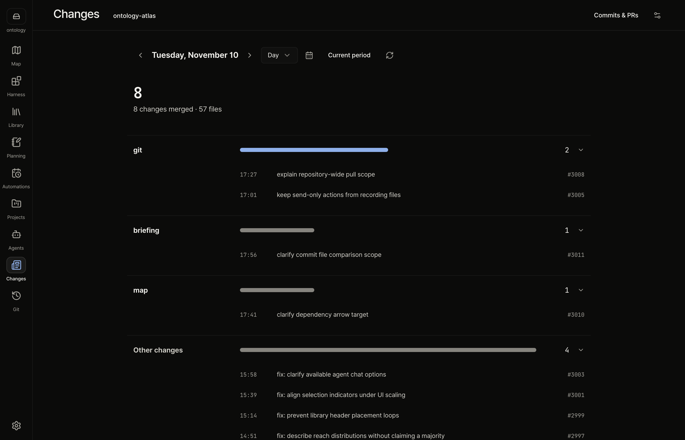<br /><b>変更</b> — 期間中に何がマージされたかを数えてまとめ、その元のプルリクエスト、コミット、ファイルへ進めます。</td>
<td width="50%">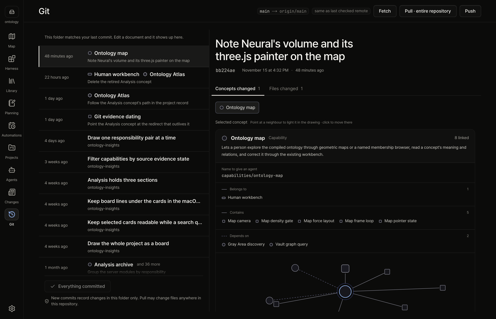<br /><b>Git</b> — コミットごとに、どの概念が変わったかを示します。編集した文書は、コミットする前にここに現れます。</td>
</tr>
<tr>
<td width="50%">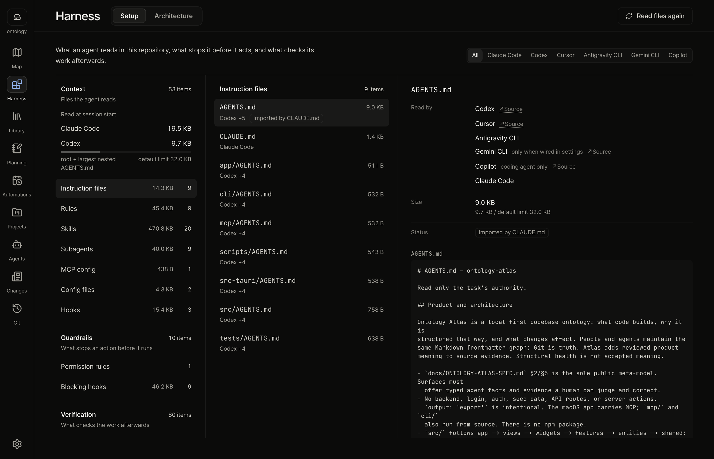<br /><b>ハーネス</b> — エージェントがこのリポジトリで読むもの、実行前に止められるもの、終了後に検査されるもの。</td>
<td width="50%">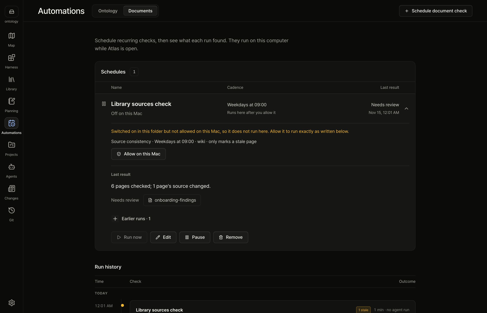<br /><b>自動化</b> — 定期チェックと、各実行で見つかったこと。</td>
</tr>
</table>

**v2.0 の新機能：** マップを回して見られる立体として描く神経網ビューとツリー状の 3D ビュー、エージェントが読むもの・止められるもの・検査されるものを一画面にまとめたハーネスの「構成」、変更の先頭に置いたマージの要約、自動化の予約ごとの実行履歴。分析は独立した画面ではなくなりました。[リリース](https://github.com/wlsdks/ontology-atlas/releases)をご覧ください。

始める前に知っておくと役立つこと：

- マップの線は宣言された関係であり、実行時の影響の証明ではありません。ビューは 5 つあります：フラット、ヘックス、ドメイン構造、3D、神経網。[マップ](docs/features/map/README.md)
- 空のフォルダでは開始操作が表示され、開始に失敗してもファイルを上書きせずにやり直せます。ポップアップのツアーは廃止しました。[初回起動](docs/features/first-run.md)
- 資料室の設定とチェックはアプリで行います。ブラウザでは、アプリの入手かファイルの追加ができます。[資料室](docs/features/library/workspace.md)
- 企画は読み取り専用で、macOS アプリで選んだフォルダに対して動作します。Markdown と PNG/JPEG 画像を表示します。[企画](docs/FEATURES.md)
- Git の送信専用操作は新しいファイルの変更をコミットしません。フォルダやブランチの状態が変わった場合は再確認できます。プルはリポジトリ全体のファイルを変更することがあります。[Git](docs/features/git.md)
- 変更は、アプリで選んだ Git リポジトリを開きます。オントロジーがなくても使えます。公開 GitHub プルリクエストの読み取りは明示的な操作で、一覧が一部だけになることがあります。非公開のプルリクエストは読みません。[変更ブリーフィング](docs/features/change-briefing.md)
- プロジェクトの文書が前回の意味のレビュー後に変更されていると、再レビューと明示的な確定を求めます。保存したことやコードのパスが一致することでは、意味は承認されません。[MCP サーバー](docs/features/mcp-server.md)
- アプリ内のチャットでは、エージェントの書き込みはあなたが許可するまで待ちます。Codex は読み取り専用で始まり、ローカルに設定された Codex の権限プロファイルは、承認の挙動が公開されていないため選べません。[エージェント](docs/features/agents.md) · [機能一覧](docs/FEATURES.md)
- フォルダを接続する前でも、アプリは資料室、企画、エージェント、変更を開けるようにしています。[機能一覧](docs/FEATURES.md)

## クイックスタート

1. **インストール**: [ダウンロードページ](https://ontologyatlas.com/ja/download/)からアプリを入手するか、[ブラウザ版](https://ontologyatlas.com/ja/topology/)を開きます。
2. **フォルダを開く**: Atlas はフォルダ内の Markdown をその場で読むか、リポジトリに `atlas/` フォルダを新しく作ります。何かを書き込む前に、必ずパスを表示します。
3. **エージェントを接続**: **エージェント › MCP** で使っているツールの **接続** を押し、エージェントを再起動して、次のタスクについて質問してみましょう。

macOS（Apple Silicon）版は署名と公証済みで、アプリ内に MCP サーバーを同梱しています。Windows x64 は未署名のベータ版です。Linux では、ブラウザ版を使うか、[ソースのチェックアウトから CLI と MCP サーバーを実行](cli/README.md#set-up-from-a-source-checkout)してください。[Releases](https://github.com/wlsdks/ontology-atlas/releases) に、各バージョンのファイルとチェックサムがあります。

## しくみ

```text
your-repo/
├── src/
└── atlas/                 ← コードと一緒にクローン、ブランチ作成、レビューする
    ├── project.md
    ├── domains/  capabilities/  elements/
    ├── sources/           届いたままの形で保管したドキュメント
    └── wiki/              それらから書いたページ。すべての事実に出典つき
```

frontmatter に `kind:` を持つ Markdown ファイル 1 つが、概念 1 つです。`uid` は変わらず、`slug` は現在のアドレスで、`path` はその概念が説明するコードを指します。マップ、文書、資料室、Git の各画面は、すべてこれらのファイルを読んで表示します。

エージェントがフォルダに届く道は 2 つあります。

- **MCP:** エージェントが Atlas の MCP サーバーを起動し、そのサーバーがディスク上のフォルダを直接読み書きします。アプリを閉じていても動きます。[エージェントを接続する](docs/guide/connect-agent.md) · [MCP リファレンス](mcp/README.md)
- **ACP:** Claude Agent と Codex は、アプリ内のチャットでも動かせます。書き込みは、あなたが許可するまで待機します。[エージェント](docs/features/agents.md)

## ローカルファースト

- バックエンド、アカウント、テレメトリはありません。フォルダは、普通の Markdown としてあなたのディスクに残ります。
- 自分の API key やローカルモデルでモデルを呼び出す機能はオプトインで、呼び出しごとに宛先が `.ontology-atlas/llm-audit.jsonl` に記録されます。
- 接続したコーディングエージェントは、プロンプトと読み取った内容を自身のプロバイダーに送信することがあります。その送信は Atlas のログの対象外です。

[信頼について](docs/guide/trust.md) · [セキュリティ](SECURITY.md)

## 現在の状況

Atlas はまだ初期段階です。私たちのベンチマークでは、Atlas を使うとより良い回答になることはまだ示せておらず、Atlas のほうが遅くなりました（[訂正記録](docs/benchmark/README.md#current-measurement-status)）。構築の試験とその失敗、限界は[構築の測定結果](docs/benchmark/CONSTRUCTION.md)にあります。

## ドキュメント

[Atlasとは](docs/guide/what-is-atlas.md) · [最初の5分](docs/guide/first-five-minutes.md) · [概念になるもの](docs/guide/what-becomes-a-node.md) · [つながり](docs/guide/relations.md) · [仕様](docs/ONTOLOGY-ATLAS-SPEC.md) · [機能](docs/FEATURES.md) · [CLI](cli/README.md) · [アーキテクチャ](docs/ARCHITECTURE.md)

## コントリビュート

まず [CONTRIBUTING.md](CONTRIBUTING.md) をお読みください。外部からのプルリクエストはフォークから送ります。[AGENTS.md](AGENTS.md) は、人とエージェントが共通で従う取り決めです。

```bash
pnpm install
pnpm dev
pnpm checks:changed -- --run
```

`pnpm pr:land <number>` は、レビュー済みのプルリクエストをマージし、元のコミットをそのまま残します。検査の全体は[開発チェック](docs/DEVELOPMENT-CHECKS.md)にまとまっています。リポジトリのコマンド表は、英語版 README の [Contributing](README.md#contributing) にあります。

## Moru

Moru は Atlas のピクセルアザラシのキャラクターで、コンパスはアプリのシンボルです。[74 のモーション、16 のポーズと原本](assets/brand/moru/README.md)を同梱しています。描いたモーションが 58、それをつないだシーンが 16 です。[ローカルモーションスタジオ](assets/brand/moru/preview.html)で再生・停止し、フレームごとに確認できます。

<p>


</p>

**登場する場所。** フォルダーを選ぶ画面では、Moru が挨拶し、小さなフォルダーを差し出して待ちます。フォルダーが開き始めると遊びをやめ、待機画面に切り替わります。ダウンロードページには専用のお迎えの動作があります。ソースを読む、あなたの許可を待つ、終わったチェックを喜ぶといった動作は、アプリがその状態を実際に確認したときだけ表示されます。確認されていない進行を Moru が示すことはありません。

**なでる。** Moru を押すと、短く一度だけ反応します。一度目は控えめで、二度目に遊び心のある動作が現れ、その後は直前の二つを避けながら持っている動作をまんべんなく見せます。フォルダー選択では 14 種類、ダウンロードのお迎えでは 18 種類です。文字のない小さな吹き出しにハート、音符、きらめきが出ることがあり、長く待っていると子どもの Moru が一度顔を出します。

**邪魔をしない。** Moru が移動するのは宙に浮いている間だけで、カーソルを重ねると着地を終えてから待ちます。処理待ちの間はその場で静かにしています。一時停止と再開は Moru のメニュー（右クリックまたは Shift+F10）にあり、キャラクターの隣に再生ボタンはありません。動きを減らす設定では、静止した表情で反応します。

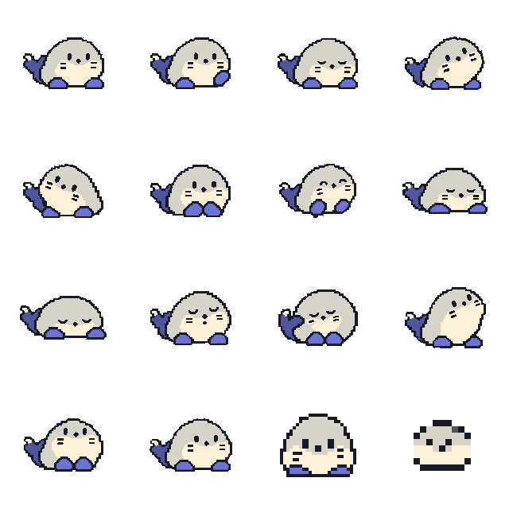

<details>
<summary>描いた 58 のモーションをすべて見る</summary>

<p><b>待つとき</b></p>

<p>


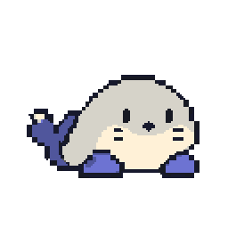


</p>

<p><b>あいさつ</b></p>

<p>


</p>

<p><b>作業中</b></p>

<p>


</p>

<p><b>気持ち</b></p>

<p>


</p>

<p><b>遊び</b></p>

<p>


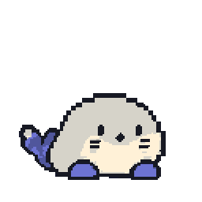

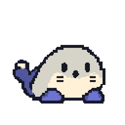
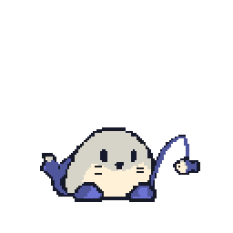
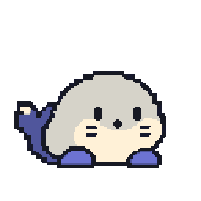

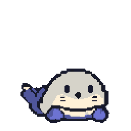


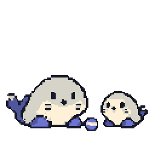
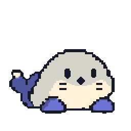

</p>

<p><b>場面</b></p>

<p>
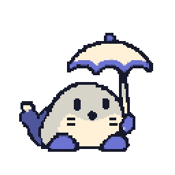
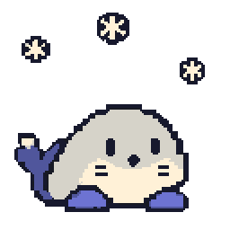
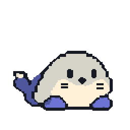

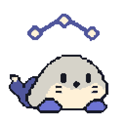
</p>

</details>

## ライセンス

[MIT](LICENSE)。サードパーティの告知は [NOTICE.md](NOTICE.md)、ライセンス全文は [public/third-party-licenses.txt](public/third-party-licenses.txt) にあります。ピクセルマスコットとその出典については[ブランド](docs/design/brand.md)をご覧ください。
