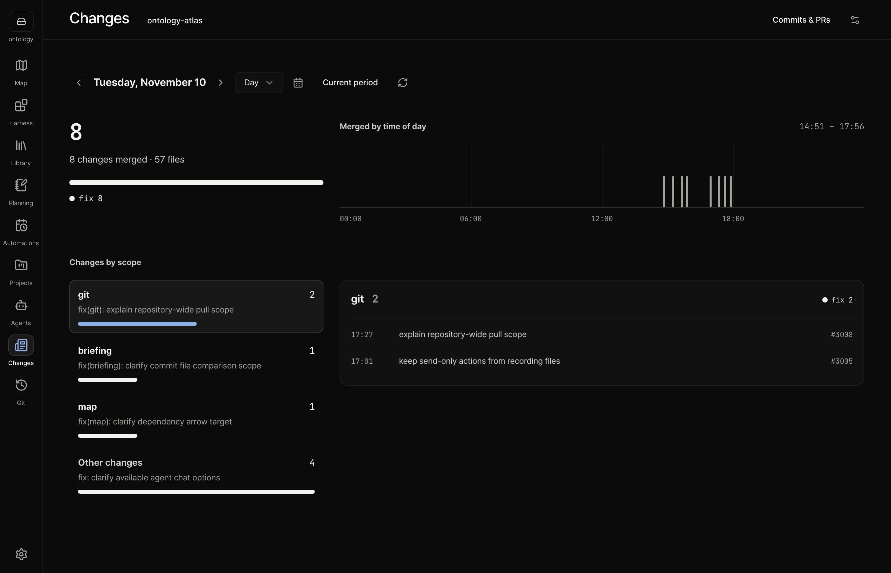
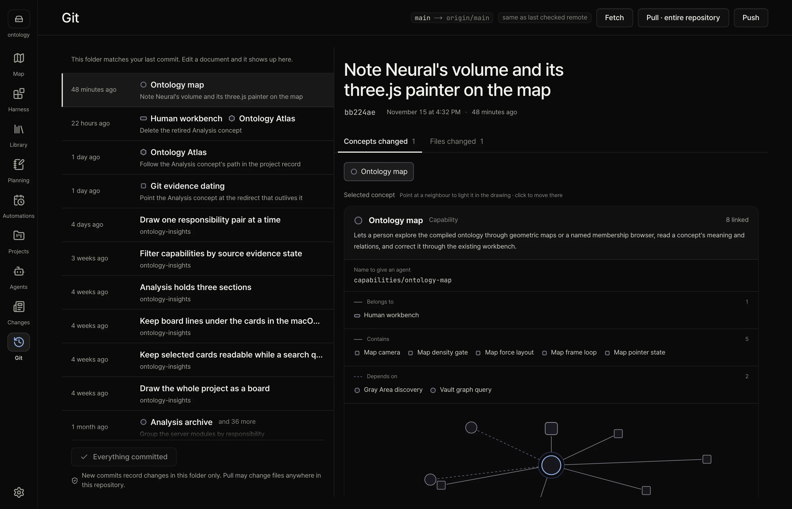
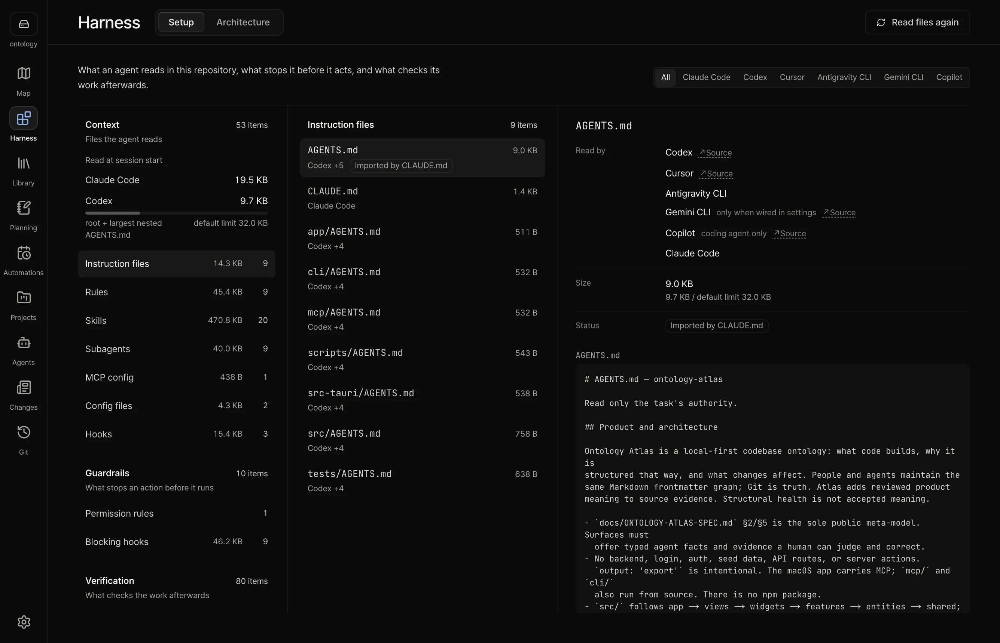
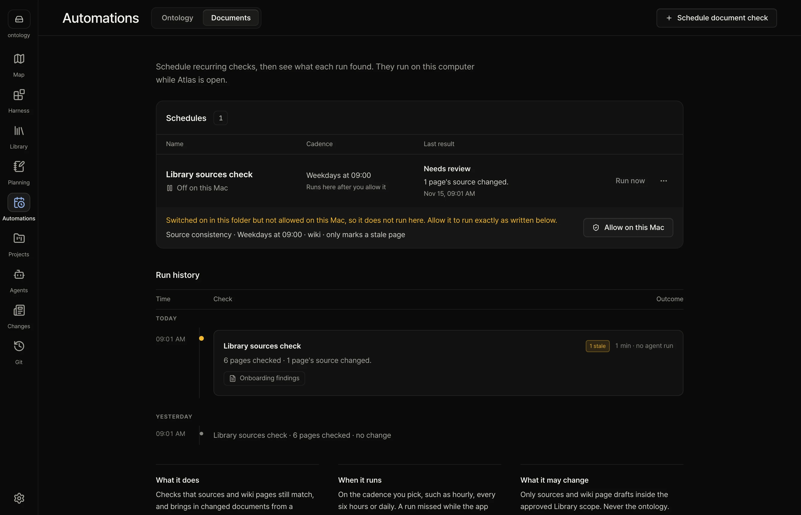

[English](README.md) | [한국어](README.ko.md) | [日本語](README.ja.md) | [简体中文](README.zh.md)

<h1 align="center">
  <picture>
    <source media="(prefers-color-scheme: dark)" srcset="public/brand/lockup-dark@2x.png" />
    
  </picture>
</h1>

<p align="center"><strong>AI エージェントがコードを変えても、システムを理解し続けられます。</strong></p>

<p align="center">
  コードが何をしていて、なぜそうなっているのかを示すマップを、リポジトリ内の Markdown として残します。<br />
  あなたもコーディングエージェントも、同じファイルを読みます。
</p>

<p align="center">
  <a href="https://ontologyatlas.com/ja/download/"><strong>ダウンロード</strong></a> ·
  <a href="https://ontologyatlas.com/ja/topology/">ブラウザで試す</a> ·
  <a href="https://ontologyatlas.com/ja/guide/">ガイド</a>
</p>

<p align="center"><a href="LICENSE"></a> <a href="https://github.com/wlsdks/ontology-atlas/releases"></a> <a href="https://mcpservers.org/servers/wlsdks/ontology-atlas"></a> <a href="https://stackmap.shipwithai.xyz/repos/wlsdks/ontology-atlas"></a></p>


## なぜ Atlas か

コーディングエージェントがコードを変える速さは、チームが頭の中に全体像を保てる速さを超えています。Atlas はその全体像をコードのそばに置きます。各部分が何のためにあるのか、どのファイルが実装しているのか、何が何に依存しているのか、そしてまだ誰も知らないことは何か。エージェントはタスクの前にそれを読み、タスクの後に更新を提案します。あなたは変更ごとに Markdown の diff を見て、そのまま残すか、直すか、却下します。

- **エージェントは文脈を持って作業を始められます。** Claude Code、Codex、Cursor、Antigravity が MCP 経由で、タスクに関わる概念、コードパス、依存関係、未解決の問いを読み取ります。
- **記録はあなたのものです。** `atlas/` フォルダに概念ごとに 1 つの Markdown ファイルがあり、コードと同じように Git でバージョン管理とレビューを行います。
- **何が正しいかはあなたが決めます。** エージェントによる変更はすべて Markdown の diff として残り、そのまま残すか、直すか、元に戻すかを選べます。アプリ内のチャットでは、書き込みのたびにあなたの許可を待ちます。
- **分からないことは分からないと示します。** マップ上の線は宣言された関係であり、実行時の影響の証拠ではありません。根拠がなければ「安全」ではなく「不明」と表示されます。

コードグラフ、Wiki、Obsidian、`CLAUDE.md` とは何が違うのか。[Atlas との比較](https://ontologyatlas.com/ja/guide/atlas-compared/)にまとめ、相手のツールのほうが向いている場面も書いています。

## クイックスタート

1. **インストール**: [ダウンロードページ](https://ontologyatlas.com/ja/download/)からアプリを入手するか、[ブラウザ版](https://ontologyatlas.com/ja/topology/)を開きます。
2. **フォルダを開く**: Atlas はフォルダ内の Markdown をその場で読むか、リポジトリに `atlas/` フォルダを新しく作ります。何かを書き込む前に、必ずパスを表示します。
3. **エージェントを接続**: **エージェント › MCP** で使っているツールの **接続** を押し、エージェントを再起動して、次のタスクについて質問してみましょう。

macOS（Apple Silicon）版は署名と公証済みで、アプリ内に MCP サーバーを同梱しています。Windows x64 は未署名のベータ版です。Linux では、ブラウザ版を使うか、[ソースのチェックアウトから MCP サーバーを実行](mcp/README.md#1-register-with-an-agent)してください。[Releases](https://github.com/wlsdks/ontology-atlas/releases) に、各バージョンのファイルとチェックサムがあります。GitHub で **Pre-release** と表示されたリリースはベータ版です。インストール済みのアプリは正式リリースにしか更新されないため、ベータ版は手動でインストールした人にだけ届きます。

## 画面を見る


**マップ** — 概念を選ぶと、それが依存するものとそれを使うものへの線が光り、パネルが一つずつ名前を示します。フラット、ヘックス、ドメイン構造、3D、神経網は、同じ概念の別のビューです。[マップ](docs/features/map/README.md)

<table>
<tr>
<td width="50%"><br /><b>マップ · 神経網</b> — 同じ概念を、回して見られる立体として描きます。一つ選ぶと、何に依存し、何から使われているかがわかります。</td>
<td width="50%"><br /><b>プロジェクト</b> — プロジェクトが何のためにあり、どのドメインに分かれ、各ドメインに何が入っているか。</td>
</tr>
<tr>
<td width="50%"><br /><b>資料室</b> — 文書を入れると、出典つきの Wiki ページが出てきます。一節を探し、ソースで確かめます。</td>
<td width="50%"><br /><b>企画</b> — 開いているフォルダ内の <code>planning/</code> に、計画を Markdown で書きます。アプリでもブラウザでも使え、macOS アプリでは別のフォルダをその場で読むこともできます。</td>
</tr>
<tr>
<td width="50%"><br /><b>変更</b> — 期間中に何がマージされたかを数えてまとめ、その元のプルリクエスト、コミット、ファイルへ進めます。</td>
<td width="50%"><br /><b>Git</b> — コミットごとに、どの概念が変わったかを示します。編集した文書は、コミットする前にここに現れます。</td>
</tr>
<tr>
<td width="50%"><br /><b>ハーネス</b> — エージェントがこのリポジトリで読むもの、実行前に止められるもの、終了後に検査されるもの。</td>
<td width="50%"><br /><b>自動化</b> — 定期チェックと、各実行で見つかったこと。</td>
</tr>
</table>

## しくみ

```text
your-repo/
├── src/
└── atlas/                 ← コードと一緒にクローン、ブランチ作成、レビューする
    ├── project.md
    ├── domains/  capabilities/  elements/
    ├── sources/           届いたままの形で保管したドキュメント
    └── wiki/              それらから書いたページ。すべての事実に出典つき
```

frontmatter に `kind:` を持つ Markdown ファイル 1 つが、概念 1 つです。概念は **プロジェクト**、**ドメイン**（長く続く責務）、**ケイパビリティ**（システムができること）、**要素**（2 つ以上のケイパビリティが共有する部品）のいずれかです。`uid` は変わらず、`slug` は現在のアドレスで、`path` はその概念が説明するコードを指します。次の例は、このリポジトリ自身のマップ [`docs/ontology/`](docs/ontology/capabilities/vault-graph-query.md) にあるファイルを短くしたものです。

```markdown
---
uid: 7c451ebd-9cd0-41a9-bc37-044affac786a
slug: capabilities/vault-graph-query
kind: capability
title: Vault graph query
domain: domains/meaning-layer
path: mcp/src/tools/graph.mjs
dependencies: [elements/graph-compiler, elements/graph-engine, elements/vault-file-store]
---

## Definition
Compiles the folder of Markdown files into one typed graph and answers
structural questions over it, so a person or agent can ask what a node touches
without opening every file.

## Excludes
- Writing anything back to the vault.

## Uncertainty
- The engine is roughly 6,400 lines and was not read beyond its header.
```

マップ、文書、資料室、Git の各画面はこれらのファイルを読み、エージェントも同じファイルを読みます。エージェントがよく尋ねる問いには、次の MCP ツールが答えます。

| タスクの前後にエージェントが尋ねること | ツール |
|---|---|
| この部分は何のためにあり、何を扱わないのか | `get_concept` |
| 名前を変えたり削除したりする前に、何がここを指しているか | `find_backlinks` |
| この 2 つの概念はどうつながっているか | `find_path` |
| この変更は何に影響しうるか | `query_ontology` の `impact` |
| これはどこに書かれているか | `find_evidence` |
| いま作った・変えたものを記録する | `add_concepts`、`add_relations`、`patch_concept` |
| フォルダはまだ整合しているか | `validate_vault` |

サーバーを読み取り専用で登録すると、読み取りツールだけが公開されます（[MCP リファレンス](mcp/README.md#read-only-registration-oatlas_read_only)）。

エージェントがフォルダに届く道は 2 つあります。

- **MCP:** エージェントが Atlas の MCP サーバーを起動し、そのサーバーがディスク上のフォルダを直接読み書きします。アプリを閉じていても動きます。[エージェントを接続する](docs/guide/connect-agent.md) · [MCP リファレンス](mcp/README.md)
- **ACP:** Claude Agent と Codex は、アプリ内のチャットでも動かせます。書き込みを許可するか却下するかは、あなたが決めます。[エージェント](docs/features/agents.md)

## ローカルファースト

- バックエンド、アカウント、テレメトリはありません。フォルダは、普通の Markdown としてあなたのディスクに残ります。
- 自分の API key やローカルモデルでモデルを呼び出す機能はオプトインで、呼び出しごとに宛先が `.ontology-atlas/llm-audit.jsonl` に記録されます。
- 接続したコーディングエージェントは、プロンプトと読み取った内容を自身のプロバイダーに送信することがあります。その送信は Atlas のログの対象外です。

[信頼について](docs/guide/trust.md) · [セキュリティ](SECURITY.md)

## 制限

- **Atlas がエージェントの書き込みを事前に確認するのは、アプリ内のチャットだけです。** そこではファイルの編集と Atlas への書き込みがあなたの許可を待ちます。そのフォルダで自動承認をオンにすると確認しませんが、シェルコマンド、削除、フォルダ外のパスは常に確認します。ただし、接続したコードフォルダのファイルを読むことは例外です。MCP で接続したエージェントは、そのツール自身の権限ルールに従って書き込みます。[エージェント](docs/features/agents.md)
- **資料室の設定とチェックはアプリで行います。** ブラウザでは、アプリの入手かファイルの追加ができます。[資料室](docs/features/library/workspace.md)
- **変更が読むのは公開 GitHub のプルリクエストだけです。** 明示的な操作で読み、一覧が一部だけになることがあります。非公開のプルリクエストは読みません。[変更ブリーフィング](docs/features/change-briefing.md)
- **Git のプルは、開いているフォルダに限らず、リポジトリ内のどのファイルでも変更することがあります。** [Git](docs/features/git.md)

## 現在の状況

Atlas はまだ初期段階です。私たちのベンチマークでは、Atlas を使うとより良い回答になることはまだ示せておらず、Atlas のほうが遅くなりました（[訂正記録](docs/benchmark/README.md#current-measurement-status)）。構築の試験とその失敗、限界は[構築の測定結果](docs/benchmark/CONSTRUCTION.md)にあります。

## ドキュメント

[Atlasとは](docs/guide/what-is-atlas.md) · [Atlas との比較](docs/guide/atlas-compared.md) · [最初の5分](docs/guide/first-five-minutes.md) · [コードから最初のマップを作る](docs/guide/from-your-repo.md) · [概念になるもの](docs/guide/what-becomes-a-node.md) · [つながり](docs/guide/relations.md) · [仕様](docs/ONTOLOGY-ATLAS-SPEC.md) · [機能](docs/FEATURES.md) · [アーキテクチャ](docs/ARCHITECTURE.md)

## コントリビュート

まず [CONTRIBUTING.md](CONTRIBUTING.md) をお読みください。外部からのプルリクエストはフォークから送ります。[AGENTS.md](AGENTS.md) は、人とエージェントが共通で従う取り決めです。

```bash
pnpm install
pnpm dev
pnpm checks:changed -- --run
```

検査の選び方、プッシュ前の検査と CI、マージ、レーンの予算、リポジトリのコマンド一覧は[開発チェック](docs/DEVELOPMENT-CHECKS.md)にまとまっています。

## Moru

Moru は Atlas のピクセルアザラシのキャラクターで、コンパスはアプリのシンボルです。[74 のモーション、16 のポーズと原本](assets/brand/moru/README.md)を同梱しており、そこにアプリで Moru が登場する場所と、描いたモーションのすべてがあります。

<p>


</p>

## ライセンス

[MIT](LICENSE)。サードパーティの告知は [NOTICE.md](NOTICE.md)、ライセンス全文は [public/third-party-licenses.txt](public/third-party-licenses.txt) にあります。ピクセルマスコットとその出典については[ブランド](docs/design/brand.md)をご覧ください。
