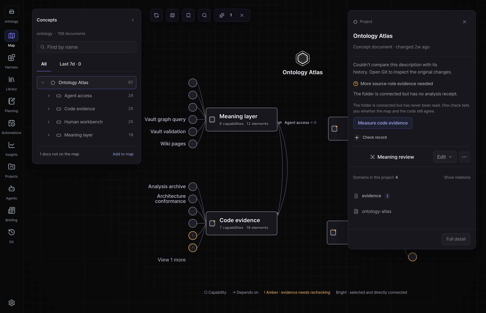
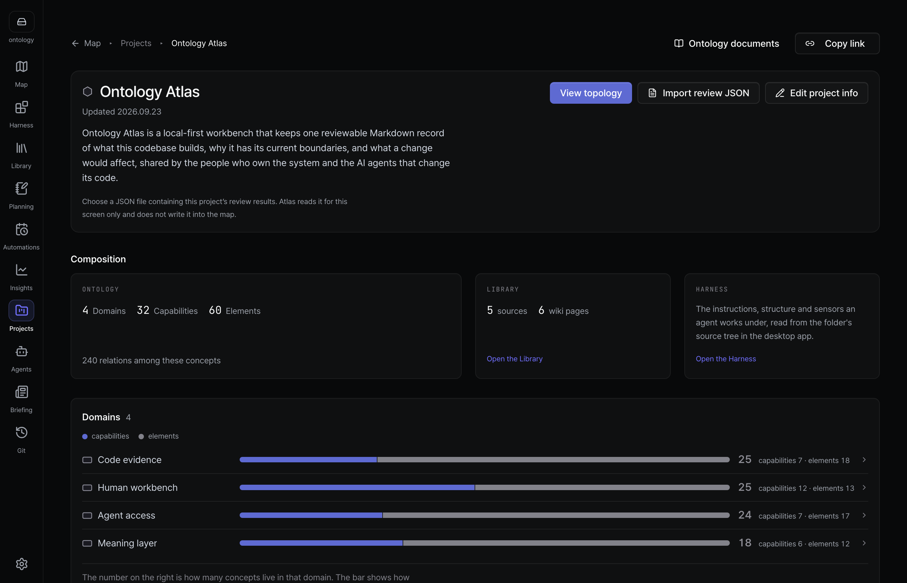
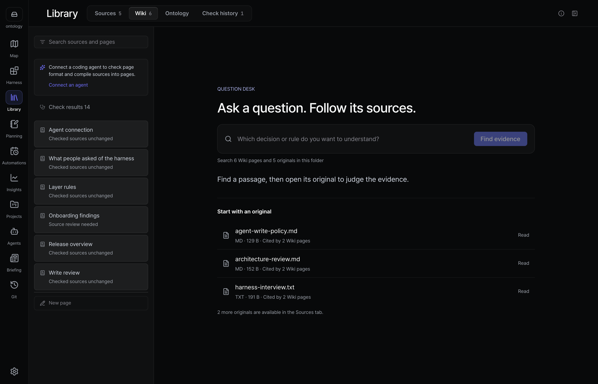
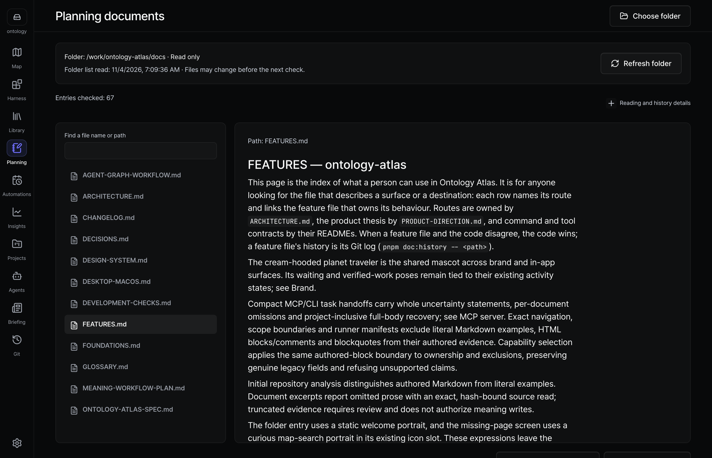
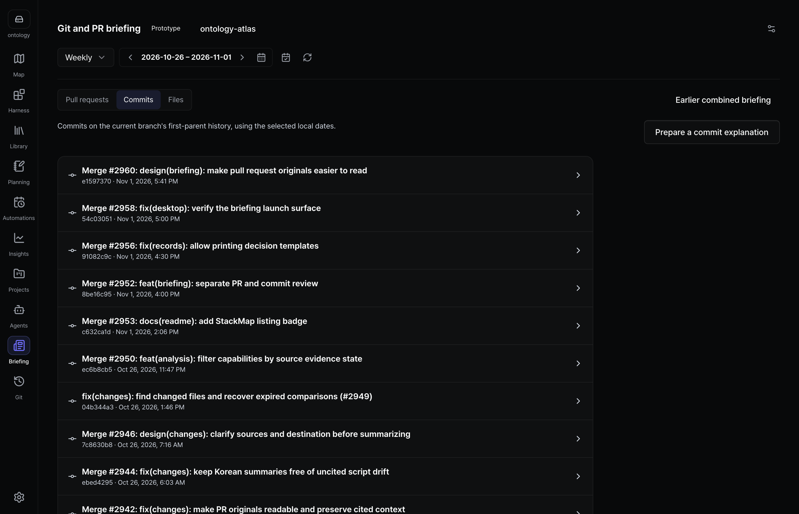
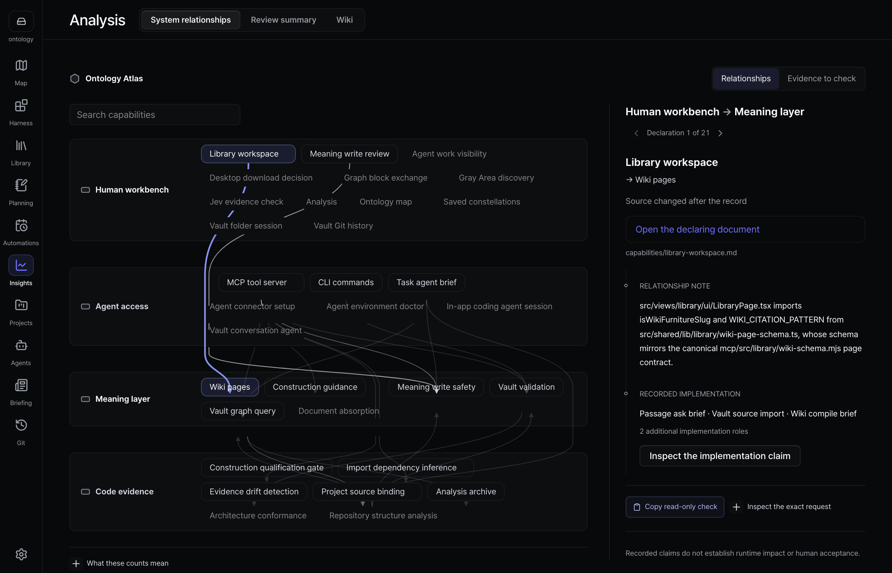
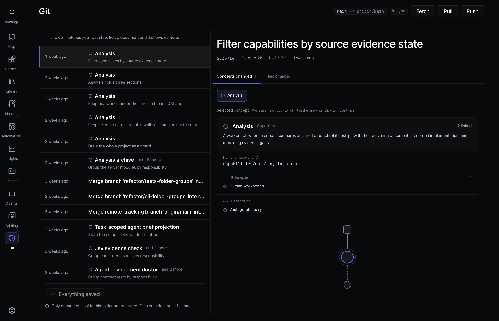
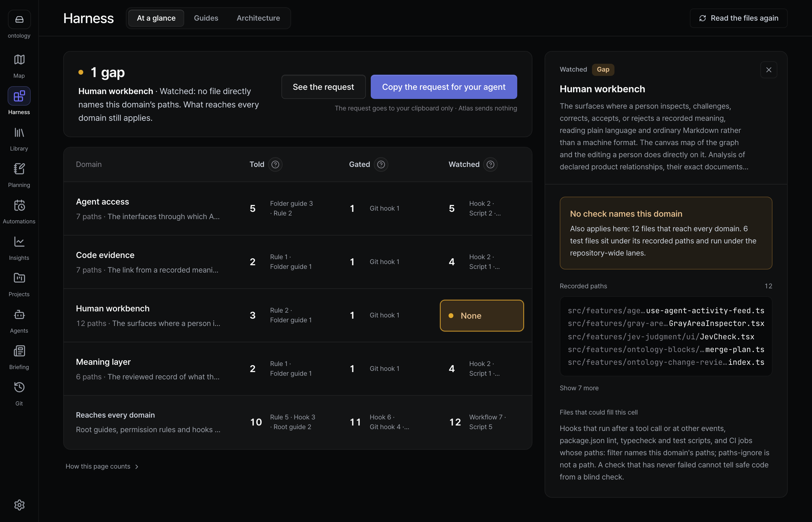
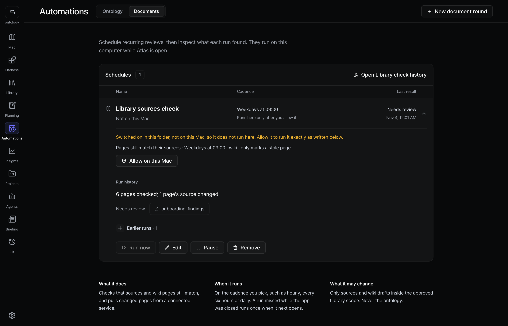

[English](README.md) | [한국어](README.ko.md) | [日本語](README.ja.md) | [简体中文](README.zh.md)

<h1 align="center">
  <picture>
    <source media="(prefers-color-scheme: dark)" srcset="public/brand/lockup-dark@2x.png" />
    
  </picture>
</h1>

<p align="center"><strong>AI エージェントがコードを変えても、システムを理解し続けられます。</strong></p>

<p align="center">
  コードが何をしていて、なぜそうなっているのかを示すマップを、リポジトリ内の Markdown として残します。<br />
  あなたもコーディングエージェントも、同じファイルを読みます。
</p>

<p align="center">
  <a href="https://ontologyatlas.com/ja/download/"><strong>macOS 版をダウンロード</strong></a> ·
  <a href="https://ontologyatlas.com/ja/topology/">ブラウザで試す</a> ·
  <a href="https://ontologyatlas.com/ja/guide/">ガイド</a>
</p>

<p align="center"><a href="LICENSE"></a> <a href="https://github.com/wlsdks/ontology-atlas/releases"></a> <a href="https://mcpservers.org/servers/wlsdks/ontology-atlas"></a> <a href="https://stackmap.shipwithai.xyz/repos/wlsdks/ontology-atlas"></a></p>



## なぜ Atlas か

コーディングエージェントがコードを変える速さは、チームが頭の中に全体像を保てる速さを超えています。Atlas はその全体像をコードのそばに置きます。各部分が何のためにあるのか、どのファイルが実装しているのか、何が何に依存しているのか、そしてまだ誰も知らないことは何か。エージェントはタスクの前にそれを読み、タスクの後に更新を提案します。あなたは変更ごとに Markdown の diff を見て、そのまま残すか、直すか、却下します。

- **エージェントは文脈を持って作業を始められます。** Claude Code、Codex、Cursor、Antigravity が MCP 経由で、タスクに関わる概念、コードパス、依存関係、未解決の問いを読み取ります。
- **記録はあなたのものです。** `atlas/` フォルダに概念ごとに 1 つの Markdown ファイルがあり、コードと同じように Git でバージョン管理とレビューを行います。
- **何が正しいかはあなたが決めます。** エージェントの提案は、あなたが受け入れるまで提案のままです。
- **分からないことは分からないと示します。** マップ上の線は宣言された関係であり、実行時の影響の証拠ではありません。根拠がなければ「安全」ではなく「不明」と表示されます。

## 画面を見る

<table>
<tr>
<td width="50%"><br /><b>プロジェクト</b> — すべてのプロジェクトと、そのうちコードの根拠がどれだけあるか。</td>
<td width="50%"><br /><b>資料室</b> — 文書を入れると、出典つきの Wiki ページが出てきます。</td>
</tr>
<tr>
<td width="50%"><br /><b>企画</b> — プロジェクトフォルダの Markdown を、コピーせずその場で読みます。</td>
<td width="50%"><br /><b>ブリーフィング</b> — 期間中に何が変わったかを、プルリクエスト、コミット、ファイルに分けて見ます。</td>
</tr>
<tr>
<td width="50%"><br /><b>分析</b> — 何が何に依存しているかを、根拠とともに見ます。</td>
<td width="50%"><br /><b>Git</b> — 保存する前に、正確な Markdown の diff を確認できます。</td>
</tr>
<tr>
<td width="50%"><br /><b>ハーネス</b> — リポジトリがエージェントに伝え、止め、見守っているもの。</td>
<td width="50%"><br /><b>自動化</b> — フォルダを最新に保つ定期チェック。</td>
</tr>
</table>

**v1.9 の新機能：** リポジトリのプルリクエスト、コミット、ファイルを別々に読む Git・PR ブリーフィングと、プロジェクトフォルダの Markdown をその場で読む企画。[リリース](https://github.com/wlsdks/ontology-atlas/releases)をご覧ください。

始める前に知っておくと役立つこと：

- マップの線は宣言された関係であり、実行時の影響の証明ではありません。凡例がすべての印と向きを説明します。[マップ](docs/features/map/flat-dial.md)
- 空のフォルダでは開始操作が表示され、開始に失敗してもファイルを上書きせずにやり直せます。ポップアップのツアーは廃止しました。[初回起動](docs/features/first-run.md)
- 資料室の設定とチェックはアプリで行います。ブラウザでは、アプリの入手かファイルの追加ができます。[資料室](docs/features/library/workspace.md)
- 企画は読み取り専用で、macOS アプリで選んだフォルダに対して動作します。Markdown と PNG/JPEG 画像を表示します。[企画](docs/FEATURES.md)
- Git の送信専用操作は新しいファイルの変更をコミットしません。フォルダやブランチの状態が変わった場合は再確認できます。プルはリポジトリ全体のファイルを変更することがあります。[Git](docs/features/git.md)
- フォルダを接続する前でも、アプリは資料室、企画、エージェント、ブリーフィングを開けるようにしています。[機能一覧](docs/FEATURES.md)

## クイックスタート

1. **インストール**: [ダウンロードページ](https://ontologyatlas.com/ja/download/)からアプリを入手するか、[ブラウザ版](https://ontologyatlas.com/ja/topology/)を開きます。
2. **フォルダを開く**: Atlas はフォルダ内の Markdown をその場で読むか、リポジトリに `atlas/` フォルダを新しく作ります。何かを書き込む前に、必ずパスを表示します。
3. **エージェントを接続**: **エージェント › MCP** で使っているツールの **接続** を押し、エージェントを再起動して、次のタスクについて質問してみましょう。

macOS（Apple Silicon）版は署名と公証済みで、アプリ内に MCP サーバーを同梱しています。Windows x64 は未署名のベータ版です。Linux では、ブラウザ版を使うか、[ソースのチェックアウトから CLI と MCP サーバーを実行](cli/README.md#set-up-from-a-source-checkout)してください。[Releases](https://github.com/wlsdks/ontology-atlas/releases) に、各バージョンのファイルとチェックサムがあります。

## しくみ

```text
your-repo/
├── src/
└── atlas/                 ← コードと一緒にクローン、ブランチ作成、レビューする
    ├── project.md
    ├── domains/  capabilities/  elements/
    ├── sources/           届いたままの形で保管したドキュメント
    └── wiki/              それらから書いたページ。すべての事実に出典つき
```

frontmatter に `kind:` を持つ Markdown ファイル 1 つが、概念 1 つです。`uid` は変わらず、`slug` は現在のアドレスで、`path` はその概念が説明するコードを指します。マップ、文書、資料室、分析、Git の各画面は、すべてこれらのファイルを読んで表示します。

エージェントがフォルダに届く道は 2 つあります。

- **MCP:** エージェントが Atlas の MCP サーバーを起動し、そのサーバーがディスク上のフォルダを直接読み書きします。アプリを閉じていても動きます。[エージェントを接続する](docs/guide/connect-agent.md) · [MCP リファレンス](mcp/README.md)
- **ACP:** Claude Agent と Codex は、アプリ内のチャットでも動かせます。書き込みは、あなたが許可するまで待機します。[エージェント](docs/features/agents.md)

## ローカルファースト

- バックエンド、アカウント、テレメトリはありません。フォルダは、普通の Markdown としてあなたのディスクに残ります。
- 自分の API key やローカルモデルでモデルを呼び出す機能はオプトインで、呼び出しごとに宛先が `.ontology-atlas/llm-audit.jsonl` に記録されます。
- 接続したコーディングエージェントは、プロンプトと読み取った内容を自身のプロバイダーに送信することがあります。その送信は Atlas のログの対象外です。

[信頼について](docs/guide/trust.md) · [セキュリティ](SECURITY.md)

## 現在の状況

Atlas はまだ初期段階です。私たちのベンチマークでは、Atlas を使うとより良い回答になることはまだ示せておらず、Atlas のほうが遅くなりました（[訂正記録](docs/benchmark/README.md#current-measurement-status)）。構築の試験とその失敗、限界は[構築の測定結果](docs/benchmark/CONSTRUCTION.md)にあります。

## ドキュメント

[Atlasとは](docs/guide/what-is-atlas.md) · [最初の5分](docs/guide/first-five-minutes.md) · [概念になるもの](docs/guide/what-becomes-a-node.md) · [つながり](docs/guide/relations.md) · [仕様](docs/ONTOLOGY-ATLAS-SPEC.md) · [機能](docs/FEATURES.md) · [CLI](cli/README.md) · [アーキテクチャ](docs/ARCHITECTURE.md)

## コントリビュート

まず [CONTRIBUTING.md](CONTRIBUTING.md) をお読みください。外部からのプルリクエストはフォークから送ります。[AGENTS.md](AGENTS.md) は、人とエージェントが共通で従う取り決めです。

```bash
pnpm install
pnpm dev
pnpm checks:changed -- --run
```

`pnpm pr:land <number>` は、レビュー済みのプルリクエストをマージし、元のコミットをそのまま残します。検査の全体は[開発チェック](docs/DEVELOPMENT-CHECKS.md)にまとまっています。リポジトリのコマンド表は、英語版 README の [Contributing](README.md#contributing) にあります。

## ライセンス

[MIT](LICENSE)。サードパーティの告知は [NOTICE.md](NOTICE.md)、ライセンス全文は [public/third-party-licenses.txt](public/third-party-licenses.txt) にあります。ピクセルマスコットとその出典については[ブランド](docs/design/brand.md)をご覧ください。
