[English](README.md) | [한국어](README.ko.md) | [日本語](README.ja.md) | [简体中文](README.zh.md)

<h1 align="center">
  <picture>
    <source media="(prefers-color-scheme: dark)" srcset="public/brand/lockup-dark@2x.png" />
    
  </picture>
</h1>

<p align="center"><strong>AI 에이전트가 코드를 바꿔도 내 시스템을 계속 이해하세요.</strong></p>

<p align="center">
  코드가 무엇을 하고 왜 그렇게 생겼는지 담은 지도를 저장소 안 마크다운으로 남겨요.<br />
  나도, 내 코딩 에이전트도 그 파일을 읽어요.
</p>

<p align="center">
  <a href="https://ontologyatlas.com/ko/download/"><strong>macOS용 받기</strong></a> ·
  <a href="https://ontologyatlas.com/ko/topology/">브라우저에서 써보기</a> ·
  <a href="https://ontologyatlas.com/ko/guide/">가이드</a>
</p>

<p align="center"><a href="LICENSE"></a> <a href="https://github.com/wlsdks/ontology-atlas/releases"></a> <a href="https://mcpservers.org/servers/wlsdks/ontology-atlas"></a> <a href="https://stackmap.shipwithai.xyz/repos/wlsdks/ontology-atlas"></a></p>

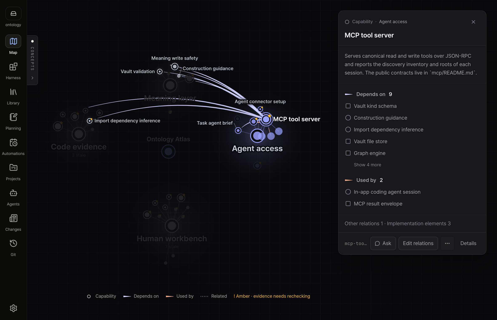

## 왜 Atlas인가

코딩 에이전트가 코드를 바꾸는 속도가 이제 팀이 머릿속에 그림을 유지하는 속도보다
빨라요. Atlas는 그 그림을 코드 옆에 둬요. 각 부분이 무엇을 위한 것인지, 어느
파일이 구현하는지, 무엇이 무엇에 기대는지, 아직 아무도 모르는 것이 무엇인지까지요.
에이전트는 작업 전에 그 그림을 읽고 작업 뒤에 갱신을 제안해요. 나는 변경마다 마크다운
diff로 보고 그대로 두거나, 고치거나, 거절해요.

- **에이전트가 맥락을 갖고 시작해요.** Claude Code, Codex, Cursor, Antigravity가 MCP로 작업에 걸린 개념, 코드 경로, 의존 관계, 아직 풀리지 않은 질문을 읽어요.
- **기록은 내가 가져요.** `atlas/` 폴더에 개념마다 마크다운 파일 하나가 있고, 코드처럼 Git으로 버전을 관리하고 리뷰해요.
- **무엇이 사실인지는 내가 정해요.** 에이전트의 제안은 내가 받아들이기 전까지 제안으로 남아요.
- **모르는 것은 모른다고 해요.** 지도의 선은 선언된 관계일 뿐, 실행 시 영향의 증거가 아니에요. 근거가 없으면 안전이 아니라 미확인으로 보여요.

## 화면 둘러보기

<table>
<tr>
<td width="50%">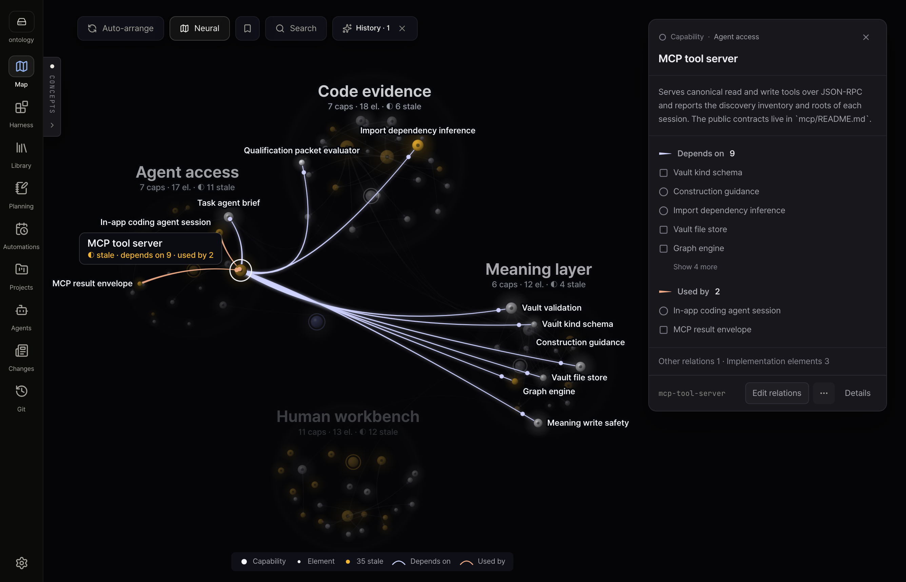<br /><b>지도 · 뉴런</b> — 같은 개념을 돌려 볼 수 있는 입체로 그려요. 하나를 고르면 무엇에 기대고 무엇이 그것을 쓰는지 보여요.</td>
<td width="50%">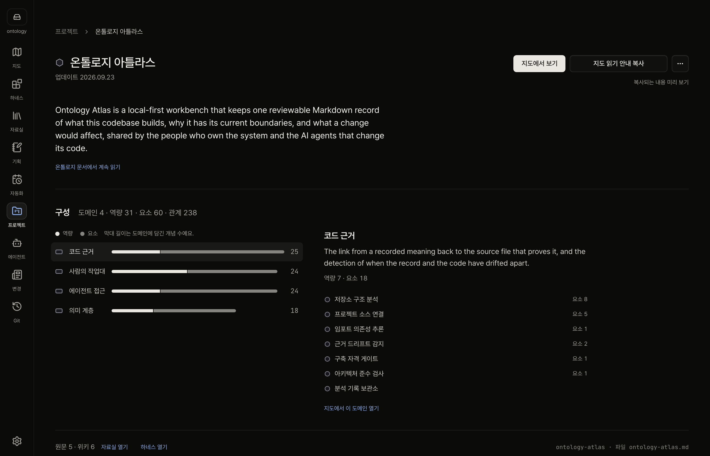<br /><b>프로젝트</b> — 프로젝트가 무엇을 위한 것인지, 어떤 도메인으로 나뉘는지, 도메인마다 무엇이 들어 있는지.</td>
</tr>
<tr>
<td width="50%">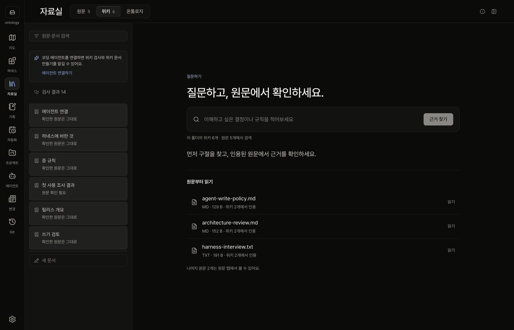<br /><b>자료실</b> — 문서가 들어가면 출처가 달린 위키 문서가 나와요. 구절을 찾고 원문에서 확인해요.</td>
<td width="50%">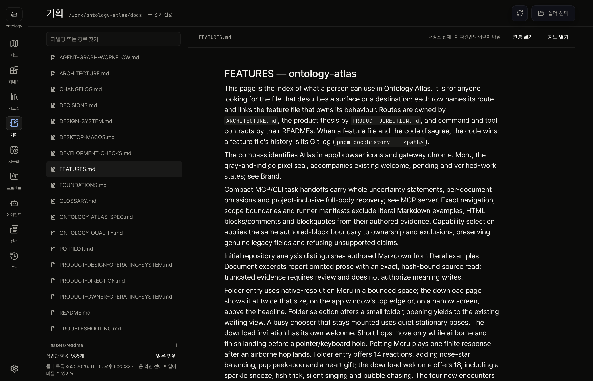<br /><b>기획</b> — 프로젝트 폴더의 마크다운을 복사하지 않고 그 자리에서 읽어요.</td>
</tr>
<tr>
<td width="50%">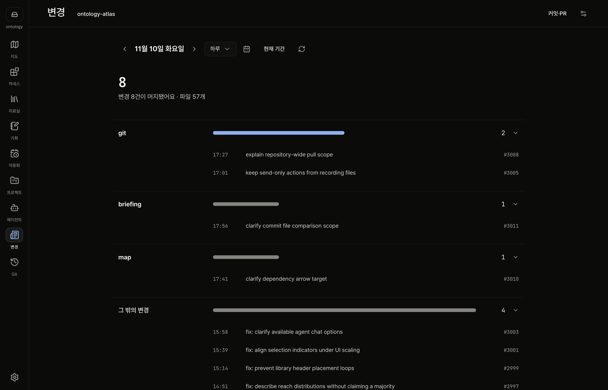<br /><b>변경</b> — 기간 동안 무엇이 머지됐는지 세고 묶어서 보여 주고, 그 뒤의 풀 리퀘스트·커밋·파일로 이어져요.</td>
<td width="50%">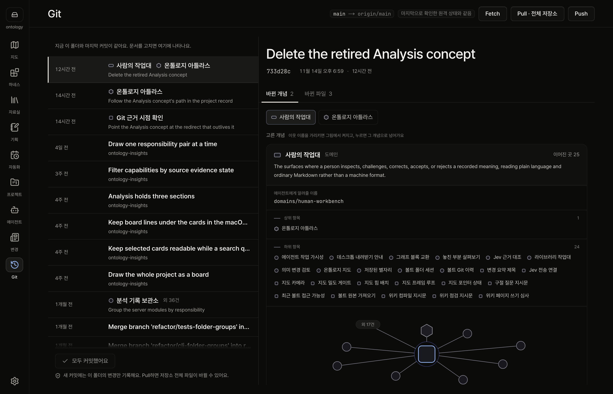<br /><b>Git</b> — 커밋마다 어떤 개념이 바뀌었는지 보여요. 고친 문서는 커밋하기 전에 여기에 나타나요.</td>
</tr>
<tr>
<td width="50%">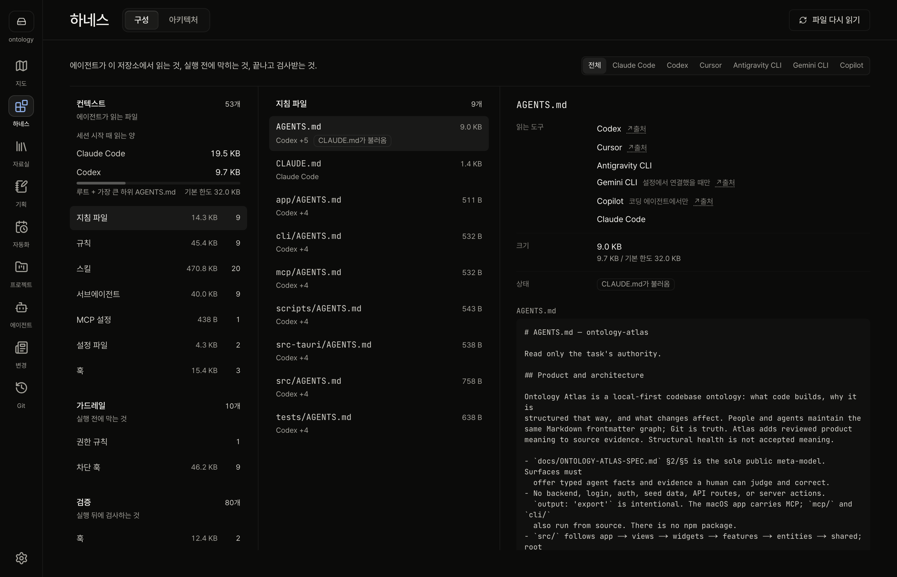<br /><b>하네스</b> — 에이전트가 이 저장소에서 읽는 것, 실행 전에 막히는 것, 끝나고 검사받는 것.</td>
<td width="50%">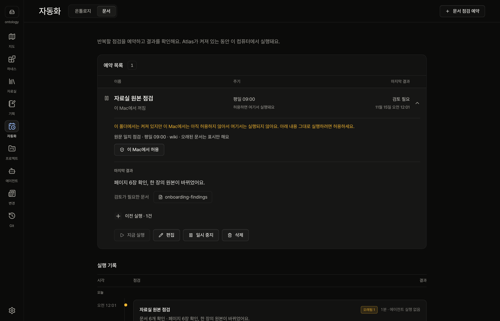<br /><b>자동화</b> — 예약 점검과, 실행마다 무엇을 찾았는지.</td>
</tr>
</table>

**v2.0의 새 기능:** 지도를 돌려 볼 수 있는 입체로 그리는 뉴런 보기와 나무 모양의 3D 보기, 에이전트가 읽는 것·막히는 것·검사받는 것을 한 화면에 모은 하네스 구성, 변경 맨 위의 머지 요약, 자동화의 예약별 실행 기록. 분석은 더 이상 따로 있는 화면이 아니에요. [릴리스](https://github.com/wlsdks/ontology-atlas/releases)에서 확인하세요.

시작하기 전에 알아 두면 좋은 것:

- 지도의 선은 선언된 관계이지 실행 영향의 증거가 아니에요. 보기는 다섯 가지예요: 평면, 육각, 도메인 구조도, 3D, 뉴런. [지도](docs/features/map/README.md)
- 빈 폴더에서는 시작 동작이 나타나고, 시작이 실패하면 파일을 덮어쓰지 않고 다시 시도할 수 있어요. 팝업 투어는 없어졌어요. [첫 실행](docs/features/first-run.md)
- 자료실 설정과 점검은 앱에서 해요. 브라우저에서는 앱을 받거나 파일을 추가할 수 있어요. [자료실](docs/features/library/workspace.md)
- 기획은 읽기 전용이고, macOS 앱에서 고른 폴더에서 동작해요. 마크다운과 PNG/JPEG 이미지를 보여 줘요. [기획](docs/FEATURES.md)
- Git의 보내기 전용 동작은 새 파일 변경을 커밋하지 않아요. 폴더나 브랜치의 상태가 달라졌다면 다시 확인할 수 있어요. 받아오기는 저장소 전체의 파일을 바꿀 수 있어요. [Git](docs/features/git.md)
- 변경은 앱에서 고른 Git 저장소를 열어요. 온톨로지가 없어도 돼요. 공개 GitHub 풀 리퀘스트는 직접 눌러야 읽고, 목록이 일부만 나올 수 있어요. 비공개 풀 리퀘스트는 읽지 않아요. [변경 브리핑](docs/features/change-briefing.md)
- 프로젝트 문서가 마지막 의미 검토 뒤에 바뀌었으면 다시 검토하고 직접 확정하라고 알려 줘요. 저장했거나 코드 경로가 맞는다고 해서 의미가 받아들여지지는 않아요. [MCP 서버](docs/features/mcp-server.md)
- 앱 안 대화에서 에이전트의 쓰기는 내가 허락할 때까지 기다려요. Codex는 읽기 전용으로 시작하고, 내 컴퓨터에 설정된 Codex 권한 프로필은 승인 방식이 공개되어 있지 않아 고를 수 없어요. [에이전트](docs/features/agents.md) · [기능 목록](docs/FEATURES.md)
- 폴더를 연결하기 전에도 앱은 자료실, 기획, 에이전트, 변경을 열어 둬요. [기능 목록](docs/FEATURES.md)

## 빠른 시작

1. **설치**: [다운로드 페이지](https://ontologyatlas.com/ko/download/)에서 앱을 받거나 [브라우저 버전](https://ontologyatlas.com/ko/topology/)을 여세요.
2. **폴더 열기**: Atlas는 폴더 안의 마크다운을 그 자리에서 읽거나 저장소에 `atlas/` 폴더를 새로 만들고, 무엇이든 쓰기 전에 경로를 먼저 보여 줘요.
3. **에이전트 연결**: **에이전트 › MCP**에서 쓰는 도구의 **연결**을 누르고, 에이전트를 다시 시작한 뒤 다음 작업에 대해 물어보세요.

macOS(Apple Silicon)용 앱은 서명과 공증을 거쳤고, 앱 안에 MCP 서버가 들어 있어요. Windows x64는 서명하지 않은 베타예요. Linux에서는 브라우저 버전을 쓰거나, [소스 체크아웃에서 CLI와 MCP 서버를 실행](cli/README.md#set-up-from-a-source-checkout)하세요. [릴리스](https://github.com/wlsdks/ontology-atlas/releases)에 버전마다 파일과 체크섬이 있어요.

## 동작 방식

```text
your-repo/
├── src/
└── atlas/                 ← 코드와 함께 클론하고, 브랜치를 따고, 리뷰해요
    ├── project.md
    ├── domains/  capabilities/  elements/
    ├── sources/           받은 그대로 보관한 문서
    └── wiki/              그 문서로 쓴 페이지, 모든 사실에 출처 표시
```

frontmatter에 `kind:`가 있는 마크다운 파일 하나가 개념 하나예요. `uid`는 바뀌지 않고,
`slug`는 지금의 주소이며, `path`는 그 개념이 설명하는 코드를 가리켜요. 지도, 문서,
자료실, Git 화면이 모두 이 파일을 읽어요.

에이전트가 폴더에 닿는 길은 둘이에요.

- **MCP:** 에이전트가 Atlas MCP 서버를 띄우고, 그 서버가 디스크의 폴더를 직접 읽고 써요. 앱이 꺼져 있어도 돼요. [에이전트 연결하기](docs/guide/connect-agent.md) · [MCP 레퍼런스](mcp/README.md)
- **ACP:** Claude Agent와 Codex는 앱 안 대화에서도 일해요. 쓰기는 내가 허락할 때까지 기다려요. [에이전트](docs/features/agents.md)

## 로컬 우선

- 백엔드, 계정, 텔레메트리가 없어요. 폴더는 내 디스크에 평범한 마크다운으로 남아요.
- 내 API key나 로컬 모델로 모델을 부르는 기능은 직접 켜야 쓸 수 있고, 호출마다 목적지가 `.ontology-atlas/llm-audit.jsonl`에 기록돼요.
- 연결한 코딩 에이전트는 내 질문과 읽은 맥락을 자기 제공자에게 보낼 수 있어요. 이 전송은 Atlas의 기록에 들어가지 않아요.

[신뢰에 관하여](docs/guide/trust.md) · [보안](SECURITY.md)

## 현재 상태

Atlas는 아직 초기 단계예요. 우리 벤치마크에서는 Atlas를 썼을 때 더 나은 답을 아직
확인하지 못했고, Atlas 쪽이 더 느렸어요([정정 기록](docs/benchmark/README.md#current-measurement-status)).
구축 실험과 그 실패, 한계는 [구축 측정](docs/benchmark/CONSTRUCTION.md)에 있어요.

## 문서

[Atlas란?](docs/guide/what-is-atlas.md) · [첫 5분](docs/guide/first-five-minutes.md) · [무엇이 개념이 되나](docs/guide/what-becomes-a-node.md) · [관계](docs/guide/relations.md) · [명세](docs/ONTOLOGY-ATLAS-SPEC.md) · [기능](docs/FEATURES.md) · [CLI](cli/README.md) · [아키텍처](docs/ARCHITECTURE.md)

## 기여하기

먼저 [CONTRIBUTING.md](CONTRIBUTING.md)를 읽어 주세요. 외부 PR은 포크에서 보내요.
사람과 에이전트가 함께 따르는 규칙은 [AGENTS.md](AGENTS.md)에 있어요.

```bash
pnpm install
pnpm dev
pnpm checks:changed -- --run
```

`pnpm pr:land <number>`는 리뷰를 마친 PR을 머지하고 원래 커밋을 그대로 남겨요.
전체 검사 안내는 [개발 검사](docs/DEVELOPMENT-CHECKS.md)에 있어요. 저장소 명령 표는
영어 README의 [Contributing](README.md#contributing)에 있어요.

## Moru

모루는 아틀라스의 픽셀 물개 캐릭터이고, 나침반은 앱을 나타내는 심볼이에요. [동작 74개·포즈 16개와 원본](assets/brand/moru/README.md)이 저장소에 들어 있어요. 직접 그린 동작이 58개, 그 동작을 이어 붙인 장면이 16개예요. [로컬 모션 스튜디오](assets/brand/moru/preview.html)를 열면 재생·정지하고 프레임마다 확인할 수 있어요.

<p>


</p>

**나오는 자리.** 폴더를 고르는 화면에서 모루가 인사하고 작은 폴더를 내밀며 기다려요. 폴더가 열리기 시작하면 장난을 멈추고 대기 화면으로 넘어가요. 다운로드 페이지에는 따로 환영 동작이 있어요. 원문을 읽거나, 내 허락을 기다리거나, 끝난 점검을 반기는 동작은 앱이 실제로 그 상태를 확인했을 때만 나와요. 그래서 모루는 확인되지 않은 진행을 보여 주지 않아요.

**쓰다듬기.** 모루를 누르면 짧게 한 번 반응해요. 첫 번째는 얌전하고, 두 번째에 장난스러운 동작이 나오고, 그다음부터는 바로 앞 두 동작을 피해 가며 가진 동작을 골고루 보여 줘요. 폴더 화면에서 14가지, 다운로드 환영 화면에서 18가지예요. 글자 없는 작은 말풍선에 하트·음표·반짝임이 뜨기도 하고, 오래 가만히 두면 아기 모루가 한 번 고개를 내밀어요.

**방해하지 않기.** 모루는 공중에 뜬 동안에만 자리를 옮기고, 커서를 올리면 착지를 마친 뒤 기다려요. 작업을 기다릴 때는 제자리에서 조용히 있어요. 일시정지와 다시 재생은 모루의 메뉴(우클릭 또는 Shift+F10)에 있고, 캐릭터 옆에 재생 버튼은 없어요. 동작 줄이기를 켜면 정지된 표정으로 반응해요.

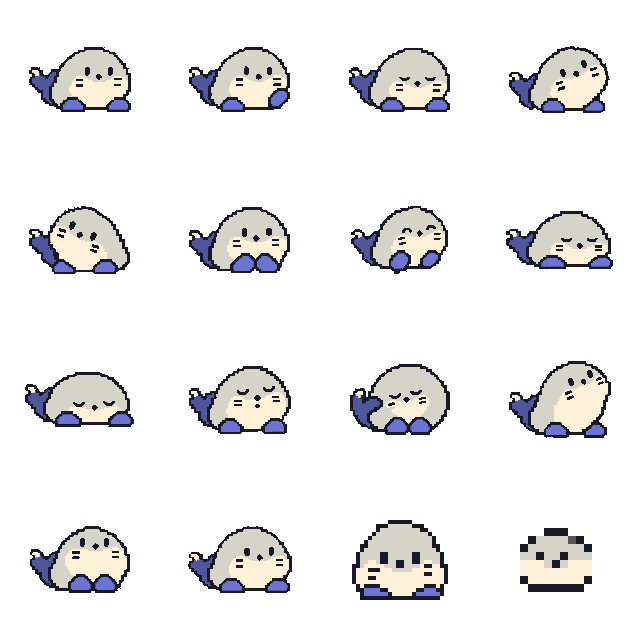

<details>
<summary>직접 그린 동작 58개 모두 보기</summary>

<p><b>기다릴 때</b></p>

<p>


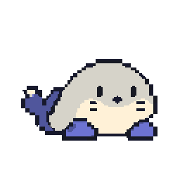


</p>

<p><b>인사</b></p>

<p>


</p>

<p><b>일할 때</b></p>

<p>


</p>

<p><b>감정</b></p>

<p>


</p>

<p><b>놀이</b></p>

<p>


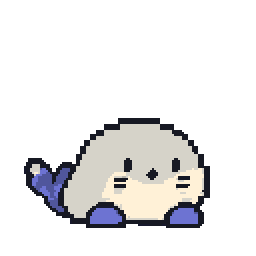

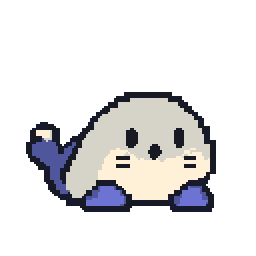
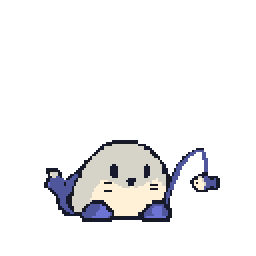
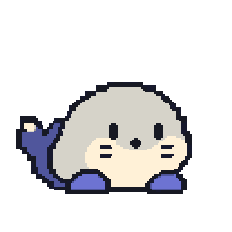

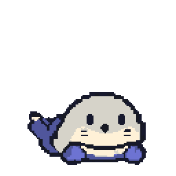


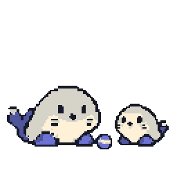
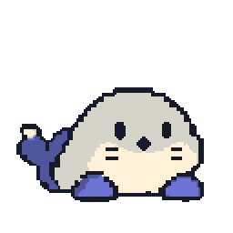

</p>

<p><b>장면</b></p>

<p>
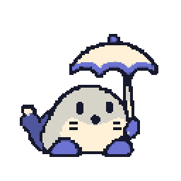
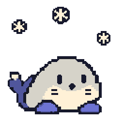
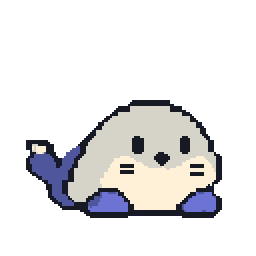

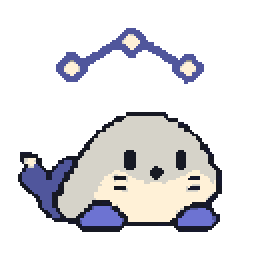
</p>

</details>

## 라이선스

[MIT](LICENSE). 서드파티 고지는 [NOTICE.md](NOTICE.md)에, 라이선스 전문은 [public/third-party-licenses.txt](public/third-party-licenses.txt)에 있어요. 픽셀 마스코트와 그 출처는 [브랜드](docs/design/brand.md)에 설명돼 있어요.
