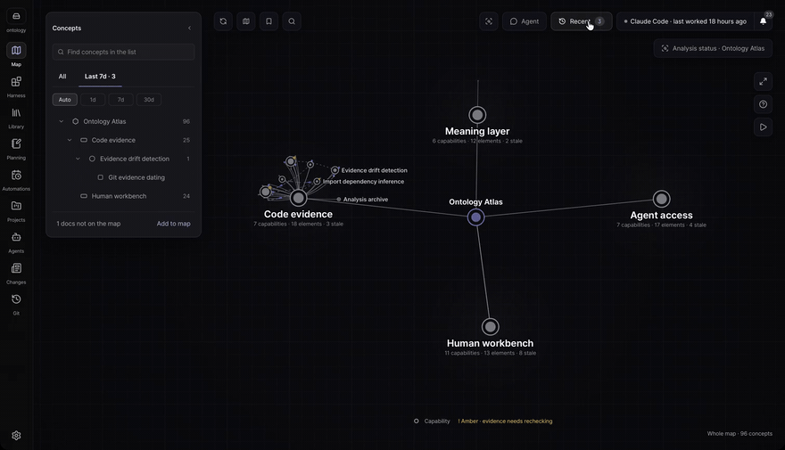
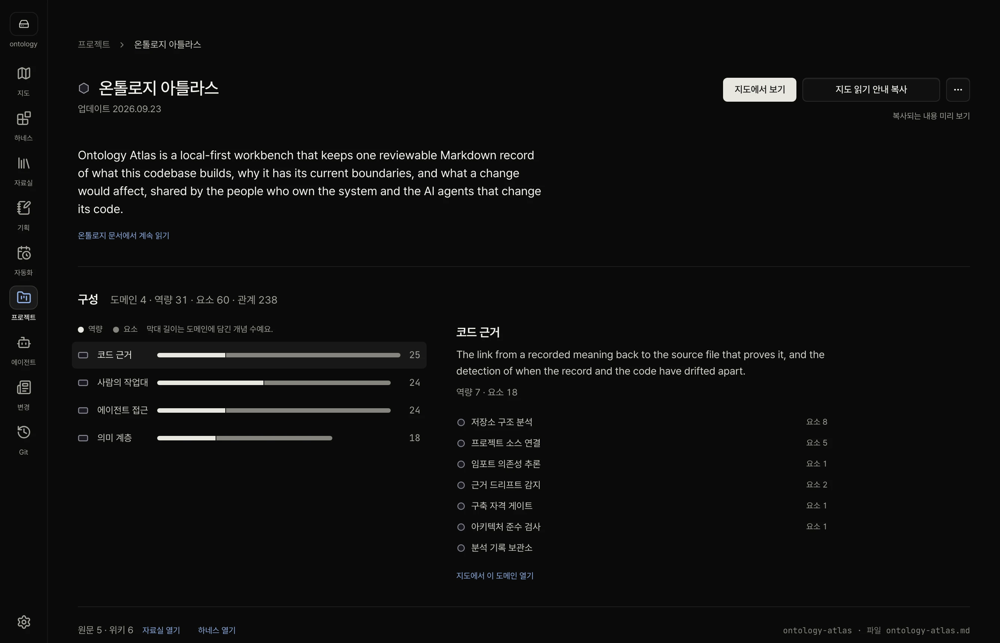
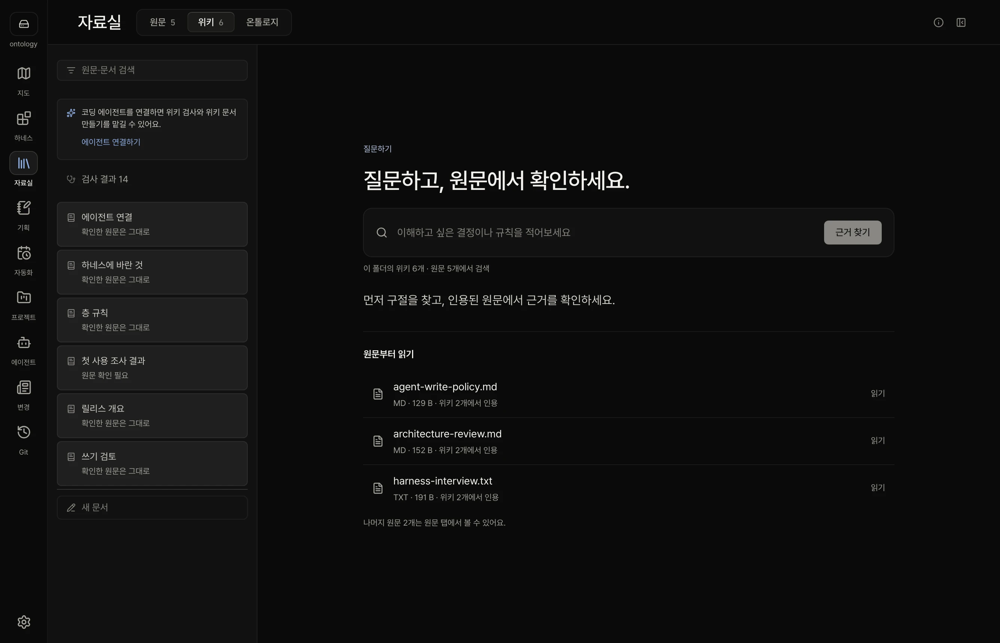
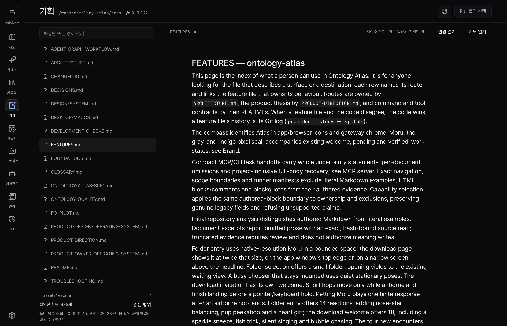
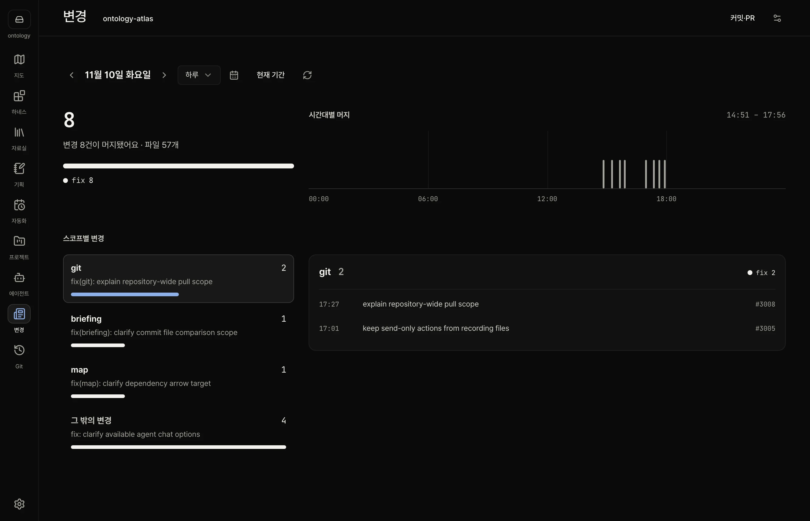
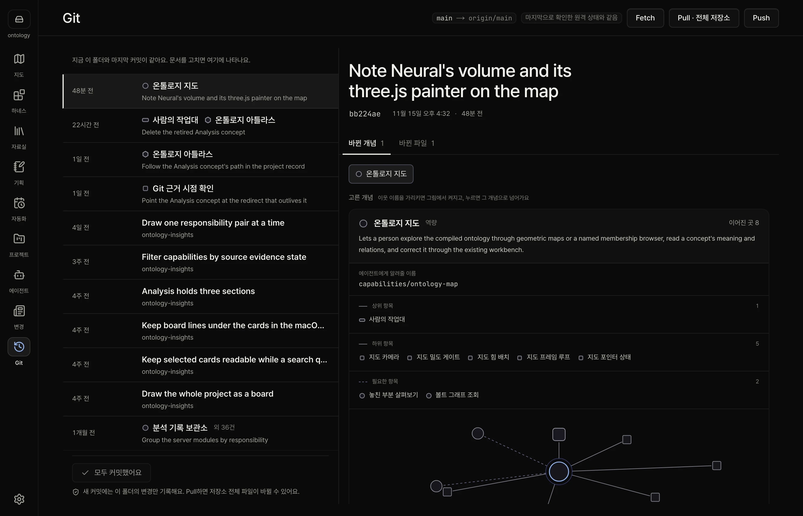
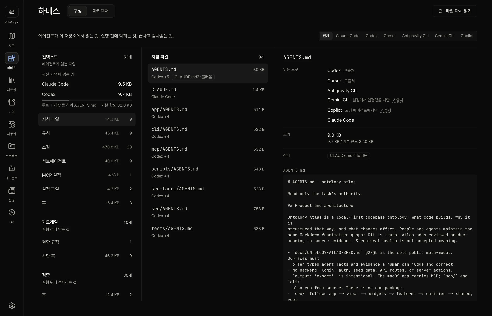
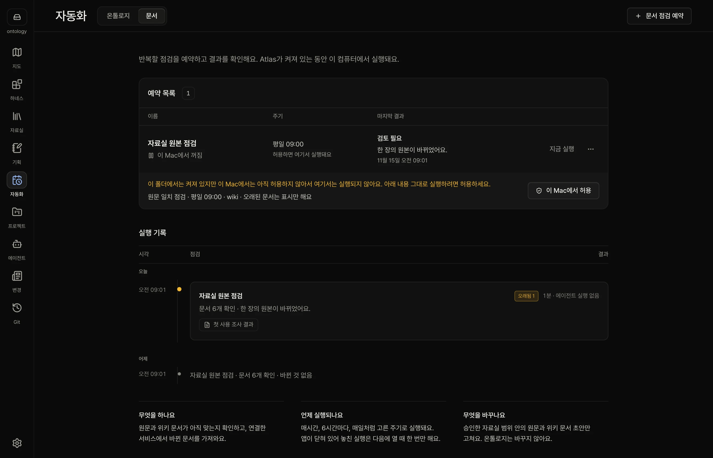

[English](README.md) | [한국어](README.ko.md) | [日本語](README.ja.md) | [简体中文](README.zh.md)

<h1 align="center">
  <picture>
    <source media="(prefers-color-scheme: dark)" srcset="public/brand/lockup-dark@2x.png" />
    
  </picture>
</h1>

<p align="center"><strong>AI 에이전트가 코드를 바꿔도 내 시스템을 계속 이해하세요.</strong></p>

<p align="center">
  코드가 무엇을 하고 왜 그렇게 생겼는지 담은 지도를 저장소 안 마크다운으로 남겨요.<br />
  나도, 내 코딩 에이전트도 그 파일을 읽어요.
</p>

<p align="center">
  <a href="https://ontologyatlas.com/ko/download/"><strong>받기</strong></a> ·
  <a href="https://ontologyatlas.com/ko/topology/">브라우저에서 써보기</a> ·
  <a href="https://ontologyatlas.com/ko/guide/">가이드</a>
</p>

<p align="center"><a href="LICENSE"></a> <a href="https://github.com/wlsdks/ontology-atlas/releases"></a> <a href="https://mcpservers.org/servers/wlsdks/ontology-atlas"></a> <a href="https://stackmap.shipwithai.xyz/repos/wlsdks/ontology-atlas"></a> <a href="https://glama.ai/mcp/servers/wlsdks/ontology-atlas"></a></p>



## 왜 Atlas인가

코딩 에이전트가 코드를 바꾸는 속도가 이제 팀이 머릿속에 그림을 유지하는 속도보다
빨라요. Atlas는 그 그림을 코드 옆에 둬요. 각 부분이 무엇을 위한 것인지, 어느
파일이 구현하는지, 무엇이 무엇에 기대는지, 아직 아무도 모르는 것이 무엇인지까지요.
에이전트는 작업 전에 그 그림을 읽고 작업 뒤에 갱신을 제안해요. 나는 변경마다 마크다운
diff로 보고 그대로 두거나, 고치거나, 거절해요.

- **에이전트가 맥락을 갖고 시작해요.** Claude Code, Codex, Cursor, Antigravity가 MCP로 작업에 걸린 개념, 코드 경로, 의존 관계, 아직 풀리지 않은 질문을 읽어요.
- **기록은 내가 가져요.** `atlas/` 폴더에 개념마다 마크다운 파일 하나가 있고, 코드처럼 Git으로 버전을 관리하고 리뷰해요.
- **무엇이 사실인지는 내가 정해요.** 에이전트가 고친 내용은 모두 마크다운 diff로 남아서, 그대로 두거나 고치거나 되돌릴 수 있어요. 앱 안 대화에서는 쓰기마다 내 허락을 기다려요.
- **모르는 것은 모른다고 해요.** 지도의 선은 선언된 관계일 뿐, 실행 시 영향의 증거가 아니에요. 근거가 없으면 안전이 아니라 미확인으로 보여요.

코드 그래프, 위키, Obsidian, `CLAUDE.md`와는 무엇이 다를까요? [Atlas 비교](https://ontologyatlas.com/ko/guide/atlas-compared/)에
정리했고, 그쪽 도구가 더 나은 경우도 적어 뒀어요.

## 빠른 시작

1. **설치**: [다운로드 페이지](https://ontologyatlas.com/ko/download/)에서 앱을 받거나 [브라우저 버전](https://ontologyatlas.com/ko/topology/)을 여세요.
2. **폴더 열기**: Atlas는 폴더 안의 마크다운을 그 자리에서 읽거나 저장소에 `atlas/` 폴더를 새로 만들고, 무엇이든 쓰기 전에 경로를 먼저 보여 줘요.
3. **에이전트 연결**: **에이전트 › MCP**에서 쓰는 도구의 **연결**을 누르고, 에이전트를 다시 시작한 뒤 다음 작업에 대해 물어보세요.

macOS(Apple Silicon)용 앱은 서명과 공증을 거쳤고, 앱 안에 MCP 서버가 들어 있어요. Windows x64는 서명하지 않은 베타예요. Linux에서는 브라우저 버전을 쓰거나, [소스 체크아웃에서 MCP 서버를 실행](mcp/README.md#1-register-with-an-agent)하세요. [릴리스](https://github.com/wlsdks/ontology-atlas/releases)에 버전마다 파일과 체크섬이 있어요. GitHub에서 **Pre-release** 표시가 붙은 릴리스는 베타예요. 설치된 앱은 정식 릴리스로만 업데이트되기 때문에, 베타는 직접 내려받아 설치한 사람만 쓰게 돼요.

## 화면 둘러보기


**지도** — 개념을 고르면 그 개념이 기대는 것과 그것을 쓰는 것으로 가는 선이 밝아지고, 패널이 하나씩 이름을 보여 줘요. 평면, 육각, 도메인 구조도, 3D, 뉴런은 같은 개념을 다르게 보는 보기예요. [지도](docs/features/map/README.md)

<table>
<tr>
<td width="50%"><br /><b>지도 · 뉴런</b> — 같은 개념을 돌려 볼 수 있는 입체로 그려요. 하나를 고르면 무엇에 기대고 무엇이 그것을 쓰는지 보여요.</td>
<td width="50%"><br /><b>프로젝트</b> — 프로젝트가 무엇을 위한 것인지, 어떤 도메인으로 나뉘는지, 도메인마다 무엇이 들어 있는지.</td>
</tr>
<tr>
<td width="50%"><br /><b>자료실</b> — 문서가 들어가면 출처가 달린 위키 문서가 나와요. 구절을 찾고 원문에서 확인해요.</td>
<td width="50%"><br /><b>기획</b> — 열어 둔 폴더 안 <code>planning/</code>에 계획을 마크다운으로 써요. 앱과 브라우저 모두에서 되고, macOS 앱에서는 다른 폴더를 그대로 읽을 수도 있어요.</td>
</tr>
<tr>
<td width="50%"><br /><b>변경</b> — 기간 동안 무엇이 머지됐는지 세고 묶어서 보여 주고, 그 뒤의 풀 리퀘스트·커밋·파일로 이어져요.</td>
<td width="50%"><br /><b>Git</b> — 커밋마다 어떤 개념이 바뀌었는지 보여요. 고친 문서는 커밋하기 전에 여기에 나타나요.</td>
</tr>
<tr>
<td width="50%"><br /><b>하네스</b> — 에이전트가 이 저장소에서 읽는 것, 실행 전에 막히는 것, 끝나고 검사받는 것.</td>
<td width="50%"><br /><b>자동화</b> — 예약 점검과, 실행마다 무엇을 찾았는지.</td>
</tr>
</table>

## 동작 방식

```text
your-repo/
├── src/
└── atlas/                 ← 코드와 함께 클론하고, 브랜치를 따고, 리뷰해요
    ├── project.md
    ├── domains/  capabilities/  elements/
    ├── sources/           받은 그대로 보관한 문서
    └── wiki/              그 문서로 쓴 페이지, 모든 사실에 출처 표시
```

frontmatter에 `kind:`가 있는 마크다운 파일 하나가 개념 하나예요. 개념은 **프로젝트**,
**도메인**(오래 유지되는 책임), **역량**(시스템이 하는 일), **요소**(둘 이상의 역량이 함께
쓰는 부품) 중 하나예요. `uid`는 바뀌지 않고, `slug`는 지금의 주소이며, `path`는 그 개념이
설명하는 코드를 가리켜요. 아래는 이 저장소의 지도
[`docs/ontology/`](docs/ontology/capabilities/vault-graph-query.md)에 있는 파일을 줄인 거예요.

```markdown
---
uid: 7c451ebd-9cd0-41a9-bc37-044affac786a
slug: capabilities/vault-graph-query
kind: capability
title: Vault graph query
domain: domains/meaning-layer
path: mcp/src/tools/graph.mjs
dependencies: [elements/graph-compiler, elements/graph-engine, elements/vault-file-store]
---

## Definition
Compiles the folder of Markdown files into one typed graph and answers
structural questions over it, so a person or agent can ask what a node touches
without opening every file.

## Excludes
- Writing anything back to the vault.

## Uncertainty
- The engine is roughly 6,400 lines and was not read beyond its header.
```

지도, 문서, 자료실, Git 화면이 모두 이 파일을 읽고, 에이전트도 같은 파일을 읽어요.
에이전트가 가장 자주 묻는 질문에는 이 MCP 도구들이 답해요.

| 작업 전후에 에이전트가 묻는 것 | 도구 |
|---|---|
| 이 부분은 무엇을 위한 것이고, 무엇을 맡지 않나? | `get_concept` |
| 이름을 바꾸거나 지우기 전에, 무엇이 이걸 가리키나? | `find_backlinks` |
| 이 두 개념은 어떻게 이어져 있나? | `find_path` |
| 이 변경이 무엇에 영향을 줄 수 있나? | `query_ontology`의 `impact` |
| 이 내용은 어디에 적혀 있나? | `find_evidence` |
| 방금 만들거나 바꾼 것을 기록하기 | `add_concepts`, `add_relations`, `patch_concept` |
| 폴더가 아직 일관된가? | `validate_vault` |

서버를 읽기 전용으로 등록하면 읽는 도구만 보여요. 방법은
[MCP 레퍼런스](mcp/README.md#read-only-registration-oatlas_read_only)에 있어요.

에이전트가 폴더에 닿는 길은 둘이에요.

- **MCP:** 에이전트가 Atlas MCP 서버를 띄우고, 그 서버가 디스크의 폴더를 직접 읽고 써요. 앱이 꺼져 있어도 돼요. [에이전트 연결하기](docs/guide/connect-agent.md) · [MCP 레퍼런스](mcp/README.md)
- **ACP:** Claude Agent와 Codex는 앱 안 대화에서도 일하고, 쓰기를 허락할지 거절할지는 내가 정해요. [에이전트](docs/features/agents.md)

## 로컬 우선

- 백엔드, 계정, 텔레메트리가 없어요. 폴더는 내 디스크에 평범한 마크다운으로 남아요.
- 내 API key나 로컬 모델로 모델을 부르는 기능은 직접 켜야 쓸 수 있고, 호출마다 목적지가 `.ontology-atlas/llm-audit.jsonl`에 기록돼요.
- 연결한 코딩 에이전트는 내 질문과 읽은 맥락을 자기 제공자에게 보낼 수 있어요. 이 전송은 Atlas의 기록에 들어가지 않아요.

[신뢰에 관하여](docs/guide/trust.md) · [보안](SECURITY.md)

## 한계

- **Atlas가 에이전트의 쓰기를 먼저 묻는 곳은 앱 안 대화뿐이에요.** 거기서는 파일 수정과 Atlas 쓰기가 내 허락을 기다려요. 그 폴더에 자동 승인을 켜면 묻지 않지만, 셸 명령, 삭제, 폴더 밖 경로는 언제나 물어요. 연결한 코드 폴더의 파일 읽기만은 예외예요. MCP로 연결한 에이전트는 그 도구의 권한 규칙에 따라 써요. [에이전트](docs/features/agents.md)
- **자료실 설정과 점검은 앱에서 해요.** 브라우저에서는 앱을 받거나 파일을 추가할 수 있어요. [자료실](docs/features/library/workspace.md)
- **변경은 공개 GitHub 풀 리퀘스트만 읽어요.** 직접 눌러야 읽고, 목록이 일부만 나올 수 있어요. 비공개 풀 리퀘스트는 읽지 않아요. [변경 브리핑](docs/features/change-briefing.md)
- **Git의 Pull은 열어 둔 폴더만이 아니라 저장소 어디의 파일이든 바꿀 수 있어요.** [Git](docs/features/git.md)

## 현재 상태

Atlas는 아직 초기 단계예요. 우리 벤치마크에서는 Atlas를 썼을 때 더 나은 답을 아직
확인하지 못했고, Atlas 쪽이 더 느렸어요([정정 기록](docs/benchmark/README.md#current-measurement-status)).
구축 실험과 그 실패, 한계는 [구축 측정](docs/benchmark/CONSTRUCTION.md)에 있어요.

## 문서

[Atlas란?](docs/guide/what-is-atlas.md) · [Atlas 비교](docs/guide/atlas-compared.md) · [첫 5분](docs/guide/first-five-minutes.md) · [내 코드로 첫 지도 만들기](docs/guide/from-your-repo.md) · [무엇이 개념이 되나](docs/guide/what-becomes-a-node.md) · [관계](docs/guide/relations.md) · [명세](docs/ONTOLOGY-ATLAS-SPEC.md) · [기능](docs/FEATURES.md) · [아키텍처](docs/ARCHITECTURE.md)

## 기여하기

먼저 [CONTRIBUTING.md](CONTRIBUTING.md)를 읽어 주세요. 외부 PR은 포크에서 보내요.
사람과 에이전트가 함께 따르는 규칙은 [AGENTS.md](AGENTS.md)에 있어요.

```bash
pnpm install
pnpm dev
pnpm checks:changed -- --run
```

검사 고르기, 푸시 전 검사와 CI, 머지, 레인 예산, 저장소 명령 전체는
[개발 검사](docs/DEVELOPMENT-CHECKS.md)에 있어요.

## Moru

모루는 아틀라스의 픽셀 물개 캐릭터이고, 나침반은 앱을 나타내는 심볼이에요. [동작 74개·포즈 16개와 원본](assets/brand/moru/README.md)이 저장소에 들어 있고, 그곳에 앱에서 모루가 나오는 자리와 직접 그린 동작 전부가 있어요.

<p>


</p>

## 라이선스

[MIT](LICENSE). 서드파티 고지는 [NOTICE.md](NOTICE.md)에, 라이선스 전문은 [public/third-party-licenses.txt](public/third-party-licenses.txt)에 있어요. 픽셀 마스코트와 그 출처는 [브랜드](docs/design/brand.md)에 설명돼 있어요.
