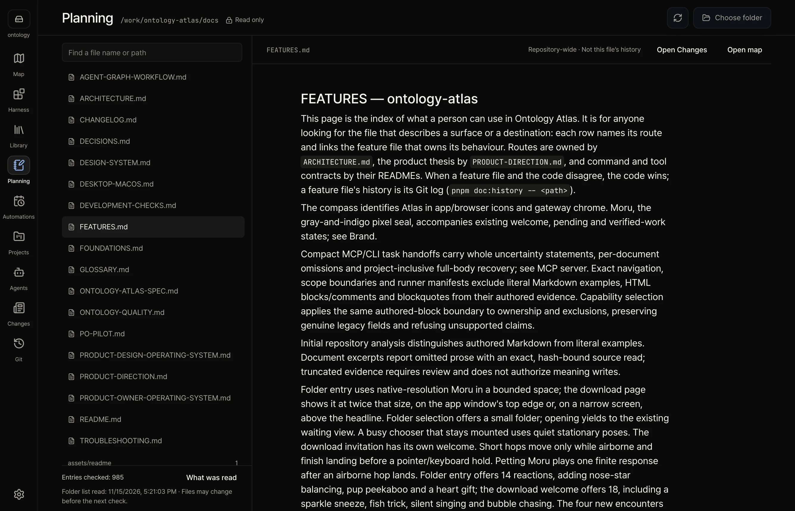

[English](README.md) | [한국어](README.ko.md) | [日本語](README.ja.md) | [简体中文](README.zh.md)

<h1 align="center">
  <picture>
    <source media="(prefers-color-scheme: dark)" srcset="public/brand/lockup-dark@2x.png" />
    
  </picture>
</h1>

<p align="center"><strong>Understand your system as AI agents change its code.</strong></p>

<p align="center">
  A map of what your code does and why, kept as Markdown in your repository<br />
  and read by both you and your coding agent.
</p>

<p align="center">
  <a href="https://ontologyatlas.com/en/download/"><strong>Download</strong></a> ·
  <a href="https://ontologyatlas.com/en/topology/">Try it in the browser</a> ·
  <a href="https://ontologyatlas.com/en/guide/">Guide</a>
</p>

<p align="center"><a href="LICENSE"></a> <a href="https://github.com/wlsdks/ontology-atlas/releases"></a> <a href="https://mcpservers.org/servers/wlsdks/ontology-atlas"></a> <a href="https://stackmap.shipwithai.xyz/repos/wlsdks/ontology-atlas"></a></p>


## Why

Coding agents now change code faster than a team can keep a picture of it in
their heads. Atlas keeps that picture beside the code: what each part is for,
which files implement it, what depends on what, and what nobody knows yet. Your
agent reads it before a task and proposes updates after; you keep, correct or
reject each change as a Markdown diff.

- **Your agent starts with context.** Claude Code, Codex, Cursor and Antigravity read the concepts, code paths, dependencies and open questions a task touches, over MCP.
- **You own the record.** One Markdown file per concept in an `atlas/` folder, versioned and reviewed in Git like the code.
- **You decide what is true.** Every agent edit is a Markdown diff you keep, correct or revert; in the app's own chat each write waits for you.
- **It says what it does not know.** A line on the map is a declared relationship, not proof of runtime impact; missing evidence shows as unknown, never as safe.

How is this different from a code graph, a wiki, Obsidian or `CLAUDE.md`? See
[Atlas compared](docs/guide/atlas-compared.md), which also says when those are the better choice.

## Quick start

1. **Install** the app from the [download page](https://ontologyatlas.com/en/download/), or open the [browser version](https://ontologyatlas.com/en/topology/).
2. **Open a folder.** Atlas reads its Markdown in place, or starts an `atlas/` folder in your repository, and shows the path before it writes anything.
3. **Connect your agent.** In **Agents › MCP**, press **Connect** for your tool, restart the agent, and ask about your next task.

macOS (Apple Silicon) is signed and notarized and carries the MCP server inside the app. Windows x64 is an unsigned beta. On Linux, use the browser version or run the [CLI and MCP server from a source checkout](cli/README.md#set-up-from-a-source-checkout). [Releases](https://github.com/wlsdks/ontology-atlas/releases) list each version's files and checksums.

## See it


**Map** — select a concept and the lines to what it depends on and what uses it light up; the panel names each one. Flat, Hex, Domain structure, a 3D tree and Neural are views of the same concepts. [Map](docs/features/map/README.md)

<table>
<tr>
<td width="50%"><br /><b>Map · Neural</b> — the same concepts as a volume you can turn; select one to see what it depends on and what uses it.</td>
<td width="50%"><br /><b>Projects</b> — what a project is for, how it divides into domains, and what each domain holds.</td>
</tr>
<tr>
<td width="50%"><br /><b>Library</b> — documents in, cited wiki pages out; find a passage, then check it in the source.</td>
<td width="50%"><br /><b>Planning</b> — write plans as Markdown in the open folder's <code>planning/</code>, in the app or the browser; the macOS app can also read another folder in place.</td>
</tr>
<tr>
<td width="50%"><br /><b>Changes</b> — what was merged in a period, counted and grouped, with the pull requests, commits and files behind it.</td>
<td width="50%"><br /><b>Git</b> — each commit by the concepts it changed; an edited document shows up here before you commit it.</td>
</tr>
<tr>
<td width="50%"><br /><b>Harness</b> — what an agent reads in your repository, what stops it before it acts, and what checks its work.</td>
<td width="50%"><br /><b>Automations</b> — scheduled checks, and what each run found.</td>
</tr>
</table>

## How it works

```text
your-repo/
├── src/
└── atlas/                 ← cloned, branched and reviewed with the code
    ├── project.md
    ├── domains/  capabilities/  elements/
    ├── sources/           documents kept exactly as they arrived
    └── wiki/              pages written from those sources, every fact cited
```

A Markdown file whose frontmatter has `kind:` is one concept: a **project**, a
**domain** (a lasting responsibility), a **capability** (something the system
does) or an **element** (a part two or more capabilities share). Its `uid` never
changes, its `slug` is its current address, and its `path` names the code it
describes. This one is abridged from this repository's own map, in
[`docs/ontology/`](docs/ontology/capabilities/vault-graph-query.md):

```markdown
---
uid: 7c451ebd-9cd0-41a9-bc37-044affac786a
slug: capabilities/vault-graph-query
kind: capability
title: Vault graph query
domain: domains/meaning-layer
path: mcp/src/tools/graph.mjs
dependencies: [elements/graph-compiler, elements/graph-engine, elements/vault-file-store]
---

## Definition
Compiles the folder of Markdown files into one typed graph and answers
structural questions over it, so a person or agent can ask what a node touches
without opening every file.

## Excludes
- Writing anything back to the vault.

## Uncertainty
- The engine is roughly 6,400 lines and was not read beyond its header.
```

The map, documents, Library and Git screens all read these files, and so does
your agent. The MCP server has 40 tools, 24 that read and 16 that write; these
answer the questions an agent asks most:

| Before or after a task, the agent asks | Tool |
|---|---|
| What is this part for, and what does it exclude? | `get_concept` |
| What points at it, before I rename or delete it? | `find_backlinks` |
| How are these two concepts connected? | `find_path` |
| What may this change affect? | `query_ontology` with `impact` |
| Where is this mentioned? | `find_evidence` |
| Record what I just built or changed | `add_concepts`, `add_relations`, `patch_concept` |
| Is the folder still consistent? | `validate_vault` |

Register the server read-only and it offers only the 24 read tools
([MCP reference](mcp/README.md#read-only-registration-oatlas_read_only)).

Your agent reaches the folder two ways:

- **MCP:** the agent starts the Atlas MCP server, which reads and writes the folder on disk, even with the app closed. [Connect an agent](docs/guide/connect-agent.md) · [MCP reference](mcp/README.md)
- **ACP:** Claude Agent and Codex also run in the app's own chat, where you allow or reject their writes. [Agents](docs/features/agents.md)

## Local-first

- No backend, account or telemetry. The folder stays plain Markdown on your disk.
- Model calls with your API key or a local model are opt-in, and each records its destination in `.ontology-atlas/llm-audit.jsonl`.
- A connected coding agent may send your prompt and what it reads to its own provider; Atlas's log does not cover those transfers.

[Trust](docs/guide/trust.md) · [Security](SECURITY.md)

## Limits

- **Atlas asks before an agent writes only in the app's chat.** There each file edit and Atlas write waits for you, unless you turn on Auto-approve for that folder; shell commands, deletions and paths outside the folder always ask. An agent connected over MCP writes under its own tool's permission rules. [Agents](docs/features/agents.md)
- **Library setup and checks need the app.** In a browser, Library offers the app or adding files. [Library](docs/features/library/workspace.md)
- **Changes reads public GitHub pull requests only,** after you ask, and the list may be incomplete; private pull requests are not read. [Change briefing](docs/features/change-briefing.md)
- **Git's Pull can change files anywhere in the repository,** not only in the open folder. [Git](docs/features/git.md)

## Status

Atlas is early. Our benchmark has not yet shown better answers with Atlas, and
Atlas was slower ([the correction](docs/benchmark/README.md#current-measurement-status)).
Construction trials, their failures and limits are in
[the construction measurements](docs/benchmark/CONSTRUCTION.md).

## Documentation

[What is Atlas?](docs/guide/what-is-atlas.md) · [Atlas compared](docs/guide/atlas-compared.md) · [First five minutes](docs/guide/first-five-minutes.md) · [Build the first map from your code](docs/guide/from-your-repo.md) · [What becomes a node?](docs/guide/what-becomes-a-node.md) · [Relations](docs/guide/relations.md) · [Specification](docs/ONTOLOGY-ATLAS-SPEC.md) · [Features](docs/FEATURES.md) · [CLI](cli/README.md) · [Architecture](docs/ARCHITECTURE.md)

## Contributing

Read [CONTRIBUTING.md](CONTRIBUTING.md); external pull requests come from forks.
[AGENTS.md](AGENTS.md) is the contract for people and agents alike.

```bash
pnpm install
pnpm dev
pnpm checks:changed -- --run
```

Installs refuse dependency versions published less than seven days ago;
[SECURITY.md](SECURITY.md#dependency-installs) explains the install settings
and how an urgent security fix skips the wait.

[Development checks](docs/DEVELOPMENT-CHECKS.md) covers choosing checks,
pre-push and CI, merging, lane budgets, and every repository command.

## Moru

Moru is Atlas's pixel seal companion; the compass is the app identity. The
repository includes [74 motions, 16 poses and their sources](assets/brand/moru/README.md),
with where Moru appears in the app and every drawn motion.

<p>


</p>

## License

[MIT](LICENSE). Third-party notices are in [NOTICE.md](NOTICE.md), and the full license texts in [public/third-party-licenses.txt](public/third-party-licenses.txt). The pixel mascot and its sources are described in [Brand](docs/design/brand.md).
