[English](README.md) | [한국어](README.ko.md) | [日本語](README.ja.md) | [简体中文](README.zh.md)

<h1 align="center">
  <picture>
    <source media="(prefers-color-scheme: dark)" srcset="public/brand/lockup-dark@2x.png" />
    
  </picture>
</h1>

<p align="center"><strong>Understand your system as AI agents change its code.</strong></p>

<p align="center">
  A map of what your code does and why, kept as Markdown in your repository<br />
  and read by both you and your coding agent.
</p>

<p align="center">
  <a href="https://ontologyatlas.com/en/download/"><strong>Download for macOS</strong></a> ·
  <a href="https://ontologyatlas.com/en/topology/">Try it in the browser</a> ·
  <a href="https://ontologyatlas.com/en/guide/">Guide</a>
</p>

<p align="center"><a href="LICENSE"></a> <a href="https://github.com/wlsdks/ontology-atlas/releases"></a> <a href="https://mcpservers.org/servers/wlsdks/ontology-atlas"></a> <a href="https://stackmap.shipwithai.xyz/repos/wlsdks/ontology-atlas"></a></p>

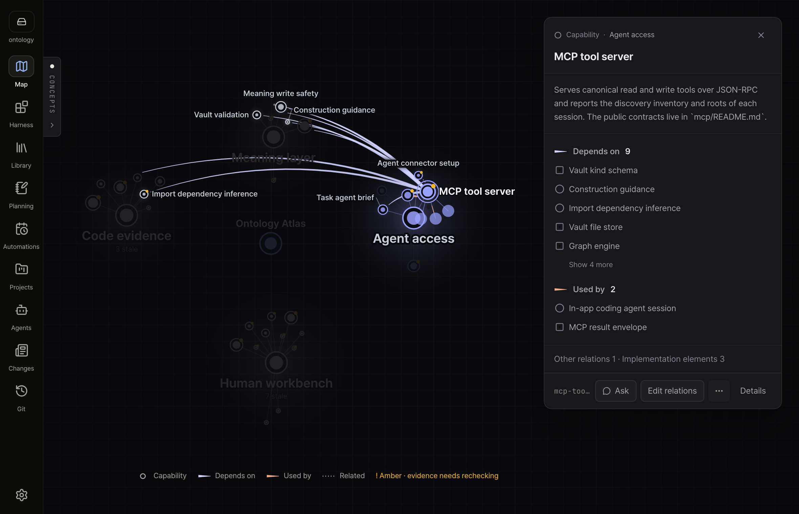

## Why

Coding agents now change code faster than a team can keep a picture of it in
their heads. Atlas keeps that picture beside the code: what each part is for,
which files implement it, what depends on what, and what nobody knows yet. Your
agent reads it before a task and proposes updates after; you keep, correct or
reject each change as a Markdown diff.

- **Your agent starts with context.** Claude Code, Codex, Cursor and Antigravity read the concepts, code paths, dependencies and open questions a task touches, over MCP.
- **You own the record.** One Markdown file per concept in an `atlas/` folder, versioned and reviewed in Git like the code.
- **You decide what is true.** Agent proposals stay proposals until you accept them.
- **It says what it does not know.** A line on the map is a declared relationship, not proof of runtime impact; missing evidence shows as unknown, never as safe.

## See it

<table>
<tr>
<td width="50%">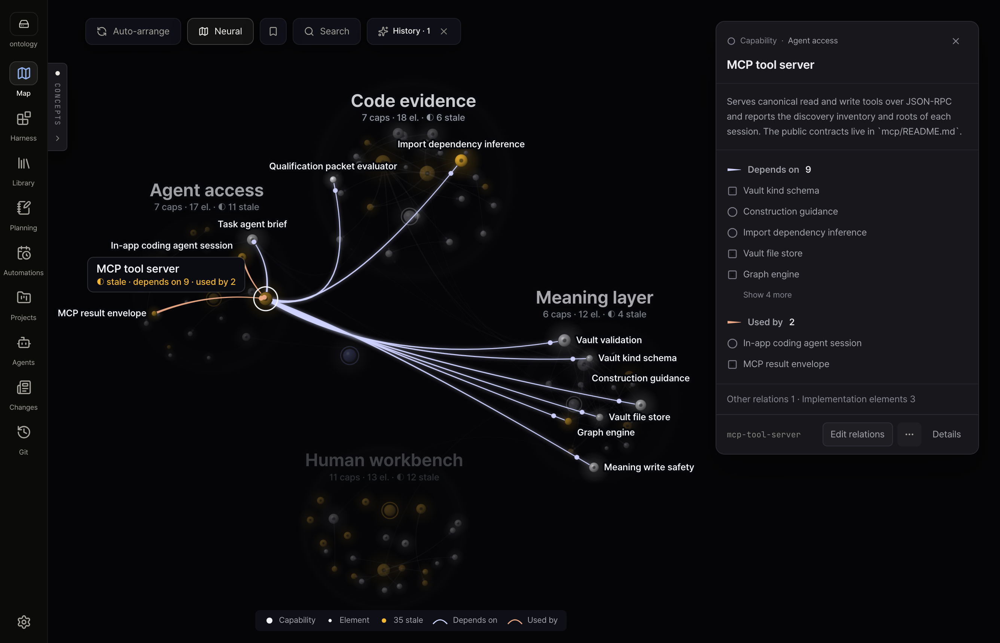<br /><b>Map · Neural</b> — the same concepts as a volume you can turn; select one to see what it depends on and what uses it.</td>
<td width="50%">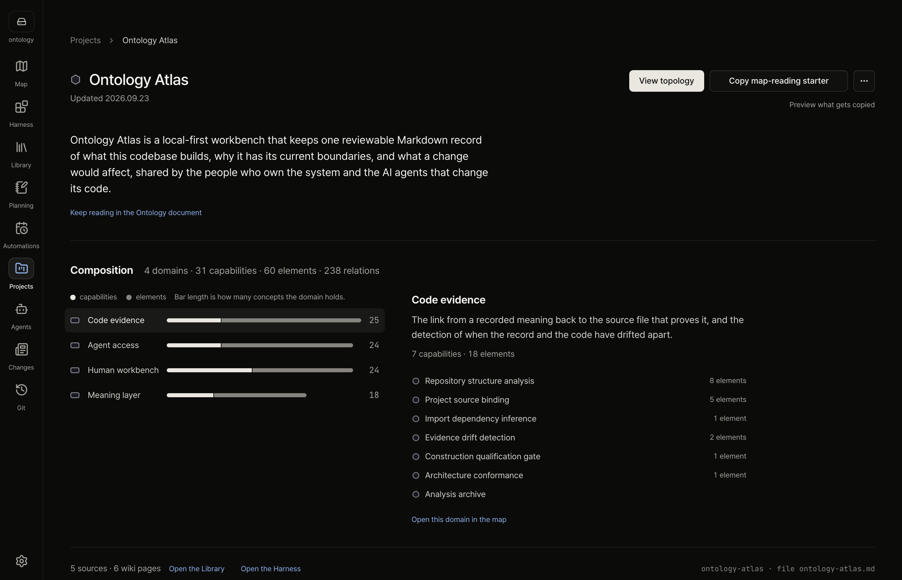<br /><b>Projects</b> — what a project is for, how it divides into domains, and what each domain holds.</td>
</tr>
<tr>
<td width="50%">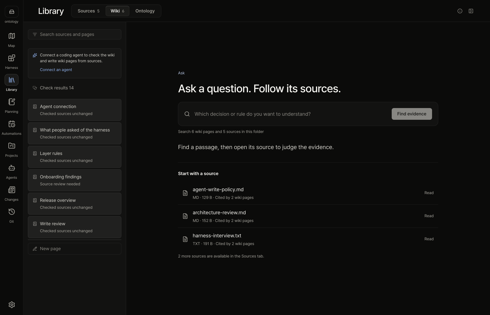<br /><b>Library</b> — documents in, cited wiki pages out; find a passage, then check it in the source.</td>
<td width="50%">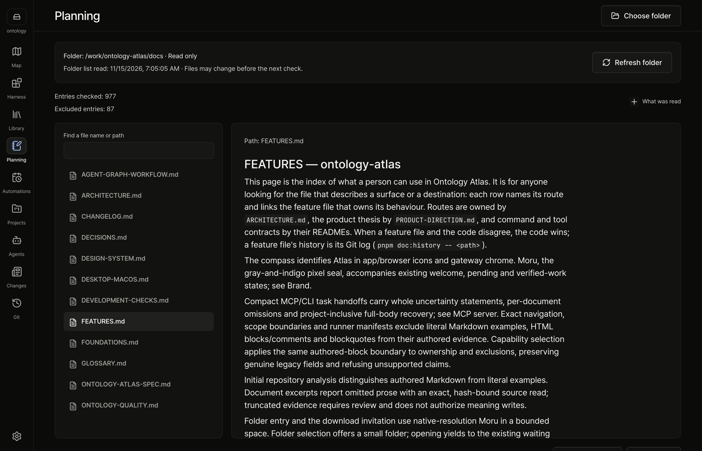<br /><b>Planning</b> — read a project folder's Markdown in place, without copying it.</td>
</tr>
<tr>
<td width="50%">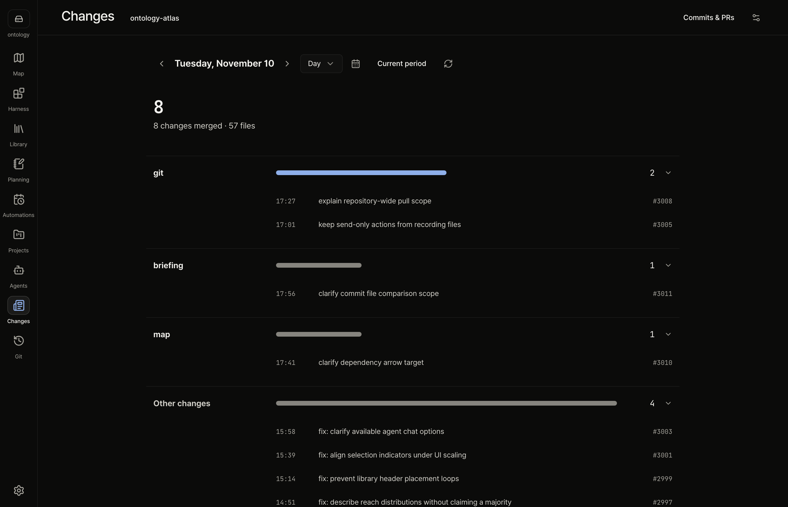<br /><b>Changes</b> — what was merged in a period, counted and grouped, with the pull requests, commits and files behind it.</td>
<td width="50%"><br /><b>Git</b> — each commit by the concepts it changed; an edited document shows up here before you commit it.</td>
</tr>
<tr>
<td width="50%">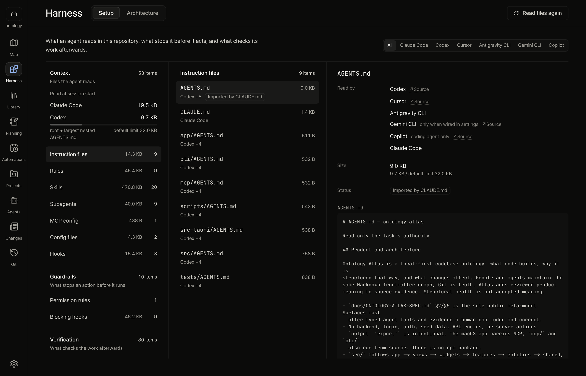<br /><b>Harness</b> — what an agent reads in your repository, what stops it before it acts, and what checks its work.</td>
<td width="50%"><br /><b>Automations</b> — scheduled checks, and what each run found.</td>
</tr>
</table>

**New in v2.0:** Neural, a view of the map drawn as a volume you can turn, beside a 3D tree; Harness Setup, which lists what an agent reads, what stops it and what checks its work; a digest of merged work at the top of Changes; and the run history of every schedule in Automations. Analysis is no longer a separate destination. See the [releases](https://github.com/wlsdks/ontology-atlas/releases).

A few things worth knowing before you start:

- The map shows declared relationships, not proof of runtime impact. It has five views: Flat, Hex, Domain structure, a 3D tree and Neural. [Map](docs/features/map/README.md)
- An empty folder offers its start actions, and a failed start can be retried without overwriting files. Popup tours are retired. [First run](docs/features/first-run.md)
- Library setup and checks need the app; a browser offers the app or adding files. [Library](docs/features/library/workspace.md)
- Planning is read-only and works in the macOS app on a folder you choose; it shows Markdown and PNG/JPEG images. [Planning](docs/FEATURES.md)
- Git's send-only action does not commit new file changes; it asks you to review a stale folder or branch again. Pull can change files across the repository. [Git](docs/features/git.md)
- Changes opens a Git repository you choose in the app, with or without an ontology. Reading public GitHub pull requests is a separate, explicit step and its list may be incomplete; private pull requests are not read. [Change briefing](docs/features/change-briefing.md)
- A project document edited since its last meaning review asks for review and explicit re-finalization; saving a change or matching a code path does not accept its meaning. [MCP server](docs/features/mcp-server.md)
- In the app's chat, each agent write waits for your permission. Codex starts read-only, and its locally configured permission profiles are not offered because their approval behaviour is not disclosed. [Agents](docs/features/agents.md) · [Features](docs/FEATURES.md)
- Before a folder is connected, the app keeps Library, Planning, Agents and Changes reachable. [Features](docs/FEATURES.md)

## Quick start

1. **Install** the app from the [download page](https://ontologyatlas.com/en/download/), or open the [browser version](https://ontologyatlas.com/en/topology/).
2. **Open a folder.** Atlas reads its Markdown in place, or starts an `atlas/` folder in your repository, and shows the path before it writes anything.
3. **Connect your agent.** In **Agents › MCP**, press **Connect** for your tool, restart the agent, and ask about your next task.

macOS (Apple Silicon) is signed and notarized and carries the MCP server inside the app. Windows x64 is an unsigned beta. On Linux, use the browser version or run the [CLI and MCP server from a source checkout](cli/README.md#set-up-from-a-source-checkout). [Releases](https://github.com/wlsdks/ontology-atlas/releases) list each version's files and checksums.

## How it works

```text
your-repo/
├── src/
└── atlas/                 ← cloned, branched and reviewed with the code
    ├── project.md
    ├── domains/  capabilities/  elements/
    ├── sources/           documents kept exactly as they arrived
    └── wiki/              pages written from those sources, every fact cited
```

A Markdown file whose frontmatter has `kind:` is one concept. Its `uid` never
changes, its `slug` is its current address, and its `path` names the code it
describes. The map, documents, Library and Git screens all read these
files.

Your agent reaches the folder two ways:

- **MCP:** the agent starts the Atlas MCP server, which reads and writes the folder on disk, even with the app closed. [Connect an agent](docs/guide/connect-agent.md) · [MCP reference](mcp/README.md)
- **ACP:** Claude Agent and Codex also run in the app's own chat; each write waits until you allow it. [Agents](docs/features/agents.md)

## Local-first

- No backend, account or telemetry. The folder stays plain Markdown on your disk.
- Model calls with your API key or a local model are opt-in, and each records its destination in `.ontology-atlas/llm-audit.jsonl`.
- A connected coding agent may send your prompt and what it reads to its own provider; Atlas's log does not cover those transfers.

[Trust](docs/guide/trust.md) · [Security](SECURITY.md)

## Status

Atlas is early. Our benchmark has not yet shown better answers with Atlas, and
Atlas was slower ([the correction](docs/benchmark/README.md#current-measurement-status)).
Construction trials, their failures and limits are in
[the construction measurements](docs/benchmark/CONSTRUCTION.md).

## Documentation

[What is Atlas?](docs/guide/what-is-atlas.md) · [First five minutes](docs/guide/first-five-minutes.md) · [What becomes a node?](docs/guide/what-becomes-a-node.md) · [Relations](docs/guide/relations.md) · [Specification](docs/ONTOLOGY-ATLAS-SPEC.md) · [Features](docs/FEATURES.md) · [CLI](cli/README.md) · [Architecture](docs/ARCHITECTURE.md)

## Contributing

Read [CONTRIBUTING.md](CONTRIBUTING.md); external pull requests come from forks.
[AGENTS.md](AGENTS.md) is the contract for people and agents alike.

```bash
pnpm install
pnpm dev
pnpm checks:changed -- --run
```

`pnpm pr:land <number>` merges a reviewed pull request and keeps its original
commits. [Development checks](docs/DEVELOPMENT-CHECKS.md) covers choosing checks,
CI internals and lane budgets.

Pre-push checks the commit being pushed and runs affected lint, unit and Node
tests in parallel with the relevant cheap checks. CI owns browser, full contract
and dependency-graph verification. Test-only edits to CI tooling run their
regressions without starting unrelated product suites; changes to the planner
implementation still require exhaustive CI.

<details>
<summary><b>Repository commands</b></summary>

| Command | What it answers |
|---|---|
| `node scripts/ci/run-playwright-ci.mjs --help` | Browser shard options, without discovering or running tests; unknown options fail before execution |
| `pnpm agents:check` | Each harness's instruction files are valid; Codex and Claude files need not match |
| `pnpm brand:sprites` | Rebuild Moru sprites, 74 animation exports, 16 poses and compass sizes from retained project sources; inspect `assets/brand/moru/preview.html` |
| `pnpm brief:new -- --slug=<slug> --owns=<path,...>` | A delegation brief with the port, scratch, checks and merge lines filled in |
| `pnpm build:static` | Reuse `out/` only for matching build inputs; fail without a reuse stamp if inputs change during the build |
| `pnpm bundle:plan` · `pnpm bundle:prune` | Plan merging several branches as one, then prune the branches main contains (`/merge`) |
| `pnpm checks:changed` | Which gates this change needs |
| `pnpm conflicts:scan` | Which open pull requests change the same files as this branch, and whether a trial merge conflicts |
| `pnpm decisions:find <terms>` · `pnpm decisions:check` | The decision to cite or overturn, and whether this change owes one |
| `pnpm design:tokens -- [--prefix=<name>]` | The current token ramps, resolved from app/styles |
| `pnpm doc:new -- --type=<kind> --area=<area> --slug=<slug>` | A new living document from its template in `docs/.templates/` |
| `pnpm docs:check` | Docs gates, including `pnpm docs:language`, `pnpm source:language`, `pnpm changelog:check`, `pnpm dev-checks:check`, `pnpm docs:meta` |
| `pnpm docs:meta` · `pnpm doc:history -- <path>` | Every living document's kind, status and area; one document's commits across moves |
| `pnpm docs:move` | Moves the documents in `docs/.moved.json` and rewrites references (`-- --check` only reports) |
| `pnpm download:repo-facts` | Records this repository's star and fork counts, with the day read, for the download page's open-source section |
| `pnpm e2e:durations -- <timings dir>` | Rebalances the browser shards from downloaded `playwright-timings-*` reports |
| `pnpm e2e:sleeps:check` | Refuses a new fixed `waitForTimeout` without a `// measurement window:` note |
| `pnpm gates:yield -- --runs=200` | Which CI checks ever failed, per run, from the lane reports CI uploads |
| `pnpm gateway:capture -- --base-url=<static export>` | Re-shoots the app screens in `public/gateway/`, in Korean and English; `--only=map,neural` re-shoots this README's two map pictures |
| `pnpm harness:tokens -- --since=<date>` | Where Claude Code tokens went per agent type, from local transcripts, and which runs broke the compaction window or turn caps ([budget](docs/engineering/agent-effort.md#token-budget)) |
| `pnpm knip` | Dead files, exports and types |
| `pnpm licenses:check` · `pnpm notice:build` · `pnpm notice:check` | Shipped packages are on the license allow-list, and `NOTICE.md` is current ([rules](docs/engineering/third-party-code.md)) |
| `pnpm messages:build` · `pnpm messages:check` · `pnpm messages:adopt` | Compose `messages/<locale>.json` from one file per namespace, prove it current, and carry an old branch's edits |
| `pnpm messages:coverage -- --locale <code>` | Checks one locale's strings against `en`: arguments, plurals, script, keep-terms and typography |
| `pnpm perf:mcp:memory` · `pnpm perf:mcp:memory:check` | Whether the MCP server releases memory across repeated calls; about a minute |
| `pnpm pr:ci <n>` | Fire CI on a draft now |
| `pnpm pr:land --plan <n...>` · `pnpm pr:land --conduct` | Dry-run a merge, or merge queued pull requests until the queue is empty |
| `pnpm pr:land <n>` · `pnpm pr:queue` | Queue a pull request to merge (green ones merge together behind one CI run), and show the queue |
| `pnpm review:facts -- --base=<ref>` | The mechanical facts a reviewer would otherwise count by hand: line growth, 800-line files, export and dependency changes, untouched sibling tests, security paths |
| `pnpm seo:check` | After `pnpm build`: every sitemap URL in `out/` canonicalizes to itself, `/` and each locale root point at `/{locale}/download/`, and titles and descriptions are unique per locale |
| `pnpm typecheck` | Types across every file, with Next's generated route and page types |
| `pnpm ui:audit -- --url=<base> --route=<path> [--setup=<module.mjs>]` | Prepare an interactive state with an optional local module, then measure rendered facts per width: horizontal overflow, occluded or unreachable controls, small touch targets, off-ramp type/radius/shadow values, low contrast, unequal repeated sets, scroll-end reserve |
| `pnpm ui:look -- --route=<path> [--vault=fixture\|sample\|<dir>] [--widths=1440] [--audit]` | Builds and serves the static export on a free port (or uses `--url`), opens each route with a vault attached, and prints one screenshot path per route and width |

Use `--scope=<selector>` to audit one visible modal or region. The selector must match exactly one visible element; the report includes its measured element count.

</details>

## Moru

Moru is Atlas's pixel seal companion; the compass is the app identity. The repository includes [74 motions, 16 poses and their sources](assets/brand/moru/README.md): 58 drawn motions and 16 scenes composed from them. Open the [local motion studio](assets/brand/moru/preview.html) to play, pause and inspect every frame.

<p>


</p>

**Where Moru appears.** At folder entry Moru greets you, holds out a small folder and waits; once a folder starts opening, play gives way to the waiting view. The download page has its own welcome. Reading a source, waiting for your permission and celebrating a finished check appear only when the app has observed that state, so Moru never shows progress nobody confirmed.

**Petting.** Press Moru for one short response. The first is gentle, the second reveals a playful one, and after that Moru works through everything it knows while avoiding the last two: 14 responses at folder entry, 18 on the download welcome. A small wordless bubble sometimes answers with a heart, a note or a sparkle, and a pup peeks out once in a long idle.

**Staying out of the way.** Moru moves only while airborne, and lands before it waits under your pointer. While work is pending it stays quiet and in place. Pause and resume live in Moru's menu (right-click or Shift+F10), with no playback button beside the character, and reduced motion answers with a still expression.

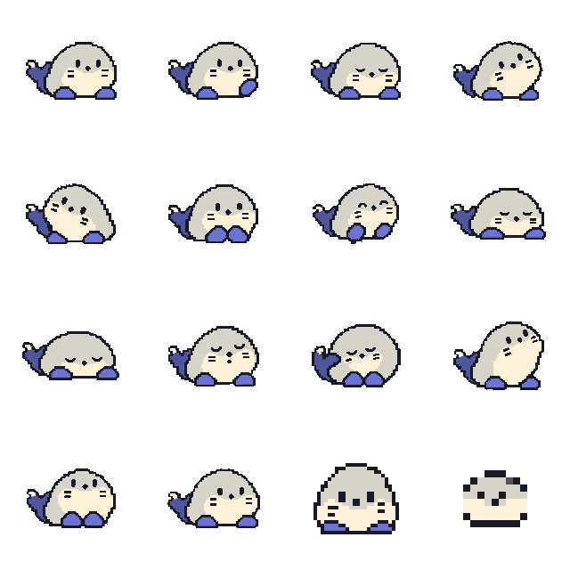

<details>
<summary>All 58 drawn motions</summary>

<p><b>Waiting</b></p>

<p>


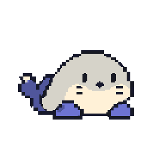


</p>

<p><b>Greeting</b></p>

<p>


</p>

<p><b>At work</b></p>

<p>


</p>

<p><b>Feelings</b></p>

<p>


</p>

<p><b>Play</b></p>

<p>


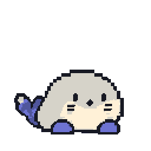

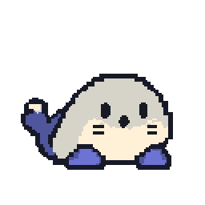
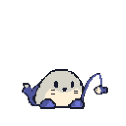
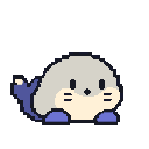

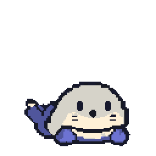


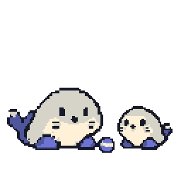
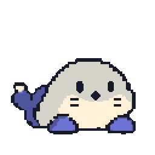

</p>

<p><b>Scenes</b></p>

<p>
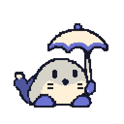
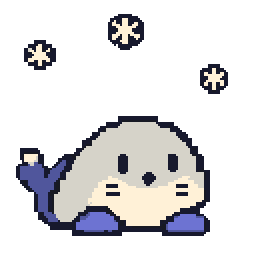
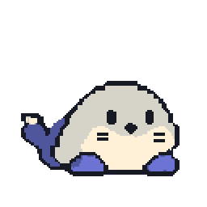

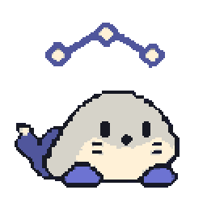
</p>

</details>

## License

[MIT](LICENSE). Third-party notices are in [NOTICE.md](NOTICE.md), and the full license texts in [public/third-party-licenses.txt](public/third-party-licenses.txt). The pixel mascot and its sources are described in [Brand](docs/design/brand.md).
