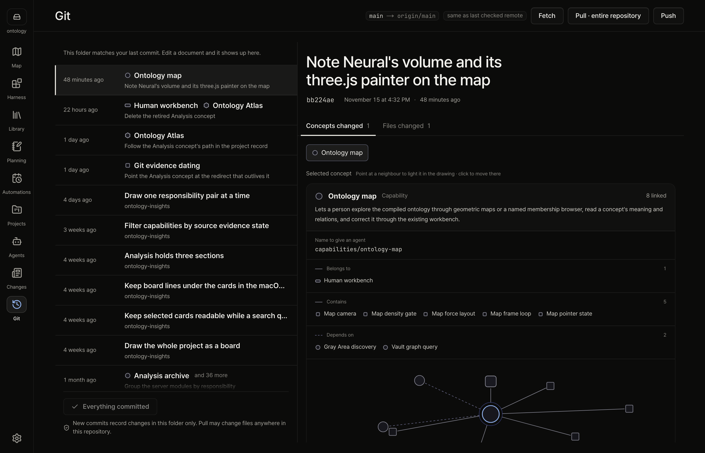
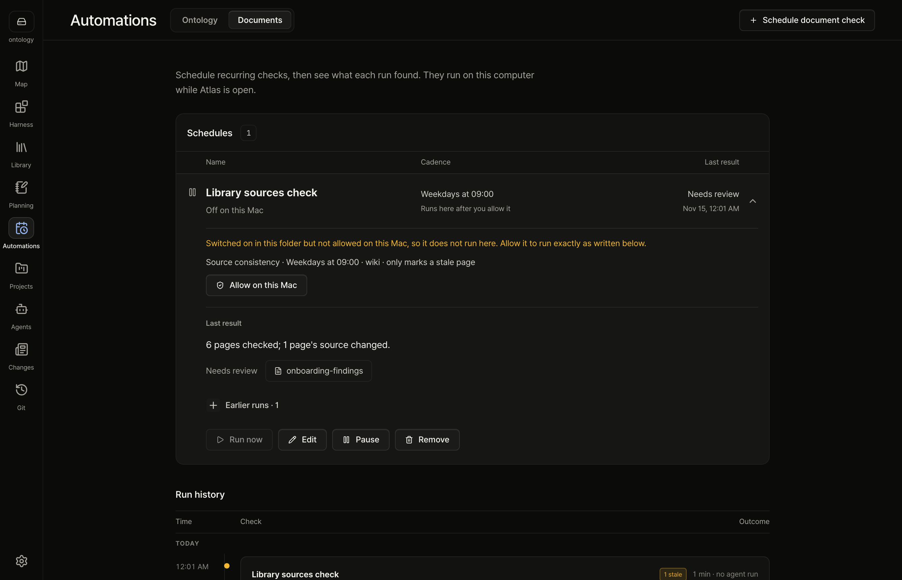

[English](README.md) | [한국어](README.ko.md) | [日本語](README.ja.md) | [简体中文](README.zh.md)

<h1 align="center">
  <picture>
    <source media="(prefers-color-scheme: dark)" srcset="public/brand/lockup-dark@2x.png" />
    
  </picture>
</h1>

<p align="center"><strong>Understand your system as AI agents change its code.</strong></p>

<p align="center">
  A map of what your code does and why, kept as Markdown in your repository<br />
  and read by both you and your coding agent.
</p>

<p align="center">
  <a href="https://ontologyatlas.com/en/download/"><strong>Download</strong></a> ·
  <a href="https://ontologyatlas.com/en/topology/">Try it in the browser</a> ·
  <a href="https://ontologyatlas.com/en/guide/">Guide</a>
</p>

<p align="center"><a href="LICENSE"></a> <a href="https://github.com/wlsdks/ontology-atlas/releases"></a> <a href="https://mcpservers.org/servers/wlsdks/ontology-atlas"></a> <a href="https://stackmap.shipwithai.xyz/repos/wlsdks/ontology-atlas"></a></p>


## Why

Coding agents now change code faster than a team can keep a picture of it in
their heads. Atlas keeps that picture beside the code: what each part is for,
which files implement it, what depends on what, and what nobody knows yet. Your
agent reads it before a task and proposes updates after; you keep, correct or
reject each change as a Markdown diff.

- **Your agent starts with context.** Claude Code, Codex, Cursor and Antigravity read the concepts, code paths, dependencies and open questions a task touches, over MCP.
- **You own the record.** One Markdown file per concept in an `atlas/` folder, versioned and reviewed in Git like the code.
- **You decide what is true.** Agent proposals stay proposals until you accept them.
- **It says what it does not know.** A line on the map is a declared relationship, not proof of runtime impact; missing evidence shows as unknown, never as safe.

## Quick start

1. **Install** the app from the [download page](https://ontologyatlas.com/en/download/), or open the [browser version](https://ontologyatlas.com/en/topology/).
2. **Open a folder.** Atlas reads its Markdown in place, or starts an `atlas/` folder in your repository, and shows the path before it writes anything.
3. **Connect your agent.** In **Agents › MCP**, press **Connect** for your tool, restart the agent, and ask about your next task.

macOS (Apple Silicon) is signed and notarized and carries the MCP server inside the app. Windows x64 is an unsigned beta. On Linux, use the browser version or run the [CLI and MCP server from a source checkout](cli/README.md#set-up-from-a-source-checkout). [Releases](https://github.com/wlsdks/ontology-atlas/releases) list each version's files and checksums.

## See it


**Map** — select a concept and the lines to what it depends on and what uses it light up; the panel names each one. Flat, Hex, Domain structure, a 3D tree and Neural are views of the same concepts. [Map](docs/features/map/README.md)

<table>
<tr>
<td width="50%"><br /><b>Map · Neural</b> — the same concepts as a volume you can turn; select one to see what it depends on and what uses it.</td>
<td width="50%"><br /><b>Projects</b> — what a project is for, how it divides into domains, and what each domain holds.</td>
</tr>
<tr>
<td width="50%"><br /><b>Library</b> — documents in, cited wiki pages out; find a passage, then check it in the source.</td>
<td width="50%"><br /><b>Planning</b> — write plans as Markdown in the open folder's <code>planning/</code>, in the app or the browser; the macOS app can also read another folder in place.</td>
</tr>
<tr>
<td width="50%"><br /><b>Changes</b> — what was merged in a period, counted and grouped, with the pull requests, commits and files behind it.</td>
<td width="50%"><br /><b>Git</b> — each commit by the concepts it changed; an edited document shows up here before you commit it.</td>
</tr>
<tr>
<td width="50%"><br /><b>Harness</b> — what an agent reads in your repository, what stops it before it acts, and what checks its work.</td>
<td width="50%"><br /><b>Automations</b> — scheduled checks, and what each run found.</td>
</tr>
</table>

## How it works

```text
your-repo/
├── src/
└── atlas/                 ← cloned, branched and reviewed with the code
    ├── project.md
    ├── domains/  capabilities/  elements/
    ├── sources/           documents kept exactly as they arrived
    └── wiki/              pages written from those sources, every fact cited
```

A Markdown file whose frontmatter has `kind:` is one concept. Its `uid` never
changes, its `slug` is its current address, and its `path` names the code it
describes. The map, documents, Library and Git screens all read these
files.

Your agent reaches the folder two ways:

- **MCP:** the agent starts the Atlas MCP server, which reads and writes the folder on disk, even with the app closed. [Connect an agent](docs/guide/connect-agent.md) · [MCP reference](mcp/README.md)
- **ACP:** Claude Agent and Codex also run in the app's own chat, where you allow or reject their writes. [Agents](docs/features/agents.md)

## Local-first

- No backend, account or telemetry. The folder stays plain Markdown on your disk.
- Model calls with your API key or a local model are opt-in, and each records its destination in `.ontology-atlas/llm-audit.jsonl`.
- A connected coding agent may send your prompt and what it reads to its own provider; Atlas's log does not cover those transfers.

[Trust](docs/guide/trust.md) · [Security](SECURITY.md)

## Limits

- **Atlas asks before an agent writes only in the app's chat.** There each file edit and Atlas write waits for you, unless you turn on Auto-approve for that folder; shell commands, deletions and paths outside the folder always ask. An agent connected over MCP writes under its own tool's permission rules. [Agents](docs/features/agents.md)
- **Library setup and checks need the app.** In a browser, Library offers the app or adding files. [Library](docs/features/library/workspace.md)
- **Changes reads public GitHub pull requests only,** after you ask, and the list may be incomplete; private pull requests are not read. [Change briefing](docs/features/change-briefing.md)
- **Git's Pull can change files anywhere in the repository,** not only in the open folder. [Git](docs/features/git.md)

## Status

Atlas is early. Our benchmark has not yet shown better answers with Atlas, and
Atlas was slower ([the correction](docs/benchmark/README.md#current-measurement-status)).
Construction trials, their failures and limits are in
[the construction measurements](docs/benchmark/CONSTRUCTION.md).

## Documentation

[What is Atlas?](docs/guide/what-is-atlas.md) · [First five minutes](docs/guide/first-five-minutes.md) · [What becomes a node?](docs/guide/what-becomes-a-node.md) · [Relations](docs/guide/relations.md) · [Specification](docs/ONTOLOGY-ATLAS-SPEC.md) · [Features](docs/FEATURES.md) · [CLI](cli/README.md) · [Architecture](docs/ARCHITECTURE.md)

## Contributing

Read [CONTRIBUTING.md](CONTRIBUTING.md); external pull requests come from forks.
[AGENTS.md](AGENTS.md) is the contract for people and agents alike.

```bash
pnpm install
pnpm dev
pnpm checks:changed -- --run
```

Installs refuse dependency versions published less than seven days ago;
[SECURITY.md](SECURITY.md#dependency-installs) explains the install settings
and how an urgent security fix skips the wait.

[Development checks](docs/DEVELOPMENT-CHECKS.md) covers choosing checks,
pre-push and CI, merging, and lane budgets.

<details>
<summary><b>Repository commands</b></summary>

| Command | What it answers |
|---|---|
| `node scripts/ci/run-playwright-ci.mjs --help` | Browser shard options, including `--only` for a named set of spec files, without discovering or running tests; unknown options fail before execution |
| `pnpm agents:check` | Each harness's instruction files are valid; Codex and Claude files need not match |
| `pnpm brand:sprites` | Rebuild Moru sprites, 74 animation exports, 16 poses and compass sizes from retained project sources; inspect `assets/brand/moru/preview.html` |
| `pnpm brief:new -- --slug=<slug> --owns=<path,...>` | A delegation brief with the port, scratch, checks and merge lines filled in |
| `pnpm build:first-load -- out en en/topology` | Per route, the JavaScript its HTML loads up front (raw and brotli KB) and any generated JSON literal over 50 KB; fails on a page naming no chunks, a missing chunk, or an oversize literal. `pnpm build` runs it for `en`, `en/topology` and `en/download`; `--allow-json=<route>` exempts a route |
| `pnpm build:static` | Reuse `out/` only for matching build inputs; fail without a reuse stamp if inputs change during the build |
| `pnpm bundle:plan` · `pnpm bundle:prune` | Plan merging several branches as one, then prune the branches main contains (`/merge`) |
| `pnpm checks:changed` | Which gates this change needs |
| `pnpm conflicts:scan` | Which open pull requests change the same files as this branch, and whether a trial merge conflicts |
| `pnpm decisions:find <terms>` · `pnpm decisions:check` | The decision to cite or overturn, and whether this change owes one |
| `pnpm design:tokens -- [--prefix=<name>]` | The current token ramps, resolved from app/styles |
| `pnpm dev:clean` | Delete the Turbopack dev cache in `.next/dev`; `pnpm dev` reuses it, so a warm start reaches the first route in about 3 s instead of 7 s |
| `pnpm doc:new -- --type=<kind> --area=<area> --slug=<slug>` | A new living document from its template in `docs/.templates/` |
| `pnpm docs:check` | Docs gates, including `pnpm docs:language`, `pnpm source:language`, `pnpm changelog:check`, `pnpm dev-checks:check`, `pnpm docs:meta` |
| `pnpm docs:meta` · `pnpm doc:history -- <path>` | Every living document's kind, status and area; one document's commits across moves |
| `pnpm docs:move` | Moves the documents in `docs/.moved.json` and rewrites references (`-- --check` only reports) |
| `pnpm download:repo-facts` | Records this repository's star and fork counts, with the day read, for the download page's open-source section |
| `pnpm e2e:durations -- <timings dir>` | Rebalances the browser shards from downloaded `playwright-timings-*` reports |
| `pnpm e2e:sleeps:check` | Refuses a new fixed `waitForTimeout` without a `// measurement window:` note |
| `pnpm gates:yield -- --runs=200` | Which CI checks ever failed, per run, from the lane reports CI uploads |
| `pnpm gateway:capture -- --base-url=<static export>` | Re-shoots the app screens in `public/gateway/`, in Korean and English; `--only=map,neural` re-shoots this README's two map pictures; `--only=harness-film` re-shoots the download page's harness film stills in all four languages |
| `pnpm harness:tokens -- --since=<date>` | Where Claude Code tokens went per agent type, from local transcripts, and which runs broke the compaction window or turn caps ([budget](docs/engineering/agent-effort.md#token-budget)) |
| `pnpm knip` | Dead files, exports and types |
| `pnpm licenses:check` · `pnpm notice:build` · `pnpm notice:check` | Shipped packages are on the license allow-list, and `NOTICE.md` is current ([rules](docs/engineering/third-party-code.md)) |
| `pnpm messages:build` · `pnpm messages:check` · `pnpm messages:adopt` | Compose `messages/<locale>.json` from one file per namespace, prove it current, and carry an old branch's edits |
| `pnpm messages:coverage -- --locale <code>` | Checks one locale's strings against `en`: arguments, plurals, script, keep-terms and typography |
| `pnpm og:build` | Re-render the 1200×630 link-preview card for each locale into `public/og/` and `public/og-image.png` from the download headline; macOS for the Japanese and Chinese faces |
| `pnpm perf:mcp:memory` · `pnpm perf:mcp:memory:check` | Whether the MCP server releases memory across repeated calls; about a minute |
| `pnpm perf:mcp:scale -- --files=50000 --flow=a --flow=b` | CPU of each MCP read's first and second call (`get_concept`, `find_backlinks`, `find_path`, `compile_ontology`, `find_evidence`), and memory after 20 calls, on a generated vault (`a`: every page a node; `b`: a few thousand nodes among plain pages); `--server=<binary>` measures a compiled server; `--check` (50,000 files, both flows) gates the compiled binary (`pnpm mcp:build-binary` output by default) at 600 ms per second call and, on macOS, a physical footprint of 175 MB after 20 calls and 430 MB at peak; RSS is printed, never gated; then it prints the source server's figures ungated |
| `pnpm perf:vault-index -- --files=10000 --files=50000 --shape=key --shape=all --check` | The installed app's search index on generated vaults: build, reopen, one-file update, ranked search, size and peak memory against their limits; a few minutes |
| `pnpm pr:ci <n>` | Mark a finished draft ready so its CI runs before `pnpm pr:land` |
| `pnpm pr:land --plan <n...>` · `pnpm pr:land --conduct` | Dry-run a merge, or merge queued pull requests until the queue is empty |
| `pnpm pr:land <n>` · `pnpm pr:queue` | Merge a pull request: on its own CI when its branch contains main and no train overlaps, otherwise on a train; and show the queue. While `main`'s full browser run is red it names the failing specs and still merges |
| `pnpm review:facts -- --base=<ref>` | The mechanical facts a reviewer would otherwise count by hand: line growth, 800-line files, export and dependency changes, untouched sibling tests, security paths |
| `pnpm seo:check` | After `pnpm build`: every sitemap URL in `out/` canonicalizes to itself, `/` and each locale root point at `/{locale}/download/`, and titles and descriptions are unique per locale |
| `pnpm typecheck` | Types across every file, with Next's generated route and page types |
| `pnpm ui:audit -- --url=<base> --route=<path> [--setup=<module.mjs>]` | Prepare an interactive state with an optional local module, then measure rendered facts per width: horizontal overflow, occluded or unreachable controls, small touch targets, off-ramp type/radius/shadow values, low contrast, unequal repeated sets, scroll-end reserve |
| `pnpm unit:durations -- <timings dir>` | Rebalances the Unit · Contract shards from downloaded `vitest-timings-*` artifacts of a full run |
| `pnpm ui:look -- --route=<path> [--vault=fixture\|sample\|<dir>] [--widths=1440] [--audit]` | Builds and serves the static export on a free port (or uses `--url`), opens each route with a vault attached, and prints one screenshot path per route and width |

Use `--scope=<selector>` to audit one visible modal or region. The selector must match exactly one visible element; the report includes its measured element count.

</details>

## Moru

Moru is Atlas's pixel seal companion; the compass is the app identity. The
repository includes [74 motions, 16 poses and their sources](assets/brand/moru/README.md),
with where Moru appears in the app and every drawn motion.

<p>


</p>

## License

[MIT](LICENSE). Third-party notices are in [NOTICE.md](NOTICE.md), and the full license texts in [public/third-party-licenses.txt](public/third-party-licenses.txt). The pixel mascot and its sources are described in [Brand](docs/design/brand.md).
