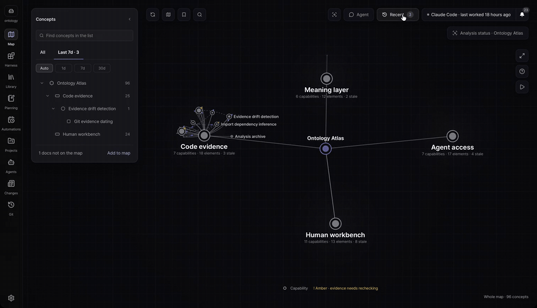
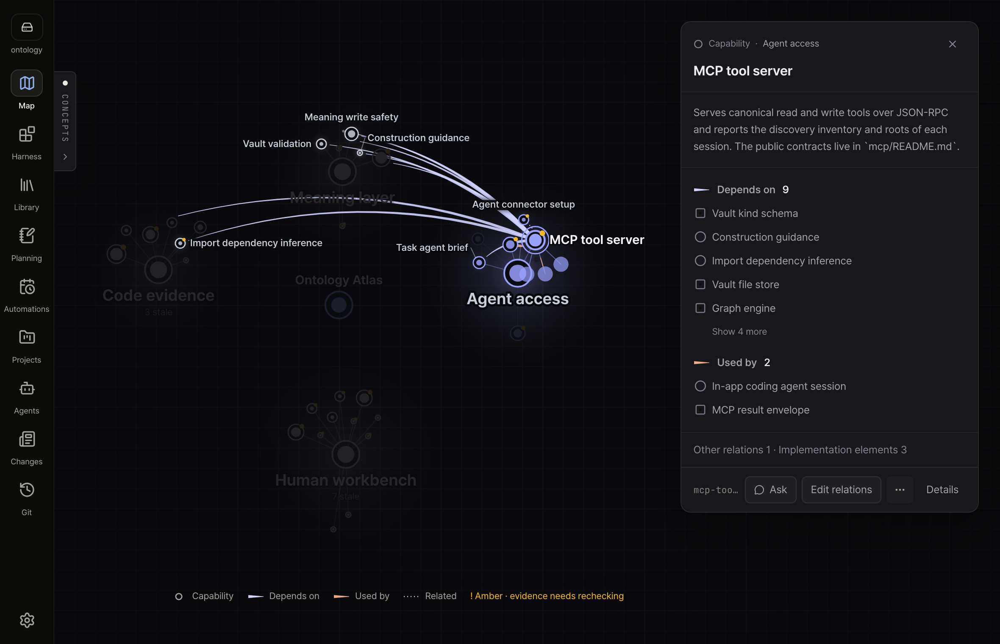
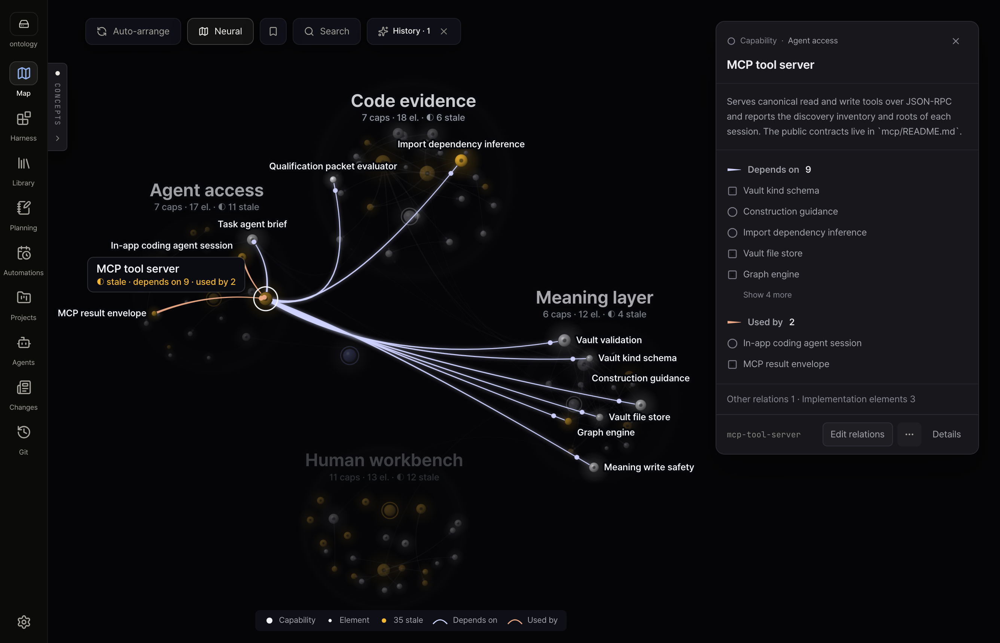
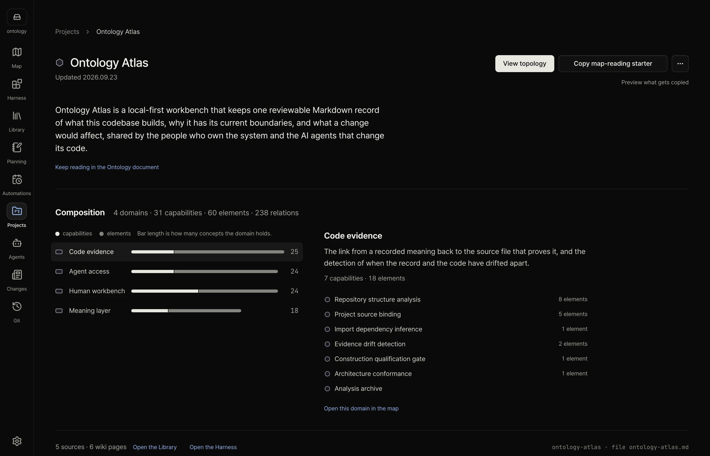
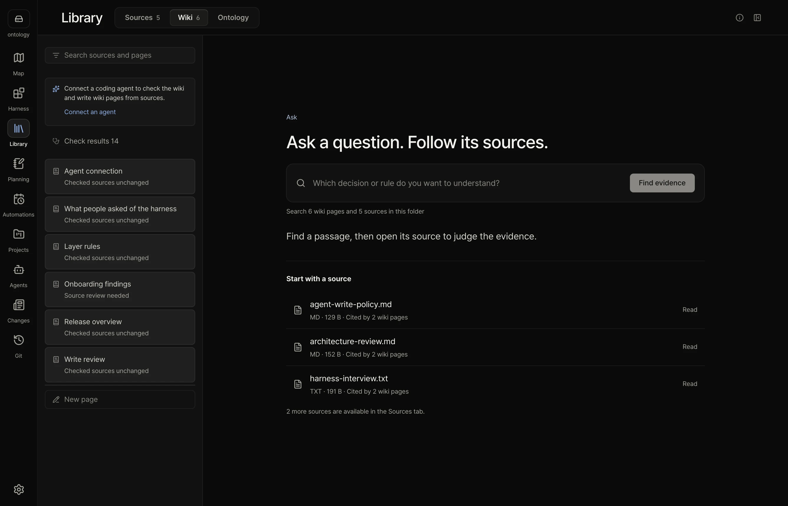
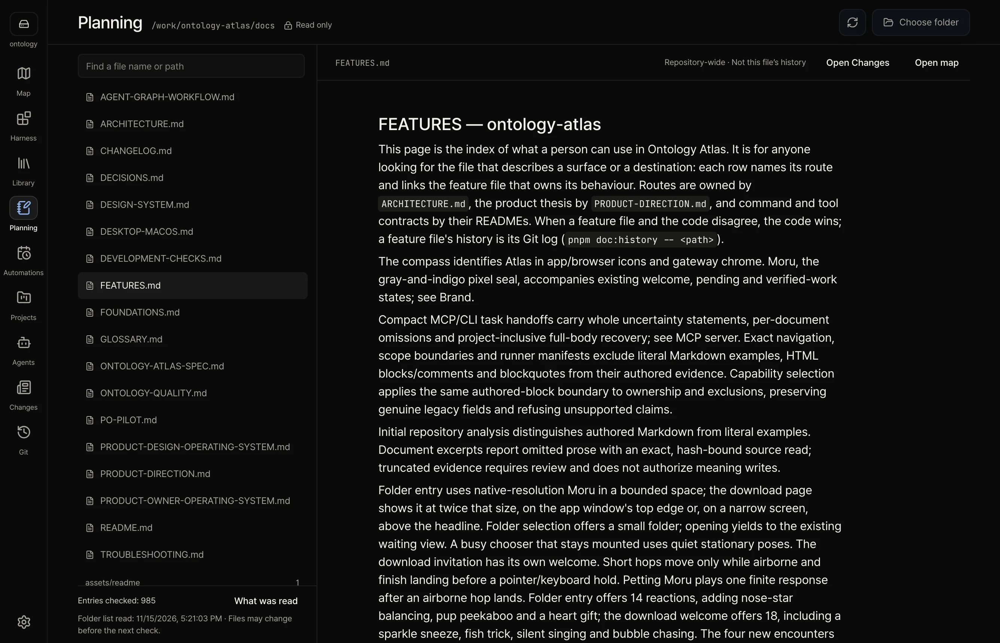
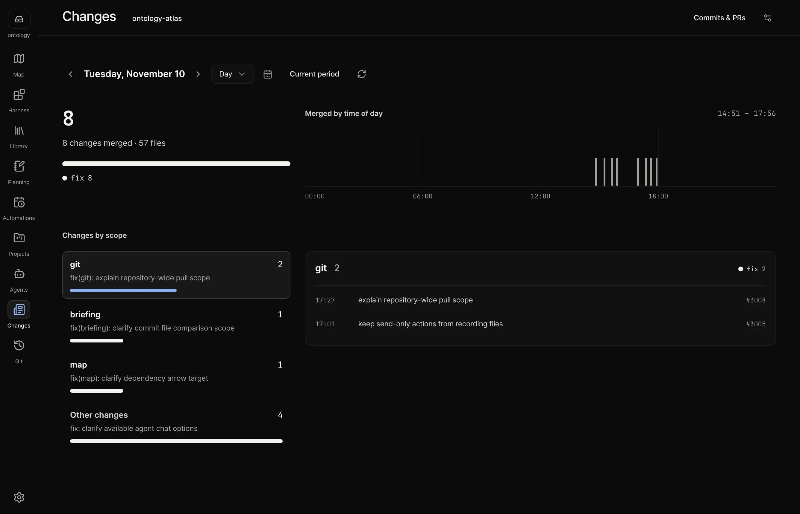
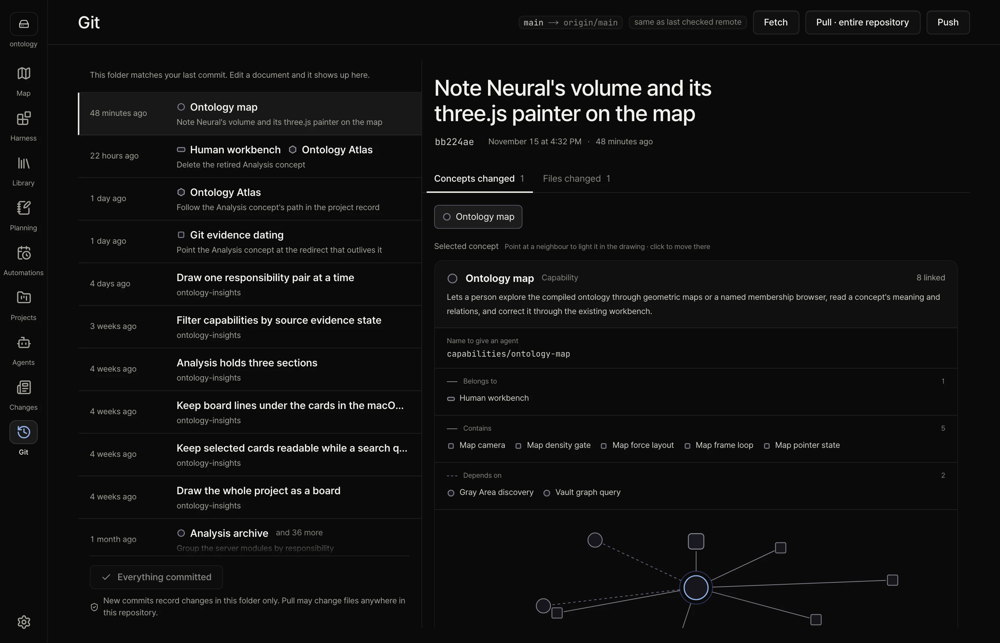
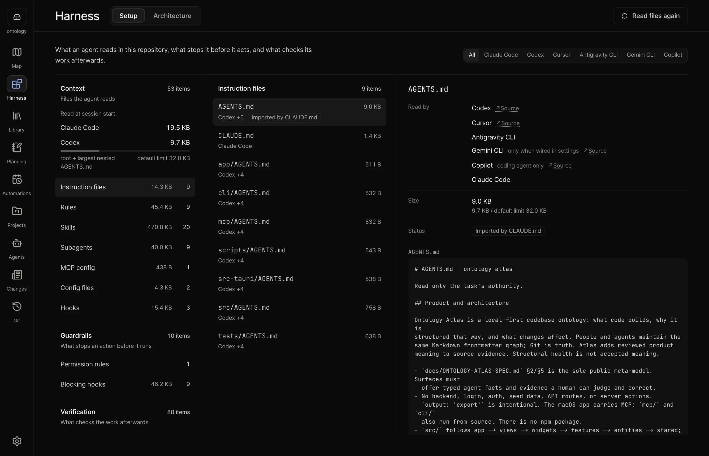
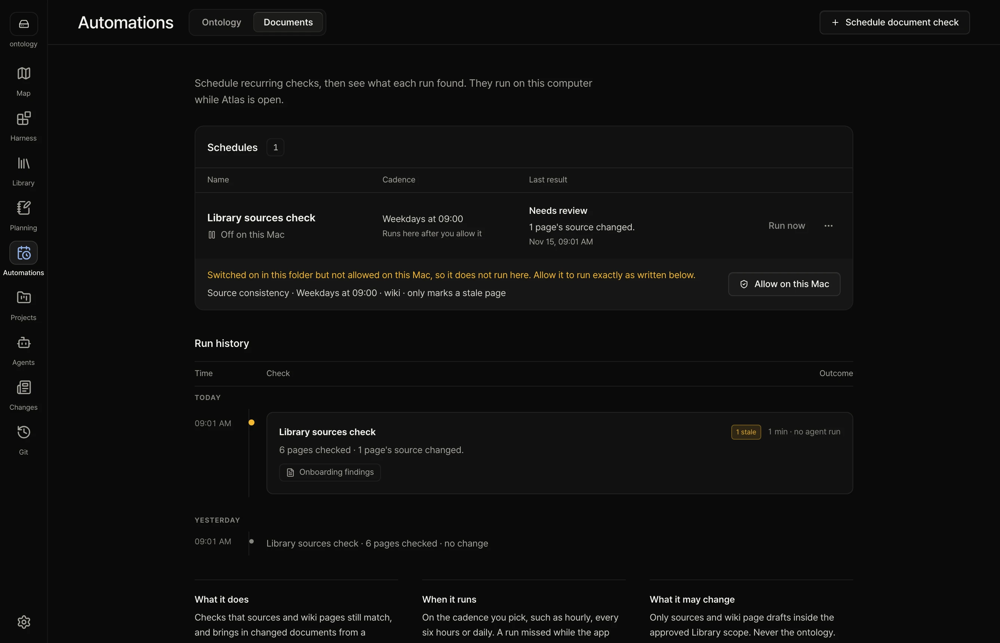

[English](README.md) | [한국어](README.ko.md) | [日本語](README.ja.md) | [简体中文](README.zh.md) | [Türkçe](README.tr.md)

<h1 align="center">
  <picture>
    <source media="(prefers-color-scheme: dark)" srcset="public/brand/lockup-dark@2x.png" />
    
  </picture>
</h1>

<p align="center"><strong>Yapay zekâ ajanları kodunuzu değiştirirken sisteminizi anlamaya devam edin.</strong></p>

<p align="center">
  Kodunuzun ne yaptığını ve neden öyle olduğunu gösteren, deponuzda Markdown olarak tutulan<br />
  ve hem sizin hem de kodlama ajanınızın okuduğu bir harita.
</p>

<p align="center">
  <a href="https://ontologyatlas.com/en/download/"><strong>İndir</strong></a> ·
  <a href="https://ontologyatlas.com/en/topology/">Tarayıcıda dene</a> ·
  <a href="https://ontologyatlas.com/en/guide/">Kılavuz</a>
</p>

<p align="center"><a href="LICENSE"></a> <a href="https://github.com/wlsdks/ontology-atlas/releases"></a> <a href="https://mcpservers.org/servers/wlsdks/ontology-atlas"></a> <a href="https://stackmap.shipwithai.xyz/repos/wlsdks/ontology-atlas"></a> <a href="https://glama.ai/mcp/servers/wlsdks/ontology-atlas"></a></p>



## Neden

Kodlama ajanları artık kodu bir ekibin zihninde tutabileceğinden daha hızlı değiştiriyor. Atlas bu resmi kodun hemen yanında tutar: her parçanın ne işe yaradığını, hangi dosyaların onu uyguladığını, neyin neye bağlı olduğunu ve henüz nelerin bilinmediğini. Ajanınız bir görevden önce bunu okur ve görevden sonra güncellemeler önerir; siz de her değişikliği bir Markdown farkı (diff) olarak korur, düzeltir veya reddedersiniz.

- **Ajanınız bağlamla başlar.** Claude Code, Codex, Cursor ve Antigravity, MCP üzerinden bir görevin dokunduğu kavramları, kod yollarını, bağımlılıkları ve açık soruları okur.
- **Kaydın sahibi sizsiniz.** Bir `atlas/` klasöründe kavram başına bir Markdown dosyası bulunur; tıpkı kod gibi Git içinde sürümlenir ve incelenir.
- **Neyin doğru olduğuna siz karar verirsiniz.** Ajanın yaptığı her düzenleme, koruduğunuz, düzelttiğiniz veya geri aldığınız bir Markdown farkıdır; uygulamanın kendi sohbetinde her yazma işlemi sizin onayınızı bekler.
- **Bilmediğini açıkça söyler.** Haritadaki bir çizgi beyan edilmiş bir ilişkidir, çalışma zamanı etkisinin kanıtı değildir; eksik kanıt hiçbir zaman güvenli olarak değil, bilinmeyen olarak gösterilir.

Bunun bir kod grafiğinden, wiki'den, Obsidian'dan veya `CLAUDE.md` dosyasından farkı nedir? Bunların ne zaman daha iyi bir seçenek olduğunu da anlatan [Atlas karşılaştırması](docs/guide/atlas-compared.md) sayfasına bakın.

## Hızlı başlangıç

1. Uygulamayı [indirme sayfasından](https://ontologyatlas.com/en/download/) **kurun** veya [tarayıcı sürümünü](https://ontologyatlas.com/en/topology/) açın.
2. **Bir klasör açın.** Atlas, Markdown dosyalarını yerinde okur veya deponuzda bir `atlas/` klasörü başlatır ve herhangi bir şey yazmadan önce yolu gösterir.
3. **Ajanınızı bağlayın.** **Agents › MCP** bölümünde aracınız için **Connect** düğmesine basın, ajanı yeniden başlatın ve bir sonraki göreviniz hakkında soru sorun.

macOS (Apple Silicon) sürümü imzalanmıştır, noter onaylıdır ve MCP sunucusunu uygulamanın içinde taşır. Windows x64 imzasız bir beta sürümdür. Linux'ta tarayıcı sürümünü kullanın veya [MCP sunucusunu kaynak koddan](mcp/README.md#1-register-with-an-agent) çalıştırın. [Sürümler](https://github.com/wlsdks/ontology-atlas/releases) sayfası her sürümün dosyalarını ve sağlama toplamlarını listeler. GitHub'da **Pre-release** olarak işaretlenen sürümler betadır: kurulu uygulamalar yalnızca kararlı sürümlere güncellenir; bu nedenle bir betaya yalnızca elle kuran kişiler ulaşır.

## Yakından görün



**Map (Harita)** — bir kavram seçtiğinizde bağımlı olduğu ve onu kullanan kavramlara giden çizgiler yanar; panel her birini adlandırır. Flat, Hex, 3D ağaç ve Neural aynı kavramların farklı görünümleridir. [Map](docs/features/map/README.md)

<table>
<tr>
<td width="50%"><br /><b>Map · Neural</b> — döndürebileceğiniz bir hacim olarak aynı kavramlar; neye bağımlı olduğunu ve neyin onu kullandığını görmek için birini seçin.</td>
<td width="50%"><br /><b>Projects (Projeler)</b> — bir projenin ne işe yaradığı, alanlara nasıl bölündüğü ve her alanın neleri barındırdığı.</td>
</tr>
<tr>
<td width="50%"><br /><b>Library (Kütüphane)</b> — belgeler içeri, kaynak gösterilen wiki sayfaları dışarı; bir pasaj bulun ve kaynağından doğrulayın.</td>
<td width="50%"><br /><b>Planning (Planlama)</b> — uygulamada veya tarayıcıda, açık klasörün <code>planning/</code> dizininde Markdown olarak planlar yazın; macOS uygulaması başka bir klasörü de yerinde okuyabilir.</td>
</tr>
<tr>
<td width="50%"><br /><b>Changes (Değişiklikler)</b> — belirli bir dönemde nelerin birleştirildiği, sayılmış ve gruplanmış haliyle, arkasındaki pull request'ler, commit'ler ve dosyalarla birlikte.</td>
<td width="50%"><br /><b>Git</b> — değiştirdiği kavramlara göre her bir commit; düzenlediğiniz bir belge siz commit etmeden önce burada görünür.</td>
</tr>
<tr>
<td width="50%"><br /><b>Harness</b> — bir ajanın deponuzda neleri okuduğu, harekete geçmeden önce onu nelerin durdurduğu ve işini nelerin denetlediği.</td>
<td width="50%"><br /><b>Automations (Otomasyonlar)</b> — zamanlanmış kontroller ve her çalıştırmanın buldukları.</td>
</tr>
</table>

## Nasıl çalışır

```text
your-repo/
├── src/
└── atlas/                 ← kodla birlikte klonlanır, dallanır ve incelenir
    ├── project.md
    ├── domains/  capabilities/  elements/
    ├── sources/           olduğu gibi saklanan belgeler
    └── wiki/              bu kaynaklardan yazılan, her bilginin atıflı olduğu sayfalar
```

Ön bilgisinde (frontmatter) `kind:` alanı bulunan bir Markdown dosyası tek bir kavramdır: bir **project** (proje), bir **domain** (alan — kalıcı bir sorumluluk), bir **capability** (yetenek — sistemin yaptığı bir şey) veya bir **element** (öğe — iki veya daha fazla yeteneğin paylaştığı bir parça). `uid` değeri asla değişmez, `slug` değeri geçerli adresidir ve `path` değeri tanımladığı kodu adlandırır. Bu örnek, bu deponun [`docs/ontology/`](docs/ontology/capabilities/vault-graph-query.md) içindeki kendi haritasından kısaltılmıştır:

```markdown
---
uid: 7c451ebd-9cd0-41a9-bc37-044affac786a
slug: capabilities/vault-graph-query
kind: capability
title: Vault graph query
domain: domains/meaning-layer
path: mcp/src/tools/graph.mjs
dependencies: [elements/graph-compiler, elements/graph-engine, elements/vault-file-store]
---

## Definition
Compiles the folder of Markdown files into one typed graph and answers
structural questions over it, so a person or agent can ask what a node touches
without opening every file.

## Excludes
- Writing anything back to the vault.

## Uncertainty
- The engine is roughly 6,400 lines and was not read beyond its header.
```

Harita, belgeler, Kütüphane ve Git ekranlarının tümü bu dosyaları okur; ajanınız da öyle. Bu MCP araçları bir ajanın en çok sorduğu soruları yanıtlar:

| Bir görevden önce veya sonra ajan şunu sorar | Araç |
|---|---|
| Bu parça ne işe yarar ve neleri hariç tutar? | `get_concepts` |
| Yeniden adlandırmadan veya silmeden önce buna ne işaret ediyor? | `find_backlinks` |
| Bu iki kavram birbirine nasıl bağlı? | `path` ile `query_ontology` |
| Bu değişiklik neleri etkileyebilir? | `impact` ile `query_ontology` |
| Bundan nerede bahsediliyor? | `find_evidence` |
| Az önce oluşturduğum veya değiştirdiğim şeyi kaydet | `add_concepts`, `add_relations`, `patch_concept` |
| Klasör hala tutarlı mı? | `validate_vault` |

Sunucuyu salt okunur (read-only) olarak kaydettiğinizde yalnızca okuma yapan araçları sunar
([MCP referansı](mcp/README.md#read-only-registration-oatlas_read_only)).

Ajanınız klasöre iki yoldan ulaşır:

- **MCP:** Ajan, uygulama kapalıyken bile diskteki klasörü okuyan ve yazan Atlas MCP sunucusunu başlatır. [Bir ajan bağlayın](docs/guide/connect-agent.md) · [MCP referansı](mcp/README.md)
- **ACP:** Claude Agent ve Codex ayrıca uygulamanın kendi sohbetinde de çalışır; burada yazma işlemlerine izin verebilir veya reddedebilirsiniz. [Ajanlar](docs/features/agents.md)

## Yerel öncelikli (Local-first)

- Arka uç (backend), hesap veya telemetri yok. Klasör diskinizde düz Markdown olarak kalır.
- API anahtarınızla veya yerel bir modelle yapılan model çağrıları isteğe bağlıdır ve her biri hedefini `.ontology-atlas/llm-audit.jsonl` dosyasına kaydeder.
- Bağlı bir kodlama ajanı isteminizi ve okuduklarını kendi sağlayıcısına gönderebilir; Atlas'ın günlüğü bu aktarımları kapsamaz.

[Güven](docs/guide/trust.md) · [Güvenlik](SECURITY.md)

## Sınırlar

- **Atlas, bir ajan yazmadan önce yalnızca uygulamanın kendi sohbetinde sorar.** Orada, söz konusu klasör için Otomatik Onay'ı (Auto-approve) açmadığınız sürece her dosya düzenlemesi ve Atlas yazma işlemi sizi bekler; kabuk komutları, kavramları silme veya birleştirme, commit'ler ve klasör dışındaki yollar her zaman sorar — Atlas'ın haritanın oluşturulduğu kod klasörünü ve bağlı kod klasörünün bir dosyasını okuması hariç. MCP üzerinden bağlanan bir ajan kendi aracının izin kuralları altında yazar. [Ajanlar](docs/features/agents.md)
- **Kütüphane kurulumu ve kontrolleri uygulamayı gerektirir.** Tarayıcıda Kütüphane, uygulamayı veya dosya eklemeyi sunar. [Kütüphane](docs/features/library/workspace.md)
- **Değişiklikler (Changes) yalnızca herkese açık GitHub pull request'lerini okur,** siz istedikten sonra ve liste eksik olabilir; özel pull request'ler okunmaz. [Değişiklik özeti](docs/features/change-briefing.md)
- **Git'in Pull işlemi deponun herhangi bir yerindeki dosyaları değiştirebilir,** yalnızca açık klasördekileri değil. [Git](docs/features/git.md)

## Durum

Atlas henüz erken aşamadadır. Karşılaştırmamız henüz Atlas ile daha iyi yanıtlar alındığını göstermedi ve Atlas daha yavaştı ([düzeltme](docs/benchmark/README.md#current-measurement-status)). Oluşturma denemeleri, başarısızlıkları ve sınırları [oluşturma ölçümleri](docs/benchmark/CONSTRUCTION.md) belgesinde yer almaktadır.

## Belgeler

[Atlas Nedir?](docs/guide/what-is-atlas.md) · [Atlas karşılaştırması](docs/guide/atlas-compared.md) · [İlk beş dakika](docs/guide/first-five-minutes.md) · [Kodunuzdan ilk haritayı oluşturun](docs/guide/from-your-repo.md) · [Ne düğüm olur?](docs/guide/what-becomes-a-node.md) · [İlişkiler](docs/guide/relations.md) · [Belirtim](docs/ONTOLOGY-ATLAS-SPEC.md) · [Özellikler](docs/FEATURES.md) · [Mimari](docs/ARCHITECTURE.md)

## Katkıda bulunma

[CONTRIBUTING.md](CONTRIBUTING.md) dosyasını okuyun; harici pull request'ler fork'lardan gelir.
[AGENTS.md](AGENTS.md) hem insanlar hem de ajanlar için ortak sözleşmedir.

```bash
pnpm install
pnpm dev
pnpm checks:changed -- --run
```

Kurulumlar yedi günden daha kısa süre önce yayımlanmış bağımlılık sürümlerini reddeder;
[SECURITY.md](SECURITY.md#dependency-installs) kurulum ayarlarını ve acil bir güvenlik düzeltmesinin bu beklemeyi nasıl atladığını açıklar.

[Geliştirme kontrolleri](docs/DEVELOPMENT-CHECKS.md) kontrollerin seçimini, pre-push ve CI süreçlerini, birleştirmeyi, kulvar bütçelerini ve her depo komutunu kapsar.

## Moru

Moru, Atlas'ın piksel fok maskotudur; pusula ise uygulamanın kimliğidir. Depoda Moru'nun uygulamada nerede göründüğünü ve çizilmiş her hareketini içeren [74 hareket, 16 poz ve kaynakları](assets/brand/moru/README.md) bulunur.

<p>


</p>

## Lisans

[MIT](LICENSE). Üçüncü taraf bildirimleri [NOTICE.md](NOTICE.md) dosyasında, tam lisans metinleri ise [public/third-party-licenses.txt](public/third-party-licenses.txt) dosyasındadır. Piksel maskot ve kaynakları [Marka](docs/design/brand.md) belgesinde açıklanmıştır.
