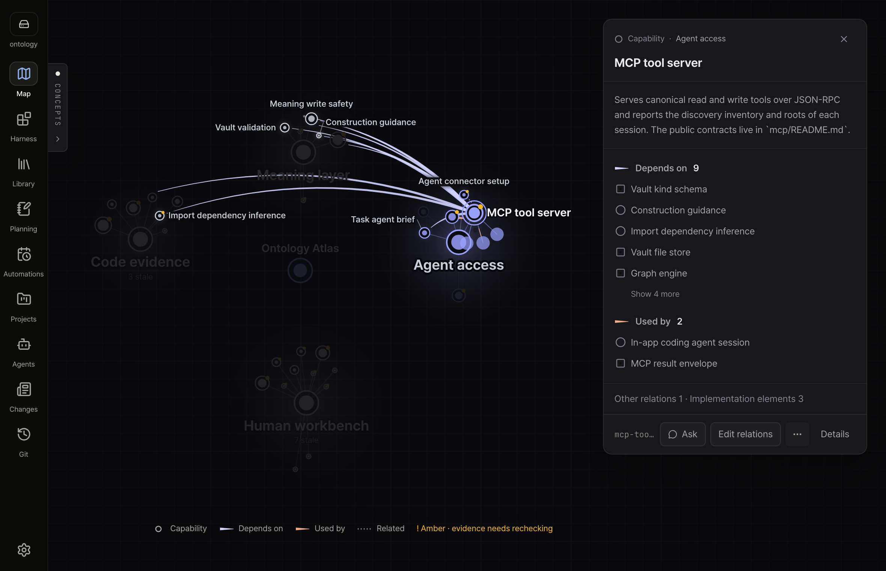
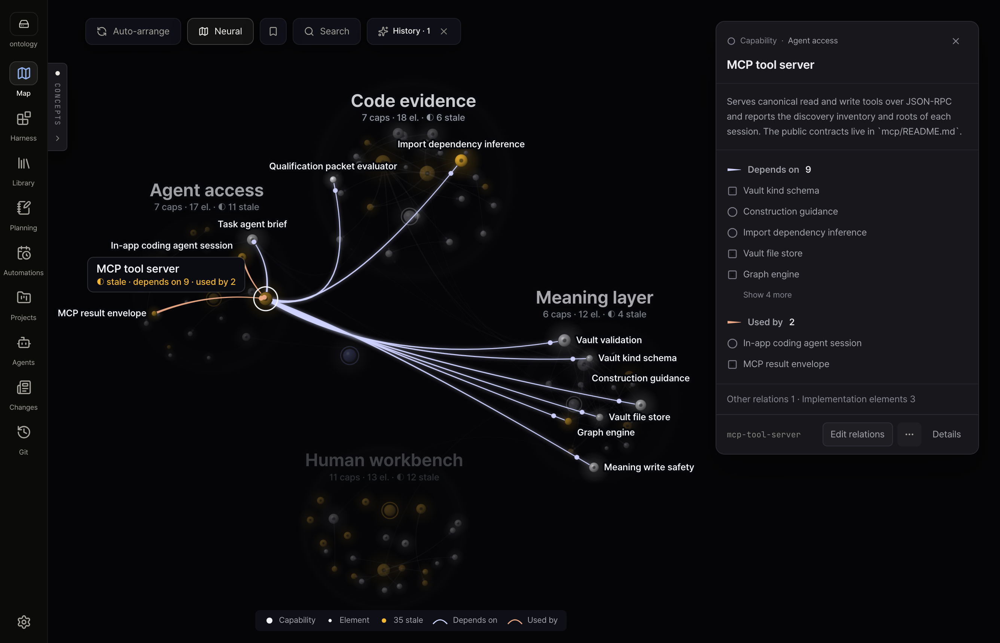
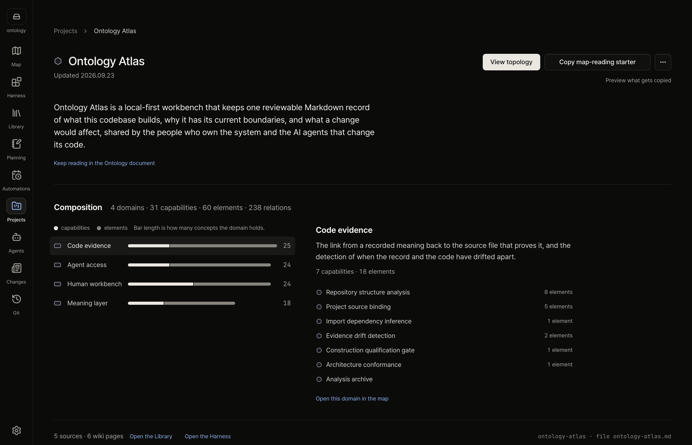
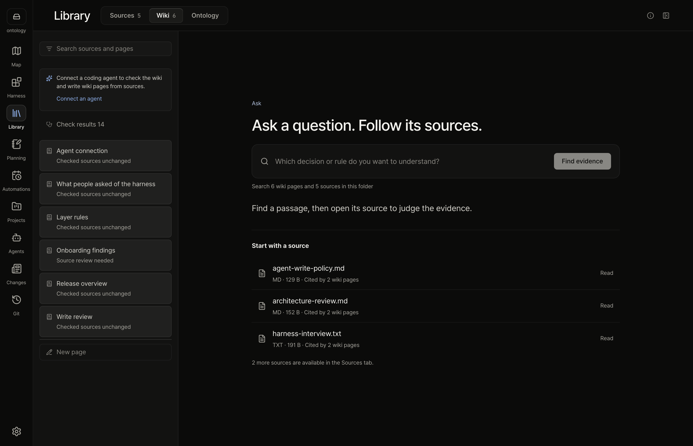
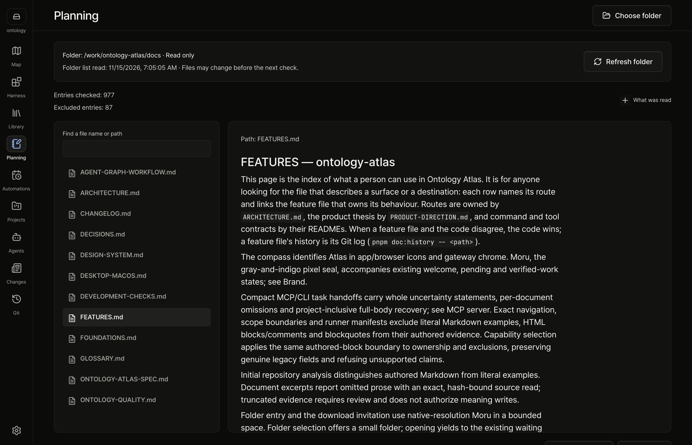
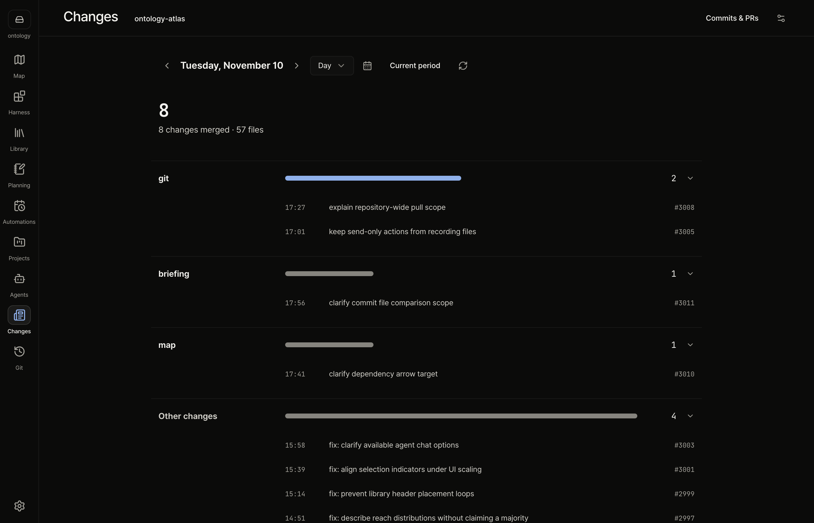
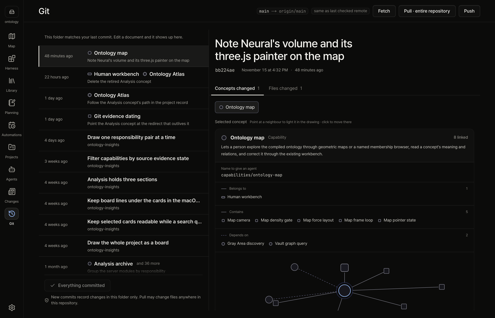
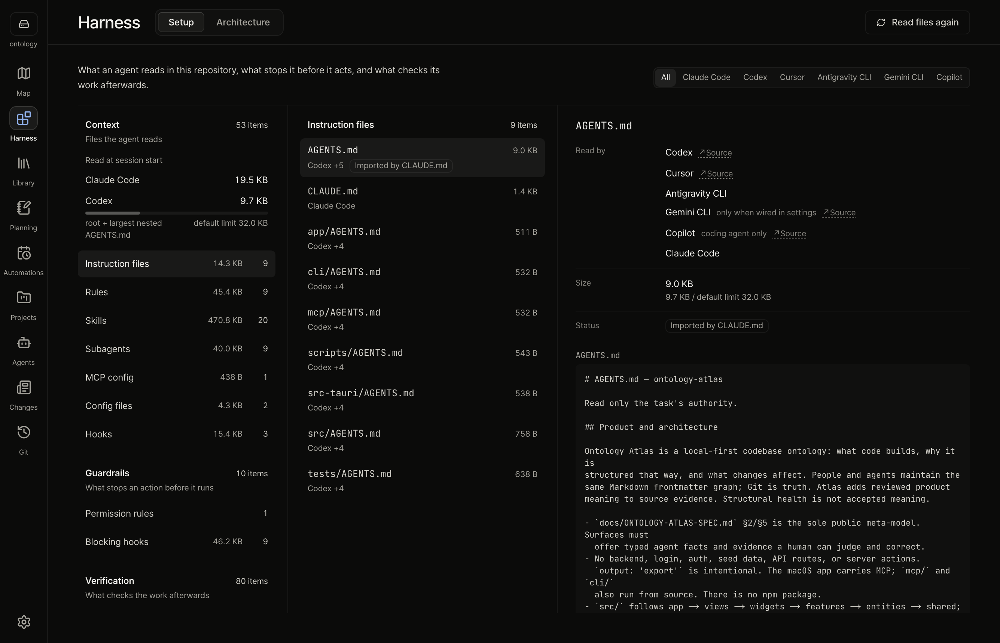
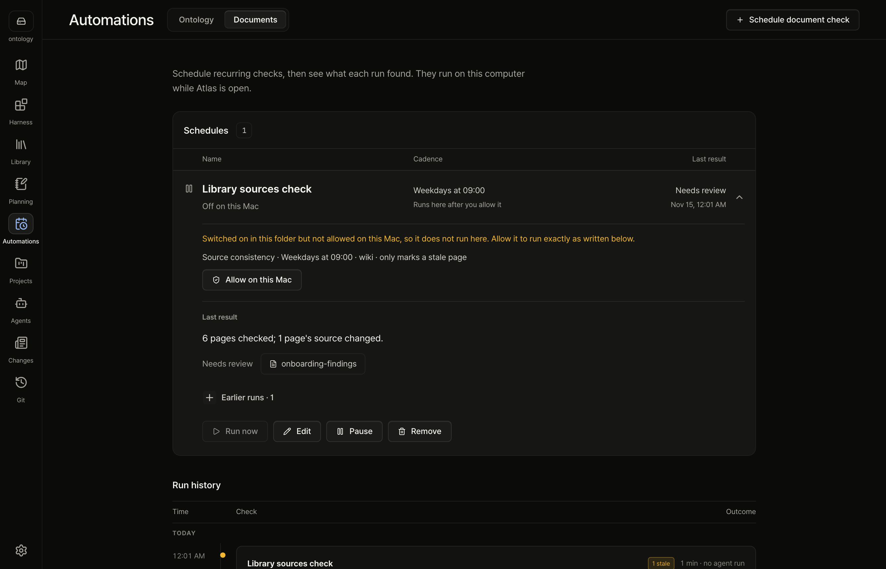
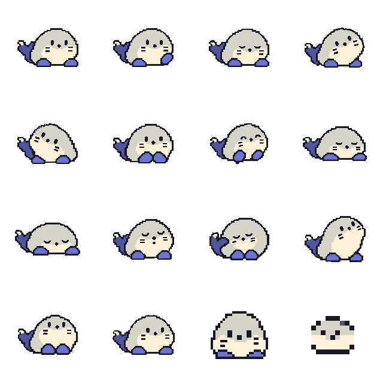

[English](README.md) | [한국어](README.ko.md) | [日本語](README.ja.md) | [简体中文](README.zh.md)

<h1 align="center">
  <picture>
    <source media="(prefers-color-scheme: dark)" srcset="public/brand/lockup-dark@2x.png" />
    
  </picture>
</h1>

<p align="center"><strong>AI 智能体改动代码时，你依然能看懂自己的系统。</strong></p>

<p align="center">
  把代码做了什么、为什么这样设计，整理成一张地图，以 Markdown 的形式保存在你的仓库里。<br />
  你和你的编码智能体读的是同一份文件。
</p>

<p align="center">
  <a href="https://ontologyatlas.com/zh/download/"><strong>下载 macOS 版</strong></a> ·
  <a href="https://ontologyatlas.com/zh/topology/">在浏览器中试用</a> ·
  <a href="https://ontologyatlas.com/zh/guide/">指南</a>
</p>

<p align="center"><a href="LICENSE"></a> <a href="https://github.com/wlsdks/ontology-atlas/releases"></a> <a href="https://mcpservers.org/servers/wlsdks/ontology-atlas"></a> <a href="https://stackmap.shipwithai.xyz/repos/wlsdks/ontology-atlas"></a></p>



## 为什么需要 Atlas

如今编码智能体改动代码的速度，已经超过团队在脑中维持全貌的速度。Atlas 把这份全貌放在代码旁边：每个部分是做什么的、由哪些文件实现、什么依赖什么，以及还有什么没人知道。你的智能体在任务前读取它，在任务后提议更新；每一处变更都以 Markdown diff 的形式交给你，你可以保留、修改或拒绝。

- **智能体带着上下文开工。** Claude Code、Codex、Cursor 和 Antigravity 通过 MCP 读取任务涉及的概念、代码路径、依赖关系和待解决的问题。
- **记录归你所有。** `atlas/` 文件夹里每个概念一个 Markdown 文件，像代码一样用 Git 做版本管理和评审。
- **什么是真的由你决定。** 智能体的提议在你接受之前，始终只是提议。
- **不知道的，就说不知道。** 地图上的连线只是声明过的关系，并不能证明运行时的影响；缺少证据时显示为未知，而不是安全。

## 界面一览

<table>
<tr>
<td width="50%"><br /><b>地图 · 神经</b> — 把同样的概念画成可以转动的立体；选中一个，就能看到它依赖什么、被什么使用。</td>
<td width="50%"><br /><b>项目</b> — 项目为何存在、分成哪些领域、每个领域里有什么。</td>
</tr>
<tr>
<td width="50%"><br /><b>资料库</b> — 文档放进去，带出处的 Wiki 页面出来；先找到段落，再到来源中核对。</td>
<td width="50%"><br /><b>规划</b> — 就地阅读项目文件夹里的 Markdown，不复制。</td>
</tr>
<tr>
<td width="50%"><br /><b>变更</b> — 一段时间内合并了什么，先计数、分组，再进入背后的拉取请求、提交和文件。</td>
<td width="50%"><br /><b>Git</b> — 每次提交改了哪些概念；编辑过的文档在提交前就会出现在这里。</td>
</tr>
<tr>
<td width="50%"><br /><b>Harness</b> — 智能体在这个仓库里读什么、执行前被什么拦住、结束后被什么检查。</td>
<td width="50%"><br /><b>自动化</b> — 定时检查，以及每次运行发现了什么。</td>
</tr>
</table>

**v2.0 新增：** 把地图画成可以转动的立体的神经视图和树状的 3D 视图；把智能体读什么、被什么拦住、被什么检查集中在一屏的 Harness「配置」；变更顶部的合并摘要；以及自动化中每项定时任务的运行记录。分析不再是单独的界面。详见[发布页](https://github.com/wlsdks/ontology-atlas/releases)。

开始之前值得知道的几点：

- 地图上的线是已声明的关系，不是运行时影响的证明。地图有五种视图：平面、六边形、领域结构、3D 和神经。[地图](docs/features/map/README.md)
- 空文件夹会给出起步操作，起步失败后可以重试，不会覆盖已有文件。弹窗式导览已取消。[首次运行](docs/features/first-run.md)
- 资料库的设置和检查需要在应用中进行；浏览器里可以获取应用或添加文件。[资料库](docs/features/library/workspace.md)
- 规划是只读的，在 macOS 应用中对你选择的文件夹生效，显示 Markdown 和 PNG/JPEG 图片。[规划](docs/FEATURES.md)
- Git 的仅发送操作不会提交新的文件更改；文件夹或分支状态变化时，可以重新查看。拉取可能更改整个仓库中的文件。[Git](docs/features/git.md)
- 变更会打开你在应用中选择的 Git 仓库，没有本体也可以使用。读取公开的 GitHub 拉取请求需要你明确操作，列表可能不完整；不会读取私有拉取请求。[变更简报](docs/features/change-briefing.md)
- 项目文档在上次含义审阅之后被修改时，会提示重新审阅并明确确认；保存更改或代码路径匹配并不代表含义已被接受。[MCP 服务器](docs/features/mcp-server.md)
- 在应用内的对话中，智能体的每次写入都要等你允许。Codex 以只读方式启动，本机配置的 Codex 权限配置文件不会出现在选项中，因为它们的审批行为没有公开。[智能体](docs/features/agents.md) · [功能清单](docs/FEATURES.md)
- 连接文件夹之前，应用也会保持资料库、规划、智能体和变更可用。[功能清单](docs/FEATURES.md)

## 快速开始

1. **安装**：从[下载页面](https://ontologyatlas.com/zh/download/)获取应用，或打开[浏览器版](https://ontologyatlas.com/zh/topology/)。
2. **打开文件夹**：Atlas 会原地读取其中的 Markdown，或在你的仓库中新建 `atlas/` 文件夹，并且在写入任何内容之前先显示路径。
3. **连接智能体**：在 **智能体 › MCP** 中，为你使用的工具点击 **连接**，重启智能体，然后问问它你的下一个任务。

macOS（Apple Silicon）版已签名并通过公证，应用内置 MCP 服务器。Windows x64 是未签名的测试版。在 Linux 上，请使用浏览器版，或在[源码检出](cli/README.md#set-up-from-a-source-checkout)中运行 CLI 和 MCP 服务器。[Releases](https://github.com/wlsdks/ontology-atlas/releases) 列出了每个版本的文件和校验和。

## 工作原理

```text
your-repo/
├── src/
└── atlas/                 ← 与代码一起克隆、建分支、评审
    ├── project.md
    ├── domains/  capabilities/  elements/
    ├── sources/           按收到时的原样保存的文档
    └── wiki/              据这些文档撰写的页面，每条事实都有出处
```

frontmatter 中带有 `kind:` 的 Markdown 文件就是一个概念。它的 `uid` 永不改变，`slug` 是它当前的地址，`path` 指向它所描述的代码。地图、文档、资料库和 Git 界面读取的都是这些文件。

你的智能体通过两种方式接触这个文件夹：

- **MCP：** 智能体会启动 Atlas MCP 服务器，由它直接读写磁盘上的文件夹，应用关闭时也能工作。[连接智能体](docs/guide/connect-agent.md) · [MCP 参考](mcp/README.md)
- **ACP：** Claude Agent 和 Codex 也可以在应用自带的对话中工作；每次写入都要等你允许后才会执行。[智能体](docs/features/agents.md)

## 本地优先

- 没有后端、账号或遥测。你的文件夹以普通 Markdown 的形式保存在你的磁盘上。
- 使用你的 API key 或本地模型调用模型的功能需要主动开启，每次调用的目的地都会记录在 `.ontology-atlas/llm-audit.jsonl` 中。
- 已连接的编码智能体可能会把你的提示词和它读取的内容发送给它自己的提供方，Atlas 的日志不涵盖这些传输。

[关于信任](docs/guide/trust.md) · [安全](SECURITY.md)

## 当前状态

Atlas 还处在早期。我们的基准测试尚未显示使用 Atlas 能得到更好的回答，而且使用 Atlas更慢（[更正说明](docs/benchmark/README.md#current-measurement-status)）。构建试验及其失败与局限见[构建测量](docs/benchmark/CONSTRUCTION.md)。

## 文档

[认识 Atlas](docs/guide/what-is-atlas.md) · [最初五分钟](docs/guide/first-five-minutes.md) · [什么会成为概念](docs/guide/what-becomes-a-node.md) · [关系](docs/guide/relations.md) · [规范](docs/ONTOLOGY-ATLAS-SPEC.md) · [功能](docs/FEATURES.md) · [CLI](cli/README.md) · [架构](docs/ARCHITECTURE.md)

## 参与贡献

请先阅读 [CONTRIBUTING.md](CONTRIBUTING.md)，外部的 pull request 请从 fork 提交。[AGENTS.md](AGENTS.md) 是人和智能体共同遵守的约定。

```bash
pnpm install
pnpm dev
pnpm checks:changed -- --run
```

`pnpm pr:land <number>` 会合并一个已评审的 pull request，并保留它原有的提交。完整的检查说明见[开发检查](docs/DEVELOPMENT-CHECKS.md)。仓库命令表见英文 README 的 [Contributing](README.md#contributing)。

## Moru

Moru 是 Atlas 的像素海豹角色，指南针是应用的标志。仓库内包含[74 个动作、16 个姿态和原始素材](assets/brand/moru/README.md)：58 个手绘动作，以及由它们拼接而成的 16 个场景。打开[本地动作预览](assets/brand/moru/preview.html)，即可播放、暂停并逐帧查看。

<p>


</p>

**出现的位置。** 在选择文件夹的画面，Moru 会打招呼、递出一个小文件夹并等待；文件夹开始打开后，它停止玩耍，切换到等待画面。下载页面有单独的欢迎动作。阅读来源、等待你的许可、庆祝检查完成这类动作，只在应用确实观察到对应状态时才出现，所以 Moru 不会展示未经确认的进展。

**抚摸。** 点击 Moru，它会做出一次简短的反应。第一次很温和，第二次会出现一个俏皮的动作，之后它会避开最近的两个动作，轮流展示全部反应：文件夹画面有 14 种，下载欢迎画面有 18 种。不带文字的小气泡有时会冒出爱心、音符或闪光；长时间闲置时，小 Moru 会探一次头。

**不打扰。** Moru 只在腾空时移动，鼠标悬停时会先落地再等待。等待操作时，它安静地待在原地。暂停和继续在 Moru 的菜单里（右键点击或 Shift+F10），角色旁没有播放按钮。启用减少动态效果后，它以静止的表情回应。



<details>
<summary>查看全部 58 个手绘动作</summary>

<p><b>等待</b></p>

<p>


</p>

<p><b>问候</b></p>

<p>


</p>

<p><b>工作</b></p>

<p>


</p>

<p><b>情绪</b></p>

<p>


</p>

<p><b>玩耍</b></p>

<p>


</p>

<p><b>场景</b></p>

<p>


</p>

</details>

## 许可证

[MIT](LICENSE)。第三方声明见 [NOTICE.md](NOTICE.md)，许可证全文见 [public/third-party-licenses.txt](public/third-party-licenses.txt)。像素吉祥物及其素材来源见[品牌](docs/design/brand.md)。
