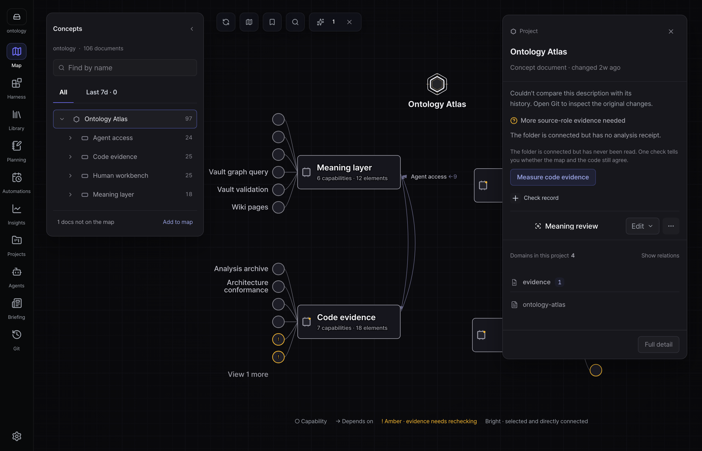
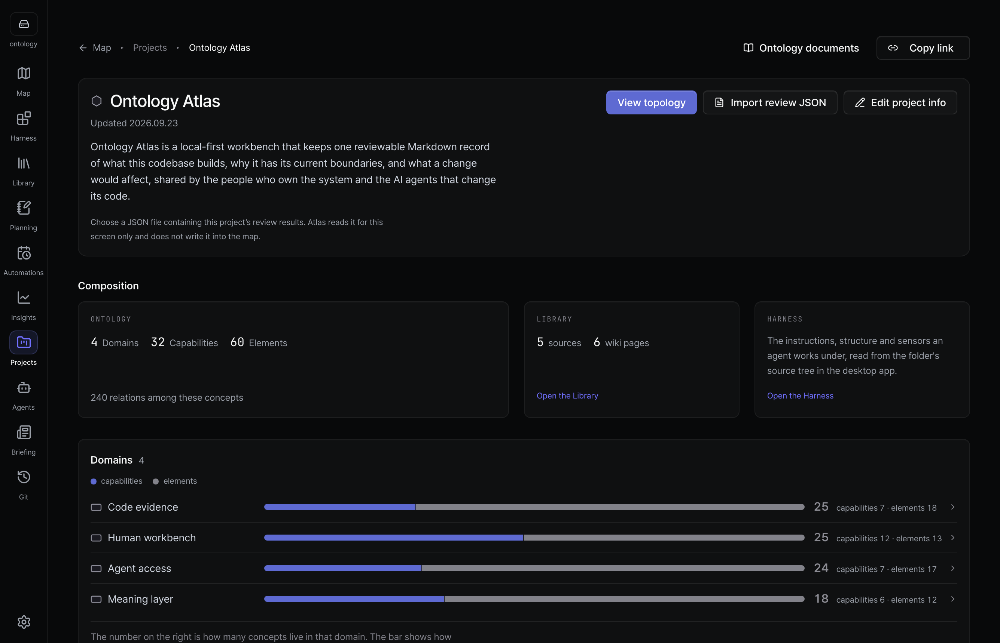
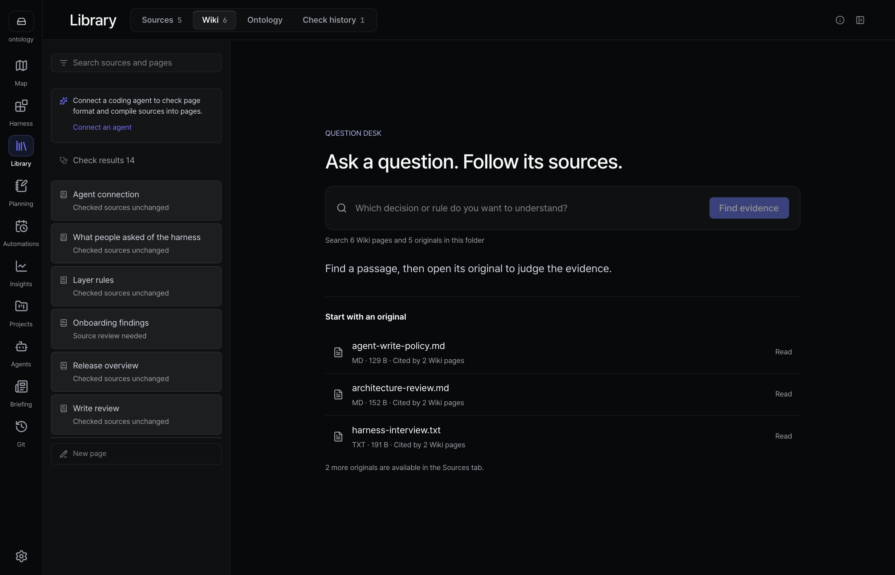
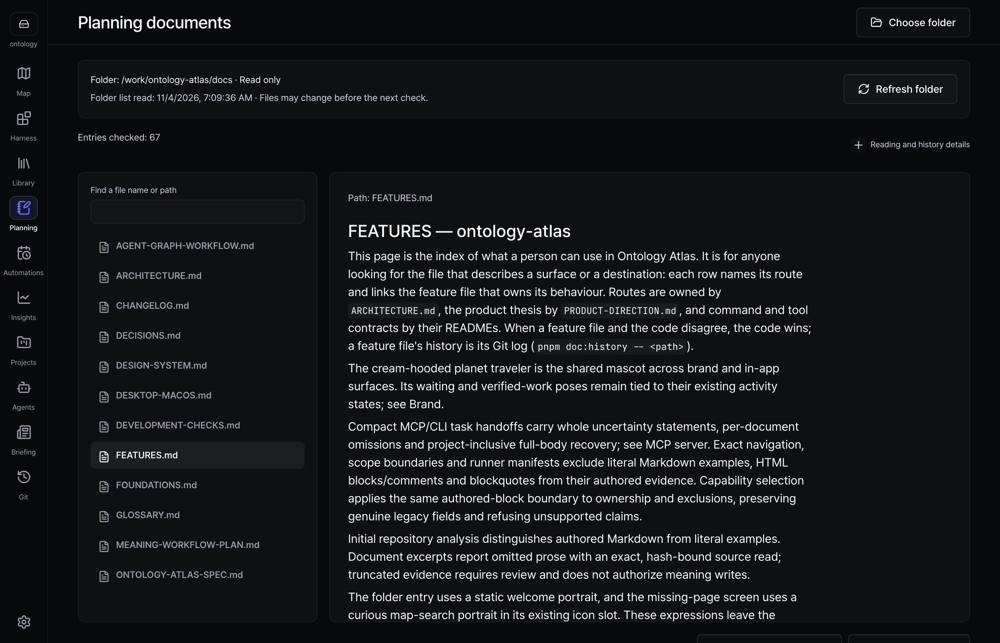
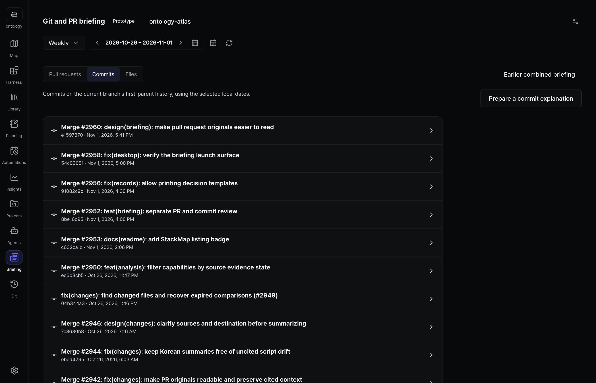
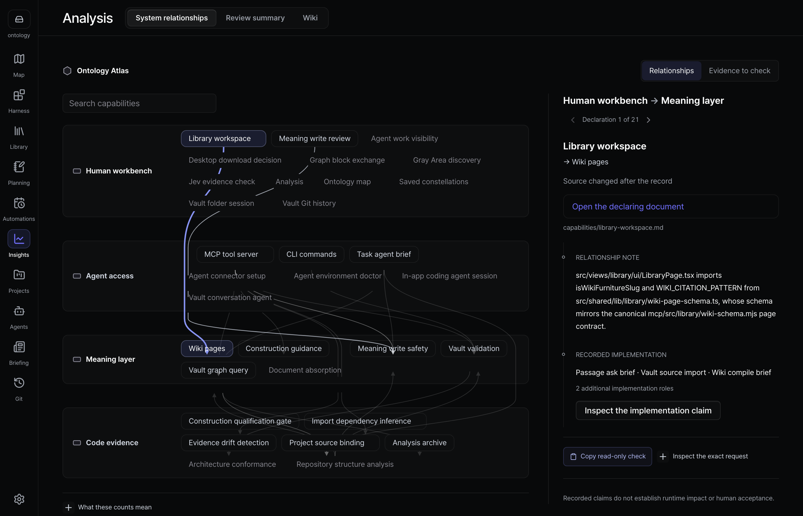
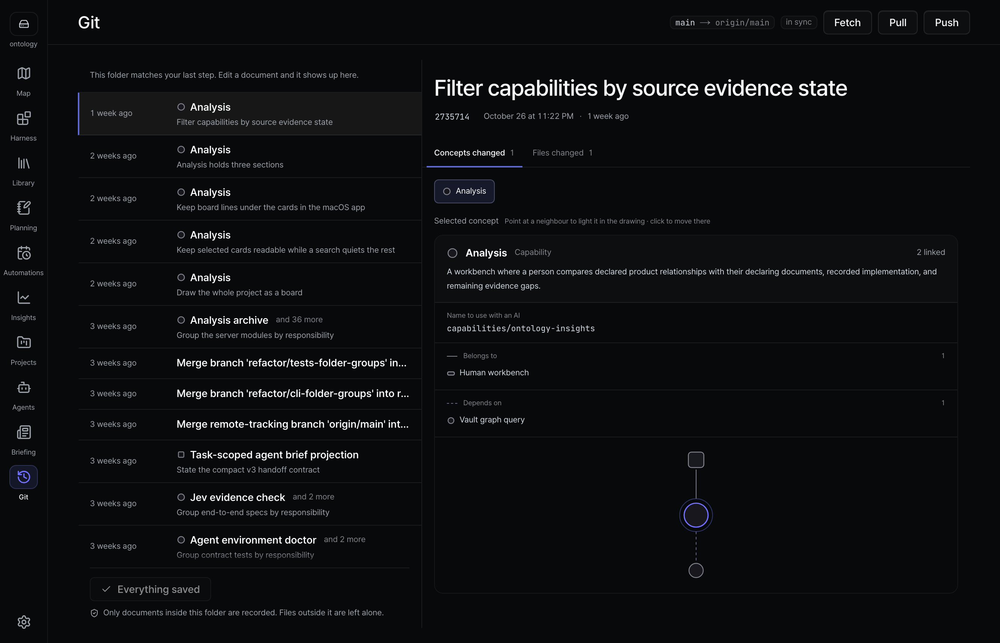
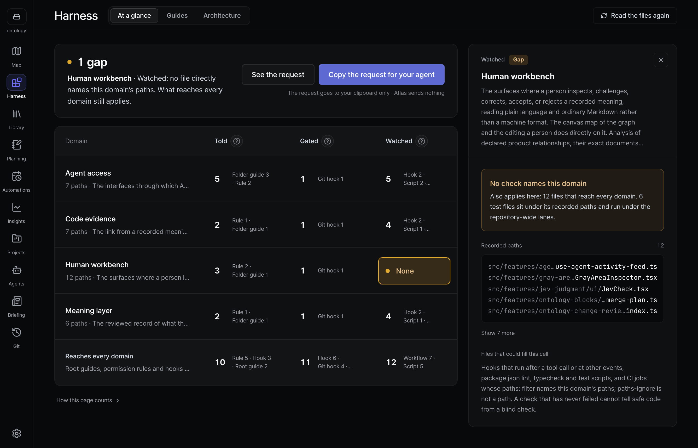
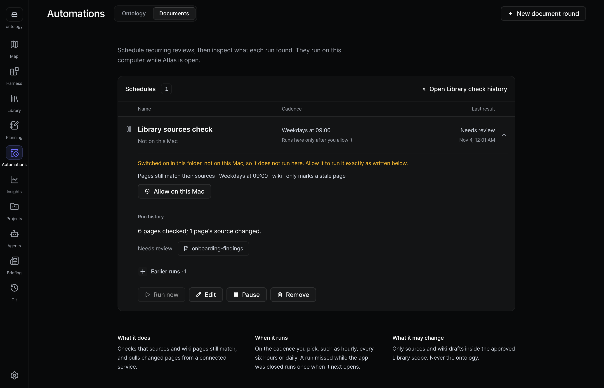
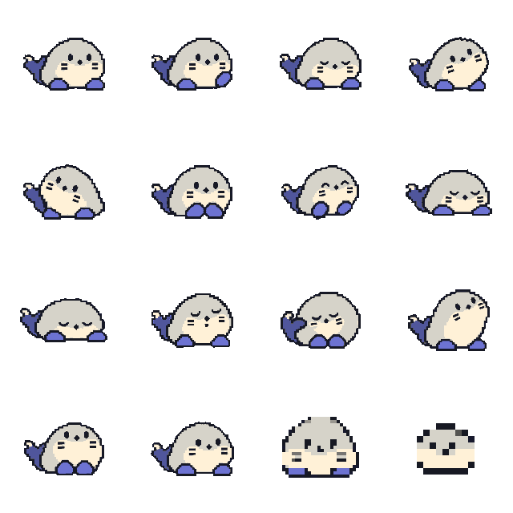

[English](README.md) | [한국어](README.ko.md) | [日本語](README.ja.md) | [简体中文](README.zh.md)

<h1 align="center">
  <picture>
    <source media="(prefers-color-scheme: dark)" srcset="public/brand/lockup-dark@2x.png" />
    
  </picture>
</h1>

<p align="center"><strong>AI 智能体改动代码时，你依然能看懂自己的系统。</strong></p>

<p align="center">
  把代码做了什么、为什么这样设计，整理成一张地图，以 Markdown 的形式保存在你的仓库里。<br />
  你和你的编码智能体读的是同一份文件。
</p>

<p align="center">
  <a href="https://ontologyatlas.com/zh/download/"><strong>下载 macOS 版</strong></a> ·
  <a href="https://ontologyatlas.com/zh/topology/">在浏览器中试用</a> ·
  <a href="https://ontologyatlas.com/zh/guide/">指南</a>
</p>

<p align="center"><a href="LICENSE"></a> <a href="https://github.com/wlsdks/ontology-atlas/releases"></a> <a href="https://mcpservers.org/servers/wlsdks/ontology-atlas"></a> <a href="https://stackmap.shipwithai.xyz/repos/wlsdks/ontology-atlas"></a></p>



## 为什么需要 Atlas

如今编码智能体改动代码的速度，已经超过团队在脑中维持全貌的速度。Atlas 把这份全貌放在代码旁边：每个部分是做什么的、由哪些文件实现、什么依赖什么，以及还有什么没人知道。你的智能体在任务前读取它，在任务后提议更新；每一处变更都以 Markdown diff 的形式交给你，你可以保留、修改或拒绝。

- **智能体带着上下文开工。** Claude Code、Codex、Cursor 和 Antigravity 通过 MCP 读取任务涉及的概念、代码路径、依赖关系和待解决的问题。
- **记录归你所有。** `atlas/` 文件夹里每个概念一个 Markdown 文件，像代码一样用 Git 做版本管理和评审。
- **什么是真的由你决定。** 智能体的提议在你接受之前，始终只是提议。
- **不知道的，就说不知道。** 地图上的连线只是声明过的关系，并不能证明运行时的影响；缺少证据时显示为未知，而不是安全。

## 界面一览

<table>
<tr>
<td width="50%"><br /><b>项目</b> — 每个项目，以及其中有多少已有代码依据。</td>
<td width="50%"><br /><b>资料库</b> — 文档放进去，带出处的 Wiki 页面出来。</td>
</tr>
<tr>
<td width="50%"><br /><b>规划</b> — 就地阅读项目文件夹里的 Markdown，不复制。</td>
<td width="50%"><br /><b>简报</b> — 一段时间内改了什么，按拉取请求、提交和文件分开看。</td>
</tr>
<tr>
<td width="50%"><br /><b>分析</b> — 哪些部分依赖哪些部分，依据就在旁边。</td>
<td width="50%"><br /><b>Git</b> — 保存前就能看到精确的 Markdown diff。</td>
</tr>
<tr>
<td width="50%"><br /><b>Harness</b> — 仓库向智能体告知、拦截和监测的内容。</td>
<td width="50%"><br /><b>自动化</b> — 让文件夹保持最新的定时检查。</td>
</tr>
</table>

**v1.9 新增：** 把仓库的拉取请求、提交和文件分开阅读的 Git 与 PR 简报，以及就地阅读项目文件夹中 Markdown 的规划。详见[发布页](https://github.com/wlsdks/ontology-atlas/releases)。

开始之前值得知道的几点：

- 地图上的线是已声明的关系，不是运行时影响的证明；图例会说明每个标记和方向。[地图](docs/features/map/flat-dial.md)
- 空文件夹会给出起步操作，起步失败后可以重试，不会覆盖已有文件。弹窗式导览已取消。[首次运行](docs/features/first-run.md)
- 资料库的设置和检查需要在应用中进行；浏览器里可以获取应用或添加文件。[资料库](docs/features/library/workspace.md)
- 规划是只读的，在 macOS 应用中对你选择的文件夹生效，显示 Markdown 和 PNG/JPEG 图片。[规划](docs/FEATURES.md)
- Git 的仅发送操作不会提交新的文件更改；文件夹或分支状态变化时，可以重新查看。拉取可能更改整个仓库中的文件。[Git](docs/features/git.md)
- 连接文件夹之前，应用也会保持资料库、规划、智能体和简报可用。[功能清单](docs/FEATURES.md)

## 快速开始

1. **安装**：从[下载页面](https://ontologyatlas.com/zh/download/)获取应用，或打开[浏览器版](https://ontologyatlas.com/zh/topology/)。
2. **打开文件夹**：Atlas 会原地读取其中的 Markdown，或在你的仓库中新建 `atlas/` 文件夹，并且在写入任何内容之前先显示路径。
3. **连接智能体**：在 **智能体 › MCP** 中，为你使用的工具点击 **连接**，重启智能体，然后问问它你的下一个任务。

macOS（Apple Silicon）版已签名并通过公证，应用内置 MCP 服务器。Windows x64 是未签名的测试版。在 Linux 上，请使用浏览器版，或在[源码检出](cli/README.md#set-up-from-a-source-checkout)中运行 CLI 和 MCP 服务器。[Releases](https://github.com/wlsdks/ontology-atlas/releases) 列出了每个版本的文件和校验和。

## 工作原理

```text
your-repo/
├── src/
└── atlas/                 ← 与代码一起克隆、建分支、评审
    ├── project.md
    ├── domains/  capabilities/  elements/
    ├── sources/           按收到时的原样保存的文档
    └── wiki/              据这些文档撰写的页面，每条事实都有出处
```

frontmatter 中带有 `kind:` 的 Markdown 文件就是一个概念。它的 `uid` 永不改变，`slug` 是它当前的地址，`path` 指向它所描述的代码。地图、文档、资料库、分析和 Git 界面读取的都是这些文件。

你的智能体通过两种方式接触这个文件夹：

- **MCP：** 智能体会启动 Atlas MCP 服务器，由它直接读写磁盘上的文件夹，应用关闭时也能工作。[连接智能体](docs/guide/connect-agent.md) · [MCP 参考](mcp/README.md)
- **ACP：** Claude Agent 和 Codex 也可以在应用自带的对话中工作；每次写入都要等你允许后才会执行。[智能体](docs/features/agents.md)

## 本地优先

- 没有后端、账号或遥测。你的文件夹以普通 Markdown 的形式保存在你的磁盘上。
- 使用你的 API key 或本地模型调用模型的功能需要主动开启，每次调用的目的地都会记录在 `.ontology-atlas/llm-audit.jsonl` 中。
- 已连接的编码智能体可能会把你的提示词和它读取的内容发送给它自己的提供方，Atlas 的日志不涵盖这些传输。

[关于信任](docs/guide/trust.md) · [安全](SECURITY.md)

## 当前状态

Atlas 还处在早期。我们的基准测试尚未显示使用 Atlas 能得到更好的回答，而且使用 Atlas更慢（[更正说明](docs/benchmark/README.md#current-measurement-status)）。构建试验及其失败与局限见[构建测量](docs/benchmark/CONSTRUCTION.md)。

## 文档

[认识 Atlas](docs/guide/what-is-atlas.md) · [最初五分钟](docs/guide/first-five-minutes.md) · [什么会成为概念](docs/guide/what-becomes-a-node.md) · [关系](docs/guide/relations.md) · [规范](docs/ONTOLOGY-ATLAS-SPEC.md) · [功能](docs/FEATURES.md) · [CLI](cli/README.md) · [架构](docs/ARCHITECTURE.md)

## 参与贡献

请先阅读 [CONTRIBUTING.md](CONTRIBUTING.md)，外部的 pull request 请从 fork 提交。[AGENTS.md](AGENTS.md) 是人和智能体共同遵守的约定。

```bash
pnpm install
pnpm dev
pnpm checks:changed -- --run
```

`pnpm pr:land <number>` 会合并一个已评审的 pull request，并保留它原有的提交。完整的检查说明见[开发检查](docs/DEVELOPMENT-CHECKS.md)。仓库命令表见英文 README 的 [Contributing](README.md#contributing)。

## Moru

Moru是Atlas的像素海豹角色，指南针是应用图标。项目内包含[70个动作、16个姿态和原始素材](assets/brand/moru/README.md)。打开[本地动作预览](assets/brand/moru/preview.html)，即可播放、暂停并逐帧查看。

在文件夹选择画面，Moru 会打招呼并展示小文件夹；打开文件夹时停止玩耍，切换到现有的等待画面。下载页面使用独立的欢迎动作。只有双脚离地的短跳跃期间才会移动。悬停时会先完成落地，再停下来等待。点击 Moru 会短暂地害羞、鼓掌、跳舞、思考、冒出爱心、欢笑或挥动鳍跳舞，右键点击或按 Shift+F10 可打开暂停菜单。角色旁不显示播放按钮。启用减少动态效果时，仅改变静态表情。

新的32姿势动作增加了鞠躬、击掌和帽子问候，下载欢迎画面还会表演小鱼魔术。点击时，小气泡会显示爱心、音符或闪光，返回跳跃时也会偶尔出现音符。等待操作时保持安静。躲猫猫、脸红和泡泡游戏可在动作预览中查看。



<details>
<summary>查看Moru的动作</summary>


</details>

## 许可证

[MIT](LICENSE)。第三方声明见 [NOTICE.md](NOTICE.md)，许可证全文见 [public/third-party-licenses.txt](public/third-party-licenses.txt)。像素吉祥物及其素材来源见[品牌](docs/design/brand.md)。
