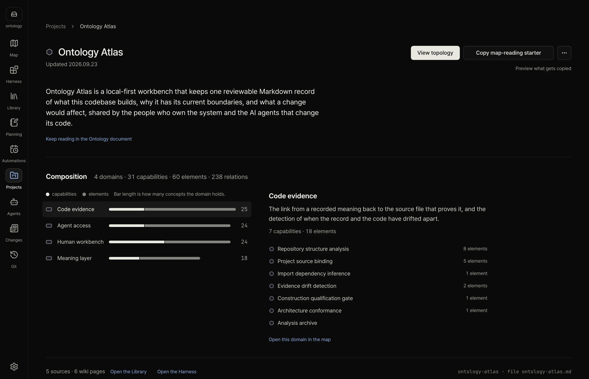
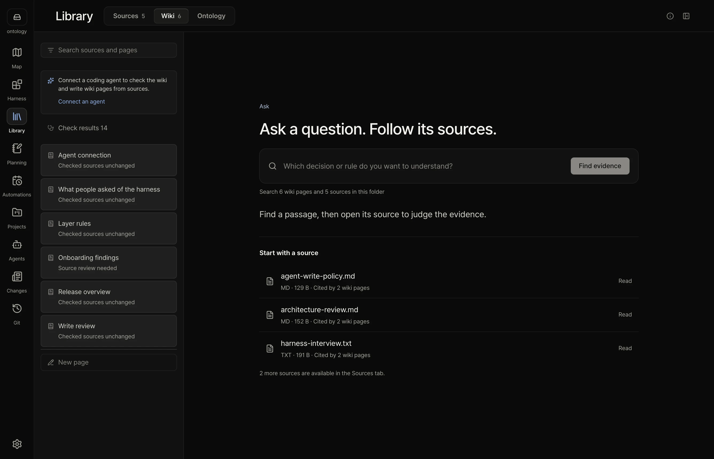

[English](README.md) | [한국어](README.ko.md) | [日本語](README.ja.md) | [简体中文](README.zh.md)

<h1 align="center">
  <picture>
    <source media="(prefers-color-scheme: dark)" srcset="public/brand/lockup-dark@2x.png" />
    
  </picture>
</h1>

<p align="center"><strong>AI 智能体改动代码时，你依然能看懂自己的系统。</strong></p>

<p align="center">
  把代码做了什么、为什么这样设计，整理成一张地图，以 Markdown 的形式保存在你的仓库里。<br />
  你和你的编码智能体读的是同一份文件。
</p>

<p align="center">
  <a href="https://ontologyatlas.com/zh/download/"><strong>下载</strong></a> ·
  <a href="https://ontologyatlas.com/zh/sample/">查看示例地图</a> ·
  <a href="https://ontologyatlas.com/zh/guide/">指南</a>
</p>

<p align="center"><a href="LICENSE"></a> <a href="https://github.com/wlsdks/ontology-atlas/releases"></a> <a href="https://mcpservers.org/servers/wlsdks/ontology-atlas"></a> <a href="https://stackmap.shipwithai.xyz/repos/wlsdks/ontology-atlas"></a> <a href="https://glama.ai/mcp/servers/wlsdks/ontology-atlas"></a></p>


## 为什么需要 Atlas

如今编码智能体改动代码的速度，已经超过团队在脑中维持全貌的速度。Atlas 把这份全貌放在代码旁边：每个部分是做什么的、由哪些文件实现、什么依赖什么，以及还有什么没人知道。你的智能体在任务前读取它，在任务后提议更新；每一处变更都以 Markdown diff 的形式交给你，你可以保留、修改或拒绝。

- **智能体带着上下文开工。** Claude Code、Codex、Cursor 和 Antigravity 通过 MCP 读取任务涉及的概念、代码路径、依赖关系和待解决的问题。
- **记录归你所有。** `atlas/` 文件夹里每个概念一个 Markdown 文件，像代码一样用 Git 做版本管理和评审。
- **什么是真的由你决定。** 智能体做的每处修改都是一份 Markdown diff，你可以保留、修正或撤销；在应用内的对话中，每次写入都会先等你同意。
- **不知道的，就说不知道。** 地图上的连线只是声明过的关系，并不能证明运行时的影响；缺少证据时显示为未知，而不是安全。

它和代码图谱、Wiki、Obsidian、`CLAUDE.md` 有什么不同？见 [Atlas 对比](https://ontologyatlas.com/zh/guide/atlas-compared/)，其中也写明了哪些场景更适合用那些工具。

## 快速开始

1. **安装**：从[下载页面](https://ontologyatlas.com/zh/download/)获取应用。
2. **打开文件夹**：Atlas 会原地读取其中的 Markdown，或在你的仓库中新建 `atlas/` 文件夹，并且在写入任何内容之前先显示路径。
3. **连接智能体**：在 **智能体 › MCP** 中，为你使用的工具点击 **连接**，重启智能体，然后问问它你的下一个任务。

macOS（Apple Silicon）版已签名并通过公证，应用内置 MCP 服务器。Windows x64 是未签名的测试版。Linux 和 Intel Mac 没有对应的应用：请查看[示例地图](https://ontologyatlas.com/zh/sample/)，或在[源码克隆](mcp/README.md#1-register-with-an-agent)中运行 MCP 服务器来连接编码智能体。[Releases](https://github.com/wlsdks/ontology-atlas/releases) 列出了每个版本的文件和校验和。在 GitHub 上标为 **Pre-release** 的版本是测试版：已安装的应用只会更新到正式版本，所以只有手动安装的人才会用到测试版。

## 界面一览


**地图** — 选中一个概念，通向它所依赖的和使用它的概念的连线就会亮起，面板逐一列出名字。平面、六边形、3D 和神经是同一组概念的不同视图。[地图](docs/features/map/README.md)

<table>
<tr>
<td width="50%"><br /><b>地图 · 神经</b> — 把同样的概念画成可以转动的立体；选中一个，就能看到它依赖什么、被什么使用。</td>
<td width="50%"><br /><b>项目</b> — 项目为何存在、分成哪些领域、每个领域里有什么。</td>
</tr>
<tr>
<td width="50%"><br /><b>资料库</b> — 文档放进去，带出处的 Wiki 页面出来；先找到段落，再到来源中核对。</td>
<td width="50%"><br /><b>规划</b> — 在已打开文件夹的 <code>planning/</code> 中用 Markdown 写计划，在应用中使用；macOS 应用还能就地阅读另一个文件夹。</td>
</tr>
<tr>
<td width="50%"><br /><b>变更</b> — 一段时间内合并了什么，先计数、分组，再进入背后的拉取请求、提交和文件。</td>
<td width="50%"><br /><b>Git</b> — 每次提交改了哪些概念；编辑过的文档在提交前就会出现在这里。</td>
</tr>
<tr>
<td width="50%"><br /><b>Harness</b> — 智能体在这个仓库里读什么、执行前被什么拦住、结束后被什么检查。</td>
<td width="50%"><br /><b>自动化</b> — 定时检查，以及每次运行发现了什么。</td>
</tr>
</table>

## 工作原理

```text
your-repo/
├── src/
└── atlas/                 ← 与代码一起克隆、建分支、评审
    ├── project.md
    ├── domains/  capabilities/  elements/
    ├── sources/           按收到时的原样保存的文档
    └── wiki/              据这些文档撰写的页面，每条事实都有出处
```

frontmatter 中带有 `kind:` 的 Markdown 文件就是一个概念。概念分为 **项目**、**领域**（长期承担的职责）、**能力**（系统能做的事）和 **要素**（两个及以上能力共用的部件）。它的 `uid` 永不改变，`slug` 是它当前的地址，`path` 指向它所描述的代码。下面这个文件节选自本仓库自己的地图 [`docs/ontology/`](docs/ontology/capabilities/vault-graph-query.md)：

```markdown
---
uid: 7c451ebd-9cd0-41a9-bc37-044affac786a
slug: capabilities/vault-graph-query
kind: capability
title: Vault graph query
domain: domains/meaning-layer
path: mcp/src/tools/graph.mjs
dependencies: [elements/graph-compiler, elements/graph-engine, elements/vault-file-store]
---

## Definition
Compiles the folder of Markdown files into one typed graph and answers
structural questions over it, so a person or agent can ask what a node touches
without opening every file.

## Excludes
- Writing anything back to the vault.

## Uncertainty
- The engine is roughly 6,400 lines and was not read beyond its header.
```

地图、文档、资料库和 Git 界面读取的都是这些文件，智能体读取的也是同一批文件。智能体最常问的问题由这些 MCP 工具回答：

| 任务前后智能体会问 | 工具 |
|---|---|
| 这部分是做什么的，不负责什么？ | `get_concepts` |
| 改名或删除之前，有哪些地方指向它？ | `find_backlinks` |
| 这两个概念是怎么连起来的？ | `query_ontology` 的 `path` |
| 这次改动可能影响什么？ | `query_ontology` 的 `impact` |
| 这件事写在哪里？ | `find_evidence` |
| 记录刚刚新建或修改的内容 | `add_concepts`、`add_relations`、`patch_concept` |
| 文件夹是否仍然一致？ | `validate_vault` |

以只读方式注册服务器时，只会提供读取类工具（[MCP 参考](mcp/README.md#read-only-registration-oatlas_read_only)）。

你的智能体通过两种方式接触这个文件夹：

- **MCP：** 智能体会启动 Atlas MCP 服务器，由它直接读写磁盘上的文件夹，应用关闭时也能工作。[连接智能体](docs/guide/connect-agent.md) · [MCP 参考](mcp/README.md)
- **ACP：** Claude Agent 和 Codex 也可以在应用自带的对话中工作，由你允许或拒绝它们的写入。[智能体](docs/features/agents.md)

## 本地优先

- 没有后端、账号或遥测。你的文件夹以普通 Markdown 的形式保存在你的磁盘上。
- 使用你的 API key 或本地模型调用模型的功能需要主动开启，每次调用的目的地都会记录在 `.ontology-atlas/llm-audit.jsonl` 中。
- 已连接的编码智能体可能会把你的提示词和它读取的内容发送给它自己的提供方，Atlas 的日志不涵盖这些传输。

[关于信任](docs/guide/trust.md) · [安全](SECURITY.md)

## 局限

- **只有在应用内的对话中，Atlas 才会在智能体写入前询问你。** 在那里，文件修改和 Atlas 写入都要等你允许；为该文件夹开启自动批准后不再询问，但 shell 命令、提交、删除与合并概念以及文件夹外的路径始终会询问；Atlas 读取生成地图的代码文件夹、读取所连接代码文件夹中的文件除外。通过 MCP 连接的智能体按其自身工具的权限规则写入。[智能体](docs/features/agents.md)
- **Atlas 只能在已安装的应用中使用。** 应用提供 Apple Silicon Mac 版和测试版的 Windows x64 版。浏览器无法打开文件夹，网站只提供只读的示例地图。[下载](docs/features/download.md)
- **变更只读取公开的 GitHub 拉取请求，** 需要你明确操作，列表可能不完整；不会读取私有拉取请求。[变更简报](docs/features/change-briefing.md)
- **Git 的拉取可能更改仓库中任何位置的文件，** 而不只是已打开的文件夹。[Git](docs/features/git.md)

## 当前状态

Atlas 还处在早期。我们的基准测试尚未显示使用 Atlas 能得到更好的回答，而且使用 Atlas更慢（[更正说明](docs/benchmark/README.md#current-measurement-status)）。构建试验及其失败与局限见[构建测量](docs/benchmark/CONSTRUCTION.md)。

## 文档

[认识 Atlas](docs/guide/what-is-atlas.md) · [Atlas 对比](docs/guide/atlas-compared.md) · [最初五分钟](docs/guide/first-five-minutes.md) · [从代码构建第一张地图](docs/guide/from-your-repo.md) · [什么会成为概念](docs/guide/what-becomes-a-node.md) · [关系](docs/guide/relations.md) · [规范](docs/ONTOLOGY-ATLAS-SPEC.md) · [功能](docs/FEATURES.md) · [架构](docs/ARCHITECTURE.md)

## 参与贡献

请先阅读 [CONTRIBUTING.md](CONTRIBUTING.md)，外部的 pull request 请从 fork 提交。[AGENTS.md](AGENTS.md) 是人和智能体共同遵守的约定。

```bash
pnpm install
pnpm desktop:dev
pnpm checks:changed -- --run
```

`pnpm desktop:dev` 会运行应用，需要 Rust 工具链（[桌面应用](docs/DESKTOP-MACOS.md)）。`pnpm dev` 在浏览器中只提供网站的页面，所有应用地址都会显示一个说明 Atlas 运行在已安装应用中的页面。

如何选择检查、推送前检查与 CI、合并、各通道的时间预算以及全部仓库命令，见[开发检查](docs/DEVELOPMENT-CHECKS.md)。

## Moru

Moru 是 Atlas 的像素海豹角色，指南针是应用的标志。仓库内包含[74 个动作、16 个姿态和原始素材](assets/brand/moru/README.md)，那里介绍了 Moru 在应用中出现的位置，并列出全部手绘动作。

<p>


</p>

## 许可证

[MIT](LICENSE)。第三方声明见 [NOTICE.md](NOTICE.md)，许可证全文见 [public/third-party-licenses.txt](public/third-party-licenses.txt)。像素吉祥物及其素材来源见[品牌](docs/design/brand.md)。
