# Moru and the Atlas compass

Open [the motion studio](preview.html) locally. It works from a file or static
server and provides Play/Pause, frame scrubbing, 64/128px inspection, light/dark
backgrounds and individual downloads. Reduced motion stays still; offscreen and
hidden canvases pause.

The pack contains **85 clips: 69 authored motions and 16 labelled compositions**.
There are **50 authored clips with 24 timed poses** and **19 with 32**. Each composition has **47**. These are authored pose counts, not display fps.
The pack also has **16 static poses**, including separately simplified 32px/16px faces.
Singing with notes, a fish friend, a happy dance and a tiny Moru chorus are
included as expressive clips. Shy smiles, a ball game with a friend, three cuddling
pups and rain/snow/breeze scenes extend the catalogue. The compass is the approved
app identity. Moru is the seal companion. A somersault, toy-fishing, laptop coding,
curious thinking and quiet pondering add five further gestures. Affectionate hearts,
a giggle, a puzzled frown and a tiny temper add four emotional expressions.
A flipper groove and two floating-ontology scenes complete the twelve-clip addition.
Eight 32-pose gestures add a soft bow, hat greeting, fish trick, blanket peekaboo,
rosy temper, flipper five, folder peek and bubble chase.
The polish pass replaces the deep bow with a small rounded nod and separately
times anticipation, movement, holds and settling for nod, hop, folder peek and
shy response. Its earlier source attempt remains alongside the chosen source.
Four more 32-pose encounters add a nose-star balance, a sparkle sneeze, pup
peekaboo and a heart gift. The flipper groove is redrawn with 32 poses. The
second pet reveals an encounter; a pup also visits once per long idle cycle.
Folder entry uses 14 responses, welcome uses 18 including singing and bubble
chasing. Props and drawn notes replace the extra bubble in those scenes.
Use `preview.html?clip=pup-peek` to open a particular motion.

- [Export manifest](moru.json): paths, timings, native grids and runtime subset.
- [Source manifest](moru-source.json): source-sheet cells and composed sequences.
- Source prompts: [v1](source/generation-v1.json), [v2](source/generation-v2.json),
  [v3](source/generation-v3.json), [v4](source/generation-v4.json), [v5](source/generation-v5.json), [v6](source/generation-v6.json), [v7](source/generation-v7.json), [v8](source/generation-v8.json), and [v9](source/generation-v9.json).
- Clips drawn in code: [the eleven Work status clips](../../../scripts/brand/moru-work-clips.mjs), posed from the neutral pose into `source/motion-v10/` by `pnpm brand:work-clips`.
- [Pose showcase](moru-poses-showcase.png) and [1024px app icon](icons/atlas-compass-1024.png).

`sprites/{64,128}/{authored,composed}` contains transparent frame strips.
`animated/{gif,webp}/{authored,composed}` contains timed, looping 256px exports.
`poses/` contains individual transparent PNGs. The source sheets `moru-source.json` names
are kept unchanged in `source/`; drafts, first passes and rejected sheets are
not committed; export processing handles palette, binary alpha, body
registration and shared neutral transitions. Clips are processed on a 256px
grid and halved to each size; eyes, nose and whiskers are reduced to their own
size so equal marks stay equal, the outline's soft gray edge joins the outline, the lighter haze beside any ink dissolves into the fill, and
ink drawn away from every fill is exported in indigo so it reads on the dark canvas
([Brand](../../../docs/design/brand.md#raster-grids-and-palette)). The peekaboo scene reserves a fixed
inset for the blanket. Rosy temper and the heart gift opt into two coral inks; ordinary gray,
ivory and indigo mapping stays unchanged.

The app uses compact 32-column pages of native 128px cells, capped at 4096px
wide, rather than increasingly long strips. Export checks compare every runtime
cell with its catalogue source. Three project-authored SVG pixel bubbles in
`public/brand/moru-emote-*.svg` add wordless hearts, notes and sparkles. They follow
the companion and pause/visibility guards, never create another control.

Run `pnpm brand:sprites` from the repository root to regenerate the pack without
an image API. Run `node --test scripts/brand/build-moru-sprites.test.mjs` to check
eye/ivory regressions, the reduction rules, identical eyes, floor lines, nod body volume, frame inventories, margins and loop seams. Full platform
fan-out is documented in [Brand](../../../docs/design/brand.md#rebuild).

## In the app

**Where Moru appears.** At folder entry Moru greets you, holds out a small folder and waits; once a folder starts opening, play gives way to the waiting view. The download page has its own welcome. Reading a source, waiting for your permission and celebrating a finished check appear only when the app has observed that state, so Moru never shows progress nobody confirmed.

**Petting.** Press Moru for one short response. The first is gentle, the second reveals a playful one, and after that Moru works through everything it knows while avoiding the last two: 14 responses at folder entry, 18 on the download welcome. A small wordless bubble sometimes answers with a heart, a note or a sparkle, and a pup peeks out once in a long idle.

**Staying out of the way.** Moru moves only while airborne, and lands before it waits under your pointer. While work is pending it stays quiet and in place. Pause and resume live in Moru's menu (right-click or Shift+F10), with no playback button beside the character, and reduced motion answers with a still expression.

## The 16 poses

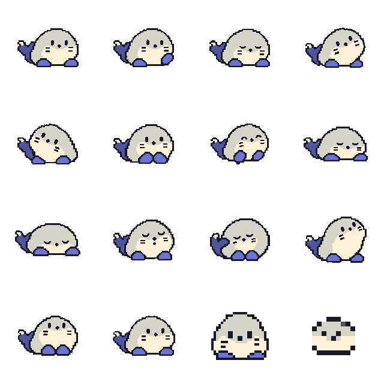

## All 69 drawn motions

### Waiting

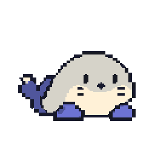

### Greeting

### At work

### Feelings

### Play

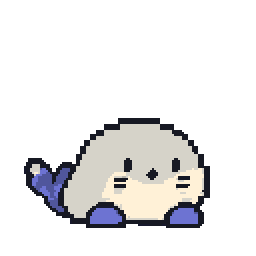

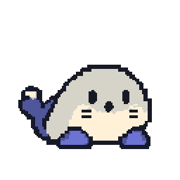
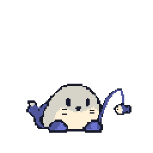
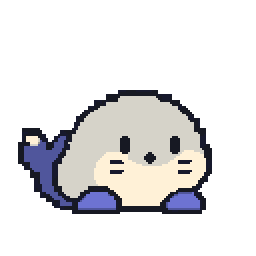

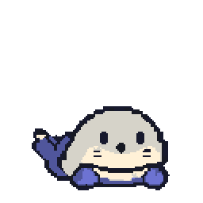

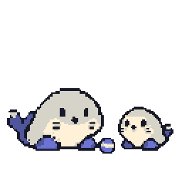
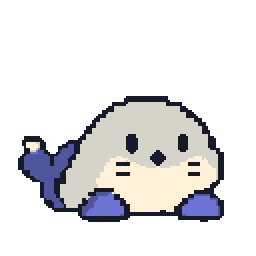

### Work status rooms

### Scenes

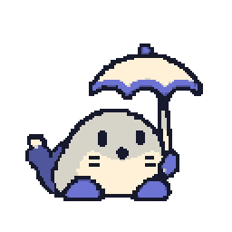
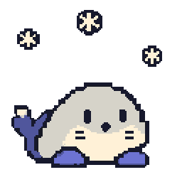
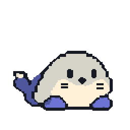
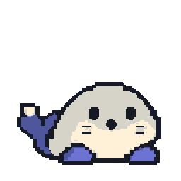
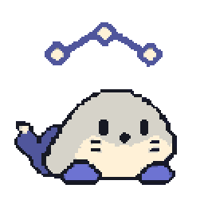

## Provenance

Only the explicitly mapped subset plays in the app, beside an existing observed
state. The catalogue's story sequences do not establish work, approval, progress
or accepted meaning. Completion art requires the existing completion evidence.

The built-in Image Gen tool created the art using this session's selected designs;
no third-party logo or character was supplied as a generation reference. The eleven
Work status clips were hand-authored as pixel art in code from those designs,
with no third-party reference and no generated image.
See [Sources and rights](../../../docs/design/brand.md#sources-and-rights) for the
limits of this provenance and the official references. The repository's
[license](../../../LICENSE) is unchanged. No trademark clearance or exclusive
copyright over AI-only elements is asserted.
